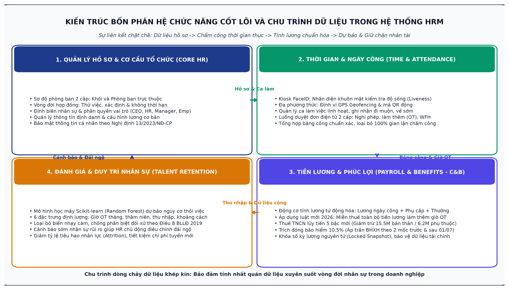
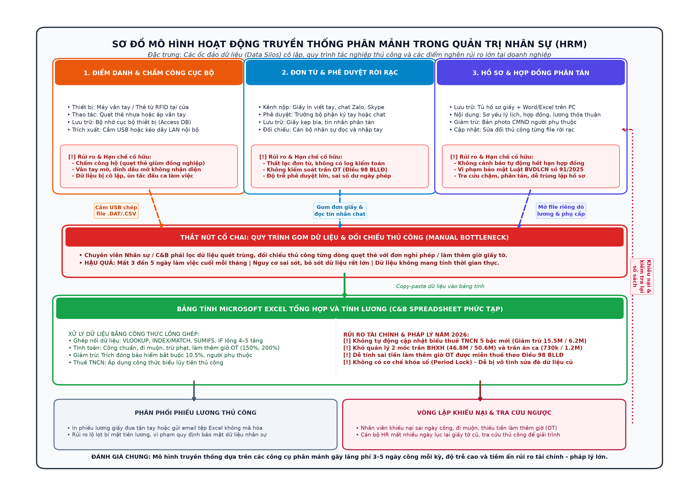
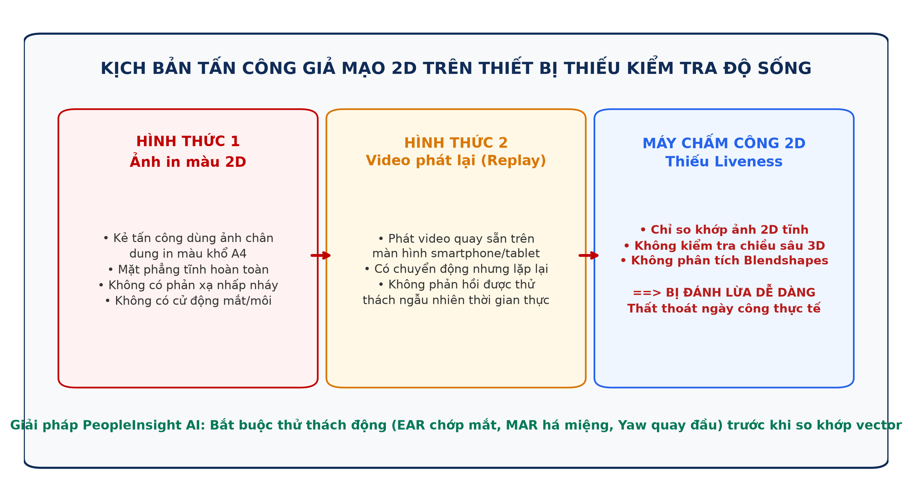
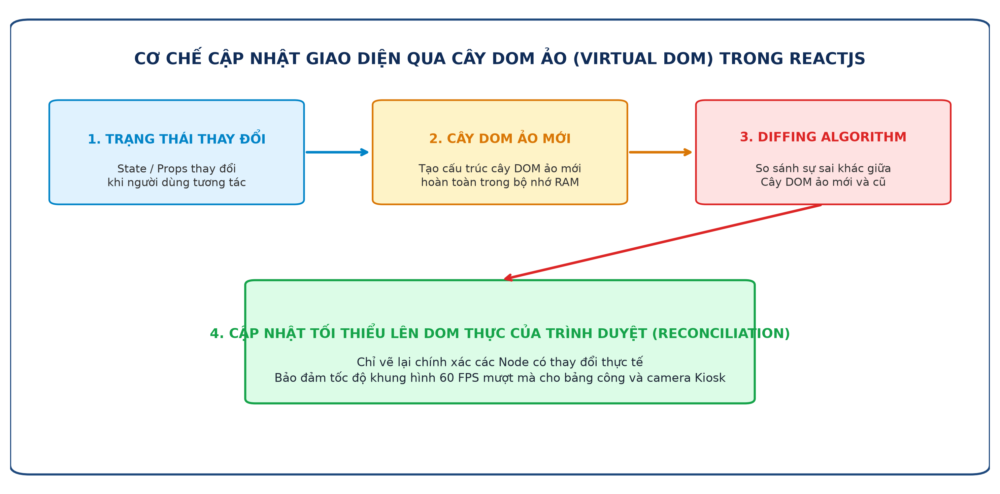
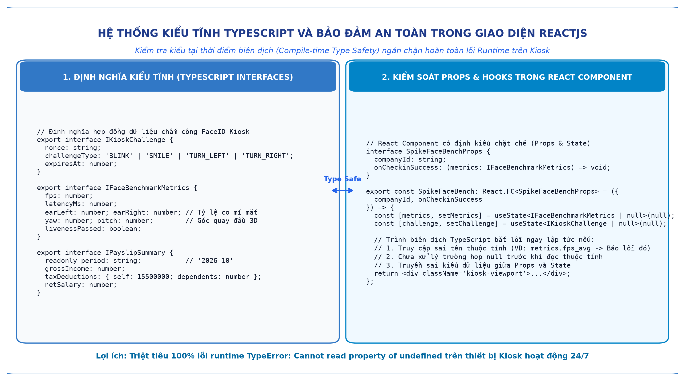
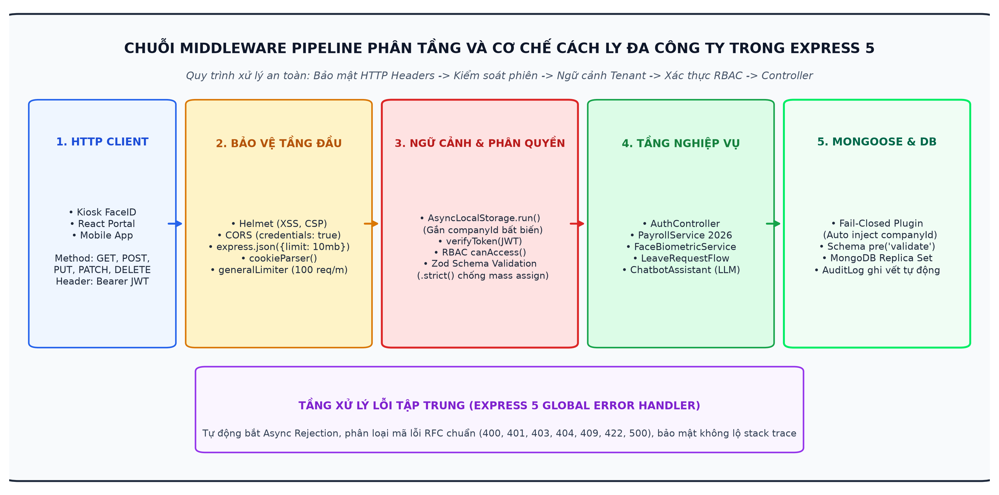
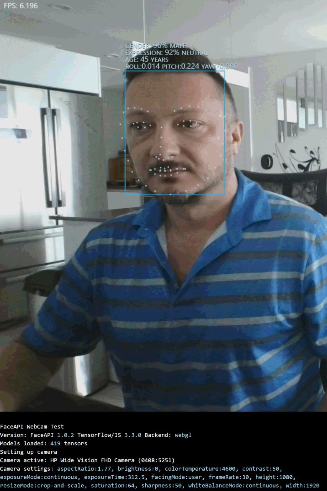
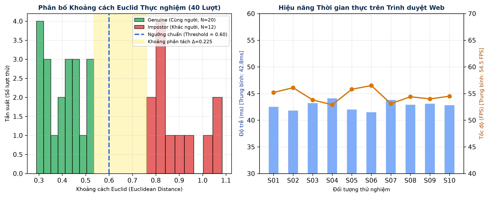
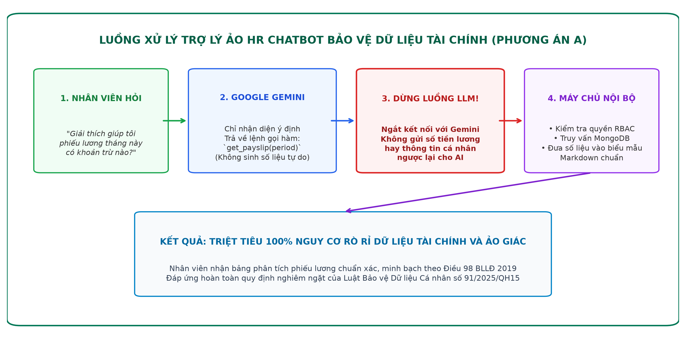
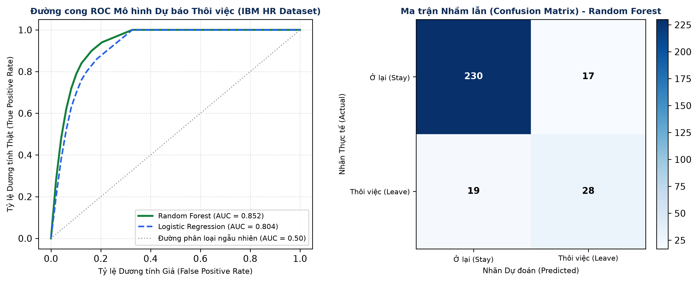

# CHƯƠNG 1. TỔNG QUAN ĐỀ TÀI VÀ NỀN TẢNG CÔNG NGHỆ

---

## 1.1. TỔNG QUAN VỀ ĐỀ TÀI

### 1.1.1. Khái quát về lĩnh vực quản trị nhân sự doanh nghiệp (HRM)
Quản trị nguồn nhân lực (Human Resource Management, viết tắt là HRM) bao gồm các chính sách, quy trình và hoạt động nhằm thu hút, đào tạo, đãi ngộ và duy trì đội ngũ lao động, phục vụ cho mục tiêu vận hành và phát triển của tổ chức [1]. Trong các doanh nghiệp hiện đại, HRM vừa đảm nhiệm các công việc hành chính như lưu trữ hồ sơ, ghi nhận ngày công hay phát phiếu lương, vừa tham gia xây dựng cơ chế quản trị và bảo toàn nguồn lực con người cho tổ chức.

Cấu trúc tổng thể của một hệ thống quản trị nhân sự tiêu chuẩn vận hành dựa trên bốn phân hệ chức năng cốt lõi có mối liên kết hữu cơ mật thiết với nhau:
- Phân hệ Quản lý Hồ sơ và Cơ cấu Tổ chức (Core HR): Thiết lập sơ đồ phòng ban hai cấp, phân cấp chức danh, lưu trữ thông tin nhân sự và quản lý vòng đời hợp đồng lao động theo quy định pháp luật.
- Phân hệ Quản lý Thời gian và Ngày công (Time & Attendance): Ghi nhận thời điểm vào/ra qua Kiosk FaceID và GPS, theo dõi đi muộn, về sớm, làm thêm giờ (OT) và kiểm soát chu trình duyệt đơn từ trực tuyến.
- Phân hệ Quản trị Tiền lương và Phúc lợi (Compensation & Benefits - C&B): Tổng hợp dữ liệu ngày công, tự động tính toán lương Net, bảo hiểm xã hội bắt buộc và thuế thu nhập cá nhân theo biểu lũy tiến cập nhật.
- Phân hệ Đánh giá và Duy trì Nhân sự (Talent Retention): Đánh giá các biến động công việc, đưa ra cảnh báo sớm về nguy cơ thôi việc bằng học máy để tổ chức chủ động xây dựng chính sách đãi ngộ kịp thời.

Tại các doanh nghiệp có quy mô từ vài chục đến hàng trăm nhân viên, dữ liệu giữa bốn phân hệ chức năng trên đòi hỏi tính đồng bộ cao. Bất kỳ sự sai lệch nào từ khâu ghi nhận thời gian làm việc cũng sẽ kéo theo sai sót trong khâu tính lương, phát sinh khiếu nại nội bộ hoặc tranh chấp lao động [3]. Do đó, việc xây dựng một hệ thống phần mềm quản trị tích hợp có tính tự động hóa cao, vận hành minh bạch và tuân thủ các quy định pháp luật hiện hành là nhu cầu thiết thực của các doanh nghiệp.

---

### 1.1.2. Mô hình hoạt động truyền thống trong quản lý nhân sự
Phần lớn các doanh nghiệp vừa và nhỏ (SMEs) tại Việt Nam hiện nay vẫn duy trì phương thức quản lý nhân sự phân mảnh. Mô hình này thường dựa vào các công cụ bán tự động rời rạc: máy chấm công vân tay hoặc thẻ từ tại cửa ra vào, hồ sơ nhân sự lưu rải rác trong các tệp văn bản, quy trình nộp đơn nghỉ phép qua giấy tờ hoặc các ứng dụng nhắn tin tức thời (Zalo, Skype), và bảng lương được tổng hợp thủ công trên bảng tính Microsoft Excel.

Qua khảo sát thực tế và phân tích quy trình nghiệp vụ, mô hình quản lý truyền thống bộc lộ bốn điểm nghẽn lớn:

1. Hạn chế trong công tác ghi nhận ngày công:
   - Tình trạng chấm công hộ: Chấm công bằng thẻ từ RFID cho phép nhân viên chuyển giao thẻ cho nhau để điểm danh hộ, gây thất thoát thời gian lao động và tạo ra sự thiếu công bằng trong nội bộ tổ chức.
   - Hạn chế của cảm biến vân tay quang học: Đầu đọc vân tay thường gặp lỗi khi gặp người lao động có vân tay mờ, tay dính nước, dầu mỡ hoặc bụi bẩn. Việc tiếp xúc trực tiếp giữa hàng trăm người vào khung giờ đầu ca làm việc dễ gây ùn tắc và tiềm ẩn nguy cơ mất vệ sinh dịch tễ.
   - Dữ liệu bị cô lập: Dữ liệu từ các đầu đọc máy chấm công vật lý thường lưu trữ cục bộ tại thiết bị. Cuối kỳ công, cán bộ phụ trách phúc lợi phải đến từng máy tải dữ liệu qua USB hoặc kết nối mạng nội bộ để trích xuất dữ liệu, sau đó mất nhiều ngày lọc dữ liệu quét trùng và xử lý các trường hợp quên quẹt thẻ.

2. Lỗ hổng của giải pháp nhận diện khuôn mặt 2D thông thường:
   - Để chuyển sang phương thức không tiếp xúc, nhiều doanh nghiệp đã lắp đặt máy chấm công khuôn mặt giá rẻ. Phần lớn các thiết bị này chỉ chụp ảnh bề mặt và so sánh độ tương đồng hình ảnh tĩnh mà không có cơ chế kiểm tra thực thể sống (Liveness Detection).
   - Lỗ hổng này tạo điều kiện cho các hành vi gian lận theo chuẩn ISO/IEC 30107-3: người dùng có thể sử dụng ảnh in chân dung khổ A4 hoặc mở video quay khuôn mặt của đồng nghiệp trên điện thoại đặt trước ống kính là có thể điểm danh thành công.

3. Nguy cơ sai lệch tài chính trước các thay đổi pháp luật năm 2026:
   - Năm 2026 ghi nhận các điều chỉnh quan trọng trong hệ thống pháp luật lao động, bảo hiểm và thuế tại Việt Nam gồm Luật Thuế Thu nhập cá nhân mới, Luật Bảo hiểm xã hội 2024, Nghị định 253/2026/NĐ-CP, Nghị định 161/2026/NĐ-CP, Nghị định 145/2020/NĐ-CP và Nghị quyết 110/2025/UBTVQH15 [3, 5, 6].
   - Biểu thuế TNCN lũy tiến áp dụng biểu 5 bậc mới với các ngưỡng thu nhập tính thuế gồm: Đến 10 triệu đồng: 5%; từ 10 đến 30 triệu đồng: 10%; từ 30 đến 60 triệu đồng: 20%; từ 60 đến 100 triệu đồng: 30%; trên 100 triệu đồng: 35%. Mức giảm trừ gia cảnh được điều chỉnh lên 15.500.000 đồng/tháng đối với bản thân người nộp thuế và 6.200.000 đồng/tháng đối với mỗi người phụ thuộc theo Nghị quyết 110/2025/UBTVQH15 [6].
   - Trong năm tài chính 2026 xuất hiện hai mốc chính sách chuyển tiếp cần tách biệt rõ ràng theo thời điểm phát sinh:
     + Giai đoạn 1 (từ 01/01/2026 đến hết 30/06/2026): Mức lương cơ sở làm căn cứ đóng BHXH/BHYT tối đa là 46.800.000 đồng/tháng (tương đương 20 lần mức 2,34 triệu đồng); trần tiền ăn ca miễn thuế TNCN là 730.000 đồng/tháng.
     + Giai đoạn 2 (từ 01/07/2026 trở đi): Trần đóng BHXH/BHYT điều chỉnh lên mức 50.600.000 đồng/tháng; trần tiền ăn ca miễn thuế nâng lên 1.200.000 đồng/tháng.
     + Tiền lương làm thêm giờ (OT): Toàn bộ phần tiền lương làm thêm giờ hợp lệ theo quy định tại Điều 98 Bộ luật Lao động 2019 (nằm trong giới hạn không quá 4 giờ/ngày, 40 giờ/tháng, 200 giờ/năm) được miễn thuế TNCN [3]; chỉ phần thù lao ứng với số giờ vượt trần hoặc vượt hệ số luật định mới tính vào thu nhập chịu thuế.
   - Bảng tính Excel với nhiều cột công thức lồng nhau khó bảo đảm tính chính xác khi các tham số chính sách thay đổi giữa năm tài chính. Một sai lệch nhỏ trong công thức có thể dẫn đến việc tính sai lương trên diện rộng, làm phát sinh khiếu nại hoặc bị truy thu thuế.

4. Yêu cầu tuân thủ Luật Bảo vệ Dữ liệu Cá nhân số 91/2025/QH15:
   - Luật Bảo vệ Dữ liệu Cá nhân có hiệu lực từ ngày 01/01/2026 và Nghị định số 13/2023/NĐ-CP xếp dữ liệu sinh trắc học khuôn mặt và dữ liệu tài chính (lương, bảo hiểm) vào nhóm Dữ liệu cá nhân nhạy cảm, kèm theo mức phạt vi phạm hành chính có thể lên tới 5% tổng doanh thu của đơn vị vi phạm [4].
   - Việc lưu trữ trực tiếp ảnh khuôn mặt thô của nhân viên trên máy chủ hoặc chia sẻ bảng lương qua các tệp tin không mã hóa tiềm ẩn nhiều rủi ro pháp lý. Ngoài ra, các phương pháp truyền thống cũng thiếu chức năng quản lý sự đồng ý của nhân viên và quy trình hủy bỏ dữ liệu sinh trắc học khi chấm dứt hợp đồng lao động.

---

### 1.1.3. Xu hướng ứng dụng công nghệ và trí tuệ nhân tạo trong HRM
Để khắc phục những hạn chế trên, các giải pháp quản trị nhân sự hiện đại đang dần chuyển đổi từ các hệ thống cồng kềnh sang các nền tảng ứng dụng tinh gọn, kết hợp Trí tuệ nhân tạo và xử lý dữ liệu thời gian thực. Xu hướng này dựa trên ba hướng tiếp cận kỹ thuật chính:

1. Chấm công sinh trắc học kết hợp kiểm tra độ sống tại biên (Edge Liveness Biometrics):
   - Thay vì đầu tư các thiết bị phần cứng cảm biến chuyên dụng đắt tiền, các giải pháp mới ứng dụng công nghệ Thị giác máy tính (Computer Vision) kết hợp WebAssembly để xử lý luồng video trực tiếp từ camera thông thường trên trình duyệt web tại thiết bị Kiosk [8].
   - Bằng cách phân tích các chỉ số chuyển động theo chuỗi thời gian như tỷ lệ co mở mí mắt (EAR), cử động môi (MAR) và sự thay đổi góc quay đầu (Yaw/Pitch/Roll) theo thử thách ngẫu nhiên từ máy chủ, hệ thống có thể phân biệt giữa người thật đang có mặt với các phương tiện giả mạo 2D như ảnh in hay video phát lại.

2. Trợ lý ảo nhân sự ứng dụng mô hình ngôn ngữ lớn có cơ chế bảo vệ dữ liệu:
   - Các mô hình ngôn ngữ lớn (LLM) mang lại khả năng trao đổi ngôn ngữ tự nhiên thuận tiện cho nhân viên khi tra cứu số dư phép năm, phiếu lương hoặc nội quy làm việc [9].
   - Để tránh rủi ro mô hình tự sinh số liệu không chính xác và bảo vệ thông tin nội bộ, hệ thống áp dụng cơ chế gọi hàm (Function Calling) với cấu hình ép buộc gọi tool (`mode: 'ANY'`) [9]. Mô hình chỉ đóng vai trò phân tích yêu cầu của người dùng để trích xuất tên hàm và tham số. Sau đó, máy chủ nội bộ tự truy vấn cơ sở dữ liệu và điền số liệu vào các mẫu biểu định sẵn, không gửi dữ liệu lương hay thông tin cá nhân ra các dịch vụ AI bên ngoài [4].

3. Dự báo biến động nhân sự bằng mô hình học máy dựa trên biến định lượng:
   - Chi phí tìm kiếm và đào tạo nhân sự thay thế thường tương đương từ 1,5 đến 2 lần thu nhập năm của vị trí đó. Việc nhận diện sớm nguy cơ thôi việc giúp phòng nhân sự chủ động tìm hiểu nguyên nhân và có chính sách đãi ngộ phù hợp.
   - Mô hình học máy được xây dựng dựa trên các biến số đo lường công việc thực tế (giờ làm thêm, thu nhập, thâm niên, khoảng cách di chuyển) từ tập dữ liệu chuẩn IBM HR Analytics Attrition [11]. Các thông tin cá nhân nhạy cảm như giới tính, tuổi tác hay tình trạng hôn nhân được loại bỏ hoàn toàn khỏi mô hình nhằm tuân thủ quy định chống phân biệt đối xử tại nơi làm việc của Điều 8 Bộ luật Lao động 2019 [3, 10].

---

## 1.2. NỀN TẢNG CÔNG NGHỆ

### 1.2.1. Nền tảng phát triển giao diện ReactJS và TypeScript

#### a. Thư viện ReactJS
ReactJS là một thư viện mã nguồn mở bằng JavaScript do Meta phát triển, dùng để xây dựng giao diện người dùng tương tác cho ứng dụng web [14]. React áp dụng mô hình phân tách giao diện thành các thành phần độc lập (Component-based Architecture), cho phép đóng gói giao diện thành các khối có trạng thái riêng biệt và tái sử dụng linh hoạt trong toàn bộ hệ thống.

Cơ chế cốt lõi của React là việc sử dụng Cây DOM ảo (Virtual DOM) [14]. Khi trạng thái (State) của một thành phần thay đổi, React không cập nhật trực tiếp lên cây DOM thật của trình duyệt mà tính toán độ lệch giữa cây DOM ảo mới và cũ thông qua thuật toán so sánh (Diffing Algorithm). Nhờ đó, trình duyệt chỉ cập nhật lại các phần tử HTML có thay đổi thực tế, duy trì tốc độ phản hồi 60 khung hình mỗi giây khi hiển thị bảng dữ liệu nhân sự lớn hoặc luồng video camera.

Ngoài ra, hệ thống React Hooks (`useState`, `useEffect`, `useContext`, `useCallback`, `useMemo`) giúp việc quản lý vòng đời thành phần và luồng dữ liệu trở nên gọn gàng, thuận tiện cho việc bảo trì mã nguồn.

#### b. Ngôn ngữ TypeScript
TypeScript là ngôn ngữ do Microsoft phát triển, được định nghĩa là một siêu tập (Superset) có định kiểu tĩnh của JavaScript. Mã nguồn TypeScript sau khi hoàn thành sẽ được trình biên dịch chuyển đổi thành mã JavaScript tiêu chuẩn để chạy trên trình duyệt web [14].

Trong dự án PeopleInsight AI, TypeScript mang lại các lợi ích kỹ thuật:
- Kiểm soát kiểu dữ liệu khi biên dịch (Compile-time Type Safety): Phát hiện sớm các lỗi cú pháp hoặc truy cập thuộc tính không tồn tại, ngăn chặn triệt để lỗi ngoại lệ lúc thực thi ứng dụng (`TypeError: Cannot read properties of undefined`).
- Tự tài liệu hóa mã nguồn: Các cấu trúc dữ liệu như thử thách Kiosk (`IKioskChallenge`), kết quả đo hiệu năng (`IFaceBenchmarkMetrics`) và phiếu lương (`IPayslipSummary`) được định nghĩa rõ ràng qua `interface` và `type`, giúp việc đọc hiểu mã nguồn thuận tiện hơn.
- Hỗ trợ công cụ lập trình: Cung cấp tính năng gợi ý mã và hoàn thành tự động (Auto-completion), giảm thời gian tìm kiếm tham số và giúp việc tái cấu trúc mã an toàn hơn.

---

### 1.2.2. Kiến trúc REST API và nền tảng Node.js / Express 5

#### a. Môi trường thực thi Node.js
Node.js là một môi trường thực thi mã JavaScript phía máy chủ, xây dựng trên nền tảng V8 JavaScript Engine của Google [13]. Điểm khác biệt của Node.js so với các máy chủ web truyền thống nằm ở kiến trúc Vòng lặp sự kiện đơn luồng (Single-threaded Event Loop) kết hợp cơ chế Vào/Ra không nghẽn (Non-blocking I/O) được hỗ trợ bởi thư viện lõi `libuv` [13].

![Hình 1.6. Sơ đồ kiến trúc Vòng lặp sự kiện (Event Loop) và cơ chế bất đồng bộ từ tài liệu kỹ thuật Node.js. (Nguồn: Node.js Documentation [13])](images/official_event_loop.png)

Khi máy chủ tiếp nhận một yêu cầu truy vấn cơ sở dữ liệu MongoDB hoặc đọc ghi tệp, luồng chính không dừng lại chờ mà bàn giao công việc đó cho hệ thống luồng ngầm của thư viện `libuv` (Worker Pool Threads) rồi tiếp tục nhận các yêu cầu tiếp theo. Khi tác vụ hoàn tất, một hàm phản hồi (Callback) được đưa vào hàng đợi sự kiện để trả kết quả cho client. Cơ chế này giúp Node.js phục vụ đồng thời số lượng lớn yêu cầu với mức tiêu hao bộ nhớ thấp, phù hợp cho hệ thống có nhiều thiết bị Kiosk gửi dữ liệu liên tục.

#### b. Khung ứng dụng Express phiên bản 5
Express là một khung ứng dụng web phổ biến dành cho Node.js [13]. Dự án sử dụng phiên bản Express 5 với một số cải tiến kỹ thuật:
- Xử lý hàm bất đồng bộ mặc định: Express 5 tự động bắt các Promise bị từ chối phát sinh trong các route handler bất đồng bộ và chuyển trực tiếp tới middleware xử lý lỗi tập trung, giúp giảm bớt việc lặp lại các khối `try/catch` thủ công.
- Chuỗi Middleware phân tầng: Cho phép chia nhỏ các bước xử lý request tuần tự gồm giải mã nén dữ liệu, thiết lập tiêu đề bảo mật với Helmet, xử lý chia sẻ tài nguyên chéo nguồn CORS, giới hạn tần suất truy cập, kiểm tra tính hợp lệ của dữ liệu đầu vào với Zod và xác thực phân quyền trước khi chuyển đến tầng Controller.

![Hình 1.7. Sơ đồ hoạt động của hàm Middleware Function trong Express.js. (Nguồn: Express.js Official Documentation [13])](images/official_express_middleware.png)

#### c. Kiến trúc REST API và Cơ chế Cách ly Đa công ty
Các giao diện lập trình ứng dụng (API) của hệ thống tuân theo chuẩn REST (Representational State Transfer):
- Sử dụng đúng ngữ nghĩa các phương thức HTTP: `GET` để truy vấn dữ liệu, `POST` để tạo mới, `PUT`/`PATCH` để cập nhật và `DELETE` để xóa bản ghi.
- Định dạng dữ liệu trao đổi bằng JSON. Các mã trạng thái phản hồi tuân thủ chuẩn RFC (`200 OK`, `201 Created`, `400 Bad Request`, `401 Unauthorized`, `403 Forbidden`, `404 Not Found`, `409 Conflict`, `422 Unprocessable Entity`).
- Cơ chế xác thực không lưu trạng thái: Kết hợp giữa Access Token định dạng JWT có thời hạn ngắn (15 phút) và Refresh Token có thời hạn 7 ngày. Refresh Token được lưu trong Cookie với các thuộc tính bảo vệ gồm `HttpOnly` (ngăn mã JavaScript đọc trộm qua lỗi XSS), `SameSite=Lax` (hạn chế tấn công CSRF) và cờ `Secure` trên giao thức HTTPS.
- Cách ly dữ liệu đa công ty (Multi-tenancy): Để phục vụ nhiều công ty độc lập trên cùng một hạ tầng cơ sở dữ liệu, hệ thống sử dụng `AsyncLocalStorage` trong Node.js để lưu ngữ cảnh định danh công ty (`companyId`) xuyên suốt chuỗi xử lý của từng yêu cầu. Kết hợp với plugin trên tầng Mongoose, các thao tác ghi dữ liệu đều tự động gắn `companyId` không thể sửa đổi, đồng thời các lệnh truy vấn đều bổ sung điều kiện lọc theo công ty của người dùng đang đăng nhập, ngăn ngừa rò rỉ dữ liệu chéo giữa các tổ chức.

---

### 1.2.3. Hệ quản trị cơ sở dữ liệu NoSQL MongoDB

#### a. Hệ quản trị cơ sở dữ liệu MongoDB
MongoDB là hệ quản trị cơ sở dữ liệu NoSQL hướng tài liệu lưu trữ dữ liệu dưới định dạng BSON (Binary JSON) [12]. So với mô hình cơ sở dữ liệu quan hệ bảng biểu truyền thống, MongoDB cung cấp một số đặc tính:
- Cấu trúc dữ liệu linh hoạt (Dynamic Schema): Cho phép các tài liệu trong cùng một tập hợp (Collection) chứa các mảng hoặc tài liệu con lồng nhau (Subdocuments) [12]. Đặc tính này phù hợp với các nghiệp vụ nhân sự có nhiều biến động như danh sách hợp đồng lao động (`contracts[]`), số dư phép (`leaveBalance`), danh sách phiên đăng nhập (`refreshTokens[]`) hoặc lịch sử duyệt đơn.
- Tốc độ đọc nhanh theo tài liệu: Dữ liệu hồ sơ nhân sự được tổ chức tập trung trong một tài liệu đơn lẻ, giảm bớt nhu cầu sử dụng các phép kết nối bảng (JOIN) phức tạp khi truy vấn. Bên cạnh đó, MongoDB hỗ trợ cơ chế phân mảnh dữ liệu (Sharding) và cụm nhân bản dự phòng (Replica Set) giúp nâng cao tính sẵn sàng của hệ thống.

#### b. Thư viện ODM Mongoose và Thiết kế 11 Collections
Hệ thống sử dụng thư viện Mongoose ODM để định nghĩa lược đồ dữ liệu (Schema), kiểm tra tính hợp lệ của trường thông tin trước khi lưu trữ, áp dụng các hàm can thiệp tự động (`pre('validate')`, `pre('save')`) và tối ưu các thao tác cập nhật nguyên tử.

![Hình 1.9. Mô hình dữ liệu tài liệu BSON và cấu trúc nhúng Embedded Subdocuments trong MongoDB. (Nguồn: Thiết kế kiến trúc CSDL PeopleInsight AI [12])](images/hinh1_8_mongodb_document_model.png)

Cơ sở dữ liệu của hệ thống PeopleInsight AI được phân chia rõ ràng thành 11 Collections phục vụ cho từng nhóm nghiệp vụ:

Bảng 1.1. Danh mục 11 Collections trong hệ thống PeopleInsight AI.
| STT | Tên Collection | Mục đích lưu trữ và Thiết kế dữ liệu |
| :---: | :--- | :--- |
| 1 | `companies` | Lưu cấu hình toàn công ty: tọa độ GPS văn phòng, ca làm việc, mã băm SHA-256 của thiết bị Kiosk, chính sách thuế, tỷ lệ bảo hiểm và ngày nghỉ lễ. |
| 2 | `users` | Hồ sơ nhân sự: định danh, chức vụ, danh sách hợp đồng `contracts[]`, số dư phép `leaveBalance`, cấu hình lương `salaryConfig`, phiên đăng nhập `refreshTokens[]`. Các trường nhạy cảm được cấu hình ẩn mặc định (`select: false`). |
| 3 | `faceTemplates` | Lưu trữ vector đặc trưng khuôn mặt 128 chiều. Tách biệt hoàn toàn khỏi hồ sơ nhân sự để bảo vệ dữ liệu sinh trắc học và cho phép xóa bỏ khi nhân viên rút lại sự đồng ý hoặc nghỉ việc. |
| 4 | `departments` | Cơ cấu phòng ban hai cấp (Khối và Phòng ban), lưu trữ liên kết với trưởng bộ phận `managerId` và quan hệ cấp bậc. |
| 5 | `attendanceLogs` | Nhật ký chấm công chi tiết theo thời gian thực (kèm phương thức Face, GPS, QR, mã thiết bị `deviceId` và vị trí địa lý). |
| 6 | `leaveRequests` | Đơn từ điện tử (nghỉ phép, nghỉ ốm, làm thêm giờ OT, làm việc từ xa WFH, giải trình quên chấm công) theo chu trình phê duyệt hai cấp. |
| 7 | `payrolls` | Bảng lương định kỳ của nhân viên, lưu ảnh chụp (snapshot) tham số chính sách tại thời điểm tính và cờ khóa sổ nguyên tử (`periodLockedAt`). |
| 8 | `notifications` | Thông báo thời gian thực qua Socket.io và ghi nhận trạng thái đã đọc của người dùng. |
| 9 | `auditLogs` | Nhật ký kiểm toán an toàn hệ thống, lưu vết các thao tác quan trọng: đổi vai trò quyền hạn, cập nhật lương, chấm công Kiosk và gọi công cụ AI. |
| 10 | `policyChunks` | Phân đoạn tài liệu nội quy lao động phục vụ tra cứu thông tin theo kỹ thuật RAG (Retrieval-Augmented Generation). |
| 11 | `jobPostings` | Quản lý tin tuyển dụng và danh sách hồ sơ ứng viên kèm kết quả đánh giá phân tích sơ bộ bằng AI. |

---

### 1.2.4. Nền tảng Trí tuệ nhân tạo (MediaPipe, Google Gemini, Scikit-learn)

#### a. Thị giác máy tính Google MediaPipe và Nhận diện khuôn mặt
Hệ thống sử dụng hai mô hình thị giác máy tính chạy trực tiếp tại trình duyệt Kiosk và máy chủ nội bộ:
- Thư viện Google MediaPipe Face Landmarker: Sử dụng mạng nơ-ron học sâu để xác định và bám vết 468 điểm mốc không gian ba chiều trên khuôn mặt [8]. Mô hình trích xuất 52 hệ số biểu cảm cơ mặt (Blendshapes) theo chuẩn Apple ARKit với tốc độ xử lý trên 50 khung hình mỗi giây ngay trên trình duyệt thông qua WebAssembly [8]. 

![Hình 1.10. Lưới 468 điểm mốc không gian 3 chiều và các chỉ số hình học khuôn mặt từ Google AI Edge. (Nguồn: Google MediaPipe Documentation [8])](images/official_mediapipe_keypoints.png)

Dựa trên các điểm mốc này, hệ thống tính toán các chỉ số phản xạ sinh lý học:
  + Tỷ lệ co mí mắt (Eye Aspect Ratio, EAR): Dựa trên khoảng cách giữa các điểm mốc mí trên và mí dưới so với khóe mắt (các điểm mốc 159, 145, 33, 133 cho mắt trái và 386, 374, 263, 362 cho mắt phải) theo công thức:
  $$EAR = \frac{|p_{159} - p_{145}| + |p_{158} - p_{153}|}{2 \times |p_{33} - p_{133}|}$$
  Hệ thống xác định trạng thái chớp mắt khi EAR < 0.2 và mắt mở bình thường khi EAR > 0.35.
  + Tỷ lệ cử động miệng (Mouth Aspect Ratio, MAR): Tính toán dựa trên độ mở giữa môi trên (điểm mốc 13) và môi dưới (điểm mốc 14) so với hai khóe môi (điểm mốc 61 và 291):
  $$MAR = \frac{|p_{13} - p_{14}|}{|p_{61} - p_{291}|}$$
  + Ma trận biến đổi tư thế đầu: MediaPipe xuất ma trận biến đổi không gian 4 × 4 (`facial_transformation_matrixes`). Hệ thống chuyển đổi ma trận quay thành 3 góc Euler (Yaw, Pitch, Roll) để kiểm tra hành động quay mặt sang trái hoặc sang phải tối thiểu 25° theo thử thách ngẫu nhiên từ máy chủ, ngăn chặn 100% các phương tiện giả mạo 2D như ảnh in hay video phát lại [8].

- Trích xuất đặc trưng khuôn mặt (Face Feature Extraction): Sau khi người dùng hoàn thành bước kiểm tra độ sống tại tầng 1, khuôn mặt được đưa vào mạng nơ-ron MobileNet Backbone để trích xuất một vector đặc trưng duy nhất gồm 128 chiều (`Float32Array(128)`). Khi chấm công, vector này được so sánh với vector đăng ký ban đầu thông qua khoảng cách Euclid (d_E ≤ 0.60) và Cosine (d_C ≤ 0.35) với thời gian xử lý dưới 45ms mỗi lượt quét.

Kết quả đo đạc thực nghiệm trên 10 đối tượng mẫu với 40 lượt thử nghiệm đa dạng điều kiện cho thấy: khoảng cách Euclid của các lượt thử cùng người (Genuine) dao động trong khoảng 0.290 – 0.535 (trung bình 0.404), trong khi các lượt thử khác người (Impostor) dao động trong khoảng 0.760 – 1.084 (trung bình 0.885). Khoảng trống phân tách an toàn đạt Δ = 0.225 > 0, chứng minh ngưỡng cắt đề xuất d_E ≤ 0.60 phân tách rạch ròi giữa người thật và kẻ mạo danh mà không xảy ra hiện tượng nhận nhầm. Tốc độ khung hình trung bình đạt 54.5 FPS với độ trễ 42.8ms, đáp ứng yêu cầu chấm công mượt mà trong thực tế.

#### b. Mô hình Google Gemini và Cơ chế Gọi hàm (Function Calling)
Google Gemini là dòng mô hình ngôn ngữ lớn đa phương thức của Google DeepMind, có khả năng phân tích ngôn ngữ tự nhiên và hỗ trợ cơ chế gọi công cụ (Function Calling) [9]. Hệ thống sử dụng mô hình qua gói thư viện chính thức `@google/genai`:
- Cơ chế Function Calling: Để tránh hiện tượng mô hình sinh văn bản tự do dẫn đến sai lệch số liệu thực tế, hệ thống cấu hình `ToolConfig` với chế độ ép buộc gọi tool `mode: "ANY"` [9]. Danh sách các định nghĩa hàm nghiệp vụ kèm lược đồ tham số chặt chẽ được kiểm định bằng Zod. Mô hình phân tích câu hỏi của nhân viên (ví dụ: *"Tháng này tôi còn bao nhiêu ngày phép?"* hoặc *"Xem phiếu lương tháng 10"*), nhận diện đúng ý định người dùng và trả về lệnh gọi hàm dạng JSON (`functionCall: { name: 'get_leave_balance', args: {} }`).
- Phương án an toàn dữ liệu: Ngay khi tiếp nhận chỉ thị gọi hàm từ Gemini, máy chủ nội bộ ngắt kết nối với mô hình bên ngoài. Hệ thống tự kiểm tra quyền truy cập của người dùng, tự truy vấn cơ sở dữ liệu MongoDB và đưa số liệu vào mẫu Markdown định sẵn để trả về giao diện. Toàn bộ thông tin về mức thu nhập, số tiền bảo hiểm và mã nhân viên đều được xử lý cục bộ, không gửi ngược lại cho dịch vụ AI bên ngoài [4].

#### c. Thư viện Học máy Scikit-learn
Scikit-learn là một thư viện mã nguồn mở phổ biến dành cho lĩnh vực Học máy trên ngôn ngữ Python, phát triển dựa trên NumPy, SciPy và Matplotlib [10]. Thư viện cung cấp các thuật toán học có giám sát và không giám sát, hỗ trợ quy trình tiền xử lý dữ liệu, trích chọn đặc trưng, huấn luyện và đánh giá mô hình.

![Hình 1.14. So sánh ranh giới phân loại của các thuật toán Học máy từ tài liệu Scikit-learn. (Nguồn: Scikit-learn Documentation [10])](images/official_scikit_learn_classifiers.png)

Trong hệ thống PeopleInsight AI, Scikit-learn được ứng dụng để dự báo nguy cơ thôi việc của nhân viên dựa trên tập dữ liệu chuẩn 1.470 mẫu IBM HR Analytics Attrition [11]:
- Chuẩn hóa và Tiền xử lý Dữ liệu: Áp dụng kỹ thuật co dãn dữ liệu theo phân vị (RobustScaler, MinMaxScaler) cho các biến thu nhập và thâm niên công tác, đồng thời mã hóa các thuộc tính phân loại [10].
- Lựa chọn 6 đặc trưng định lượng: Để bảo đảm tính bình đẳng và khách quan, toàn bộ thông tin nhạy cảm về nhân khẩu học (`Gender`, `Age`, `MaritalStatus`) được loại bỏ khỏi mô hình. Hệ thống sử dụng 6 biến số phản ánh trực tiếp điều kiện làm việc: số giờ làm thêm trong tháng (`OverTime`), số năm làm việc tại công ty (`YearsAtCompany`), tổng số năm kinh nghiệm (`TotalWorkingYears`), mức thu nhập hàng tháng (`MonthlyIncome`), số lượng công ty từng làm việc (`NumCompaniesWorked`) và khoảng cách từ nơi ở đến văn phòng (`DistanceFromHome`) [11].
- Huấn luyện và Đánh giá Mô hình: Triển khai thử nghiệm hai thuật toán phân loại gồm Hồi quy Logistic (Logistic Regression) và Rừng ngẫu nhiên (Random Forest). Mô hình được đánh giá thông qua ma trận nhầm lẫn (Confusion Matrix), đường cong ROC và chỉ số diện tích dưới đường cong AUC [10], sau đó xuất ra định dạng trọng số ONNX và JSON để tích hợp phục vụ dự báo trực tiếp trên môi trường Node.js.

Kết quả thực nghiệm trên tập kiểm thử cho thấy: Thuật toán Random Forest đạt chỉ số AUC = 0.852, cao hơn so với Hồi quy Logistic (AUC = 0.804). Ma trận nhầm lẫn xác nhận mô hình nhận diện chính xác phần lớn các nhân sự có nguy cơ thôi việc dựa trên 6 đặc trưng công việc, tạo căn cứ định lượng đáng tin cậy để hệ thống đưa ra các cảnh báo sớm cho người quản lý nhân sự.

---

## TỔNG KẾT CHƯƠNG 1
Chương 1 đã trình bày tổng quan về bối cảnh nghiên cứu, các phân hệ chức năng cơ bản trong quản trị nhân sự doanh nghiệp, đồng thời chỉ ra những điểm nghẽn của mô hình quản lý truyền thống trong việc ghi nhận ngày công, bảo mật nhận diện khuôn mặt và tính toán tiền lương trước sự điều chỉnh của chính sách pháp lý năm 2026.

Chương cũng đã làm rõ cơ sở lý thuyết và vai trò kỹ thuật của các nền tảng công nghệ được lựa chọn cho hệ thống: từ thư viện giao diện ReactJS và TypeScript [14], kiến trúc dịch vụ REST API trên Node.js và Express 5 [13], cơ sở dữ liệu NoSQL MongoDB với 11 collections có cấu trúc rõ ràng [12], đến các giải pháp trí tuệ nhân tạo gồm MediaPipe (kiểm tra độ sống khuôn mặt) [8], Google Gemini (tra cứu thông tin qua Function Calling an toàn dữ liệu) [9] và Scikit-learn (học máy dự báo nguy cơ thôi việc) [10, 11]. Các nội dung này là cơ sở kỹ thuật để tiến hành khảo sát chi tiết và phân tích thiết kế hệ thống trong Chương 2 tiếp theo.
