# CHƯƠNG 2. KHẢO SÁT VÀ PHÂN TÍCH HỆ THỐNG

Chương 2 tập trung khảo sát hiện trạng nghiệp vụ, phân tích chi tiết các yêu cầu chức năng và phi chức năng của hệ thống Quản trị nguồn nhân lực tích hợp trí tuệ nhân tạo PeopleInsight AI theo chuẩn phương pháp luận Phân tích & Thiết kế Hướng đối tượng (OOAD) và chuẩn quy định Đồ án tốt nghiệp của Khoa Công nghệ Thông tin & Chuyển đổi số Trường Đại học Nguyễn Trãi. Nội dung chương bao gồm: xác định các yêu cầu chức năng mức cao, các yêu cầu phi chức năng nghiêm ngặt về hiệu năng, an toàn dữ liệu và tính sẵn sàng; xác định các tác nhân (Actors) tham gia vào hệ thống; phân tích chi tiết 5 quy trình nghiệp vụ cốt lõi; xây dựng biểu đồ Use Case tổng quát và đặc tả chi tiết 5 Use Case trọng tâm; mô hình hóa động học các luồng tương tác thông qua hệ thống Biểu đồ tuần tự (Sequence Diagram) và Biểu đồ hoạt động (Activity Diagram). Toàn bộ quá trình phân tích đều gắn liền với các ràng buộc pháp lý mới của năm 2026 (Luật Thuế Thu nhập cá nhân số 109/2025/QH15, Luật Bảo vệ Dữ liệu Cá nhân số 91/2025/QH15 và Bộ luật Lao động 2019), tạo cơ sở vững chắc cho giai đoạn thiết kế kiến trúc và xây dựng ứng dụng trong các chương tiếp theo.

---

## 2.1 Chức năng của hệ thống

Phần này khái quát toàn bộ các yêu cầu chức năng và phi chức năng mức cao của hệ thống PeopleInsight AI, phác thảo bức tranh tổng thể về năng lực vận hành của phần mềm nhằm giải quyết triệt để 4 điểm nghẽn quản trị đã được phân tích ở Chương 1. Các kịch bản tương tác chi tiết giữa người dùng và hệ thống sẽ được trình bày cụ thể trong mục 2.2.

### 2.1.1 Một số chức năng chính

Hệ thống PeopleInsight AI được xây dựng nhằm giải quyết triệt để các bất cập trong quản lý nhân sự truyền thống, tự động hóa các luồng công việc thủ công và tích hợp trí tuệ nhân tạo có kiểm soát để bảo vệ dữ liệu nhạy cảm.

### Bảng 2.1. Một số chức năng chính của hệ thống PeopleInsight AI

| Yêu cầu chức năng | Mô tả |
| :--- | :--- |
| **Đăng ký và xác thực tài khoản** | Nhân viên và quản trị viên đăng nhập hệ thống an toàn bằng email và mật khẩu; hệ thống cấp mã phiên làm việc bảo mật (JWT Token) với cơ chế tự động gia hạn phiên an toàn, bảo vệ tài khoản khi người dùng mở nhiều tab làm việc đồng thời và tự động thu hồi phiên đăng nhập khi phát hiện dấu hiệu bất thường. |
| **Quản trị phân quyền 4 cấp** | Thiết lập ma trận phân quyền theo vai trò rõ ràng gồm 4 cấp: Ban Giám đốc (`CEO`), Trưởng phòng Nhân sự (`HR_MANAGER`), Trưởng bộ phận (`MANAGER`) và Nhân viên (`EMPLOYEE`); kiểm soát quyền truy cập chặt chẽ, bảo vệ thông tin nhạy cảm, tuyệt đối không cho phép cấp quản lý xem mức lương và thông tin thu nhập của nhân viên dưới quyền. |
| **Quản lý sơ đồ phòng ban 2 cấp** | Xây dựng sơ đồ cơ cấu tổ chức doanh nghiệp phân cấp 2 tầng (Khối chức năng → Phòng ban trực thuộc); gán người phụ trách quản lý, theo dõi số lượng nhân sự trực thuộc và kiểm soát an toàn dữ liệu khi luân chuyển hoặc tinh gọn phòng ban. |
| **Quản lý hồ sơ nhân sự và hợp đồng** | Quản lý thông tin lý lịch nhân sự, tự động cấp mã nhân viên theo quy chuẩn `NVxxxx`; theo dõi các loại hợp đồng lao động (thử việc, có thời hạn và không xác định thời hạn) theo Bộ luật Lao động 2019; hệ thống tự động quét và gửi thông báo nhắc nhở khi hợp đồng sắp đến hạn (trước 30 ngày và 60 ngày). |
| **Điểm danh khuôn mặt Kiosk FaceID 1-Chạm** | Nhận diện khuôn mặt tự động 1 chạm thời gian thực tại máy Kiosk văn phòng: Camera tự động bám vết 468 điểm mốc sinh học, xác thực duy nhất 1 người trong khung hình, tự động nhận diện danh tính dưới 0.5 giây khi người đứng ổn định trước ống kính; hỗ trợ linh hoạt 3 chế độ (Tự động theo giờ sáng/chiều, Vào ca, Tan ca); phản hồi tức thì qua thẻ thông báo nổi dưới chân màn hình (Toast Card) hiển thị họ tên, phòng ban, giờ vào/tan và số phút đi muộn (nếu có); lưu vết vào băng chuyền lịch sử vừa ghi nhận. |
| **Chấm công di động GPS & QR động** | Hỗ trợ nhân viên chấm công linh hoạt qua điện thoại thông minh khi ở trong phạm vi văn phòng công ty (định vị vị trí GPS bán kính cho phép); hoặc điểm danh bằng mã QR động được làm mới tự động mỗi 30 giây trên màn hình văn phòng, ngăn chặn triệt để hành vi chụp ảnh màn hình gửi cho đồng nghiệp chấm công hộ. |
| **Quản lý và phê duyệt đơn từ 2 cấp** | Số hóa quy trình nộp và xử lý 5 loại đơn công tác (nghỉ phép năm, nghỉ ốm, làm thêm giờ, làm việc từ xa, giải trình quên chấm công); áp dụng quy trình duyệt 2 cấp độc lập: Trưởng bộ phận duyệt kế hoạch → Trưởng phòng Nhân sự phê duyệt hoàn tất, hệ thống tự động trừ ngày phép vào quỹ phép cá nhân một cách chính xác. |
| **Động cơ tính lương tự động 2026** | Tự động hóa quy trình tính lương 3 bước: Tổng thu nhập (Gross) → Thu nhập chịu thuế → Thu nhập tính thuế & Thực nhận (Net); cập nhật Biểu thuế TNCN lũy tiến 5 bậc mới theo Luật Thuế TNCN số 109/2025/QH15; xử lý chính xác các mức trần bảo hiểm xã hội và tiền ăn ca theo quy định mới năm 2026; miễn thuế thu nhập đối với tiền làm thêm giờ theo luật; hỗ trợ khóa sổ kỳ lương để cố định số liệu tài chính lịch sử. |
| **Trợ lý ảo HR AI đa năng & An toàn thông tin** | Trợ lý ảo thông minh tương tác bằng ngôn ngữ tự nhiên: (1) Trò chuyện, chào hỏi, tư vấn giải đáp thắc mắc công việc và quy chế, nội quy công ty theo thời gian thực; (2) Đọc, phân tích, tóm tắt và giải đáp thắc mắc về các tài liệu đính kèm (Word `.docx`, Excel `.xlsx`) như hợp đồng lao động, bảng tính lương; (3) Tra cứu nhanh chóng số dư ngày phép, phiếu lương và ngày công theo cơ chế khép kín Phương án A (ngắt luồng LLM và truy vấn CSDL nội bộ) bảo vệ tuyệt đối an toàn thông tin cá nhân. |
| **Dự báo nguy cơ thôi việc Machine Learning** | Phân tích tự động các chỉ số làm việc khách quan (giờ làm thêm, thu nhập, thâm niên làm việc, khoảng cách đi làm) bằng mô hình học máy; phân loại nhân viên theo 3 mức độ rủi ro (Thấp, Trung bình, Cao); chỉ ra các nhóm nguyên nhân chính trên biểu đồ trực quan giúp phòng nhân sự chủ động có biện pháp đối thoại, đãi ngộ và giữ chân nhân tài. |
| **Cổng thông tin tuyển dụng & Nộp CV (AI ATS)** | Cung cấp cổng thông tin doanh nghiệp (Landing Page) cho phép ứng viên bên ngoài tra cứu danh sách việc làm đang mở, nộp hồ sơ xin việc trực tuyến và tải tệp CV; hệ thống trí tuệ nhân tạo tự động phân tích hồ sơ, đánh giá độ phù hợp của kỹ năng giúp bộ phận nhân sự sàng lọc ứng viên nhanh chóng. |
---

### 2.1.2 Yêu cầu phi chức năng

Hệ thống cần đảm bảo tính ổn định, bảo mật và thân thiện với người dùng.

### Bảng 2.2. Yêu cầu phi chức năng của hệ thống PeopleInsight AI

| Yêu cầu | Mô tả chi tiết |
| :--- | :--- |
| **Hiệu suất (Performance)** | - Tốc độ nhận diện khuôn mặt và kiểm tra người thật tại máy Kiosk đạt ≥ 45 khung hình/giây (FPS), độ trễ xử lý cực nhanh dưới 50 ms/khung hình. - Thời gian phản hồi trung bình của toàn bộ các chức năng hệ thống đạt dưới 380 ms dưới áp lực kiểm thử 100 người dùng truy cập đồng thời. - Động cơ tính lương tự động xử lý toàn bộ 50 nhân viên trong thời gian dưới 100 ms, bảo đảm tính toán tức thì, không gây nghẽn hệ thống. |
| **Bảo mật (Security)** | - Mật khẩu người dùng được mã hóa băm một chiều an toàn bằng thuật toán tiêu chuẩn cao. - Bảo vệ phiên làm việc qua cơ chế tự động xoay vòng mã truy cập, tự động dọn dẹp các phiên làm việc hết hạn và chống đăng xuất ngoài ý muốn khi mở nhiều tab. - Cô lập dữ liệu đa doanh nghiệp tuyệt đối tại tầng xử lý hệ thống, ngăn chặn triệt để hành vi can thiệp trái phép vào dữ liệu công ty khác hoặc xem thông tin người khác. - Dữ liệu sinh trắc học khuôn mặt được mã hóa bảo vệ tại tầng ứng dụng, tuyệt đối không lưu trữ ảnh khuôn mặt thô của nhân viên theo Luật Bảo vệ Dữ liệu Cá nhân số 91/2025/QH15. |
| **Tương thích (Compatibility)** | - Giao diện hoạt động mượt mà trên tất cả các trình duyệt web hiện đại phổ biến (Google Chrome, Microsoft Edge, Apple Safari, Mozilla Firefox). - Hỗ trợ cài đặt và sử dụng thuận tiện dưới dạng ứng dụng trên điện thoại thông minh chạy hệ điều hành Android và iOS. - Tương thích hoàn chỉnh với camera của máy tính, điện thoại và thiết bị Kiosk chuyên dụng phục vụ điểm danh thời gian thực. |
| **Dễ sử dụng (Usability)** | - Giao diện người dùng được thiết kế khoa học, hiện đại, màu sắc trang nhã, bố cục rõ ràng theo chuẩn trải nghiệm ứng dụng doanh nghiệp. - Đạt điểm số Thang đo Khả dụng Hệ thống rất cao **SUS = 82.50 / 100 điểm** (Xếp hạng A — Xuất sắc) trong khảo sát người dùng thực tế. - Khung chat Trợ lý ảo tích hợp các nút câu hỏi gợi ý nhanh tiện lợi, giúp nhân viên tra cứu 1-chạm mà không cần nhớ cú pháp. |
| **Khả năng mở rộng (Scalability)** | - Kiến trúc hệ thống phi trạng thái, cho phép dễ dàng nâng cấp mở rộng quy mô phục vụ doanh nghiệp từ vài chục đến hàng nghìn nhân sự. - Cơ sở dữ liệu chuẩn hóa đúng 11 bảng danh mục rõ ràng, chỉ mục tìm kiếm tối ưu, tốc độ truy vấn nhanh và ổn định. - Đóng gói hoàn chỉnh hỗ trợ triển khai nhanh chóng trên các nền tảng máy chủ đám mây. |
---

### 2.1.3 Các tác nhân tham gia hệ thống

Dựa trên mô hình tổ chức doanh nghiệp và chu trình quản trị nhân sự thực tế, hệ thống PeopleInsight AI xác định 6 tác nhân (Actors) chính tham gia tương tác với phần mềm, bao gồm:
- **Bốn tác nhân người dùng nội bộ:** Ban Giám đốc (`CEO`) quản trị chiến lược và phê duyệt kỳ lương; Trưởng phòng Nhân sự (`HR_MANAGER`) quản lý hồ sơ, tính toán lương và giám sát chính sách; Trưởng bộ phận (`MANAGER`) theo dõi chuyên cần và phê duyệt đơn từ cấp cơ sở; Nhân viên (`EMPLOYEE`) thực hiện chấm công và quản lý thông tin cá nhân.
- **Một tác nhân người dùng bên ngoài:** Ứng viên tuyển dụng / Khách vãng lai (`CANDIDATE`) tiếp cận cổng thông tin doanh nghiệp để tra cứu việc làm và nộp hồ sơ xin việc trực tuyến.
- **Một tác nhân hệ thống biên:** Thiết bị Kiosk (`Kiosk Device`) thực hiện chụp hình, kiểm tra độ sống và giao tiếp bảo mật với máy chủ trung tâm để ghi nhận điểm danh.

---

### 2.1.4 Quy trình nghiệp vụ trong hệ thống

Nhằm đáp ứng yêu cầu vận hành liên tục và tuân thủ các quy định pháp luật mới nhất của năm 2026, hệ thống PeopleInsight AI tập trung chuẩn hóa và tự động hóa 6 quy trình nghiệp vụ trọng tâm sau đây:

1. **Quy trình điểm danh nhận diện khuôn mặt Kiosk FaceID trực tiếp 1 chạm:**
   - *Đối tượng tham gia:* Nhân viên (`EMPLOYEE`), Thiết bị Kiosk (`Kiosk Device`), Máy chủ hệ thống.
   - *Mục đích thực hiện:* Ghi nhận ngày công chính xác và nhanh chóng (dưới 0.5 giây/lượt), ngăn chặn triệt để hành vi chấm công hộ, cảnh báo khi có nhiều người cùng đứng trong khung hình và hiển thị trạng thái ca làm việc tức thì mà không gây ùn tắc hàng chờ ra vào.
   - *Hoạt động nghiệp vụ:* Nhân viên bước vào vùng quét trước camera Kiosk (cự ly 0.5 – 1.2m) → Kiosk tự động bám vết khuôn mặt, hiển thị khung radar dẫn hướng và lưới điểm mốc thời gian thực → Khi phát hiện duy nhất một khuôn mặt ổn định trong khoảng 0.25 giây (6 khung hình liên tục), hệ thống tự động trích xuất vector đặc trưng sinh trắc học gửi về máy chủ → Máy chủ so khớp 1:N trong kho dữ liệu mẫu nội bộ, xác định danh tính nhân sự và ghi nhận giờ vào ca (Check-In) hoặc tan ca (Check-Out) theo chế độ đã chọn hoặc theo giờ thực tế → Kiosk lập tức hiển thị thẻ thông báo nổi (Toast Card) dưới chân màn hình hiển thị: Họ tên, Mã nhân viên, Phòng ban, Trạng thái Vào/Tan ca, Số phút đi muộn (nếu có) kèm âm thanh thông báo; đồng thời lưu vết vào băng chuyền "Lượt chấm công vừa ghi nhận tại Kiosk" và tự động ẩn sau 3.5 giây để sẵn sàng đón lượt điểm danh kế tiếp.

2. **Quy trình nộp và phê duyệt đơn từ 2 cấp độc lập:**
   - *Đối tượng tham gia:* Nhân viên (`EMPLOYEE`), Trưởng bộ phận (`MANAGER`), Trưởng phòng Nhân sự (`HR_MANAGER`).
   - *Mục đích thực hiện:* Số hóa toàn diện quy trình xin nghỉ phép, làm thêm giờ (OT), làm việc tại nhà (WFH) và giải trình chấm công; bảo đảm sự phê duyệt sát sao của quản lý trực tiếp và quản lý quỹ phép của phòng nhân sự.
   - *Hoạt động nghiệp vụ:* Nhân viên nộp đơn trực tuyến trên ứng dụng → Hệ thống tự động kiểm tra số ngày phép khả dụng và giới hạn giờ làm thêm hợp lệ → Đơn được gửi đến Trưởng bộ phận duyệt kế hoạch chuyên môn (Cấp 1) → Sau khi được duyệt, đơn tự động chuyển tiếp lên Trưởng phòng Nhân sự duyệt chung cuộc (Cấp 2) → Hệ thống cập nhật trạng thái đã duyệt, tự động trừ số ngày nghỉ vào quỹ phép của nhân viên và gửi thông báo hoàn tất cho các bên liên quan.

3. **Quy trình tính toán và khóa sổ bảng lương tự động năm 2026:**
   - *Đối tượng tham gia:* Trưởng phòng Nhân sự (`HR_MANAGER`), Ban Giám đốc (`CEO`), Động cơ tính lương tự động.
   - *Mục đích thực hiện:* Tính toán bảng lương hàng tháng tự động, chính xác 100%, tuân thủ các quy định mới của Luật Thuế TNCN số 109/2025/QH15 và chính sách bảo hiểm năm 2026, khóa cố định dữ liệu tài chính lịch sử để phục vụ quyết toán.
   - *Hoạt động nghiệp vụ:* Hàng tháng, cán bộ nhân sự kích hoạt tính lương → Hệ thống tự động tổng hợp ngày công thực tế, giờ làm thêm và đơn nghỉ phép từ sổ chấm công → Áp dụng quy trình tính lương 3 bước chuẩn năm 2026: Tính Tổng thu nhập (Gross), miễn thuế thu nhập đối với toàn bộ tiền làm thêm giờ theo luật, trích các khoản bảo hiểm bắt buộc và tính thuế TNCN theo Biểu thuế lũy tiến 5 bậc mới → Cán bộ nhân sự rà soát bảng lương và thực hiện khóa sổ kỳ lương để cố định số liệu, chống sửa đổi dữ liệu quá khứ → Hệ thống phát hành phiếu lương cá nhân chi tiết đến từng nhân viên.

4. **Quy trình tương tác, trò chuyện tự nhiên, giải đáp thắc mắc tài liệu và tra cứu qua Trợ lý ảo HR AI:**
   - *Đối tượng tham gia:* Người dùng (`EMPLOYEE`, `MANAGER`, `HR_MANAGER`, `CEO`), Trợ lý ảo AI (Google Gemini), Bộ phân tích tệp văn phòng (Mammoth / XLSX), Cơ sở dữ liệu nội bộ MongoDB.
   - *Mục đích thực hiện:* Cung cấp một trợ lý nhân sự số đa năng, thông minh và thân thiện 24/7: trò chuyện tự nhiên, giải đáp thắc mắc chính sách lao động; đọc hiểu, thẩm định và đối soát các tài liệu đính kèm (hợp đồng Word, bảng tính Excel); đồng thời tra cứu nhanh chóng số dư ngày phép, phiếu lương, lịch sử chấm công với cơ chế bảo vệ dữ liệu PII khép kín tuyệt đối (Phương án A).
   - *Hoạt động nghiệp vụ:*
     + *Nhánh 1 (Trò chuyện tự nhiên & giải đáp thắc mắc):* Người dùng gửi câu hỏi chào hỏi, hỏi thăm hoặc thắc mắc về nội quy lao động, giờ giấc, quy chế làm việc → AI phản hồi tự nhiên, chuẩn xác, trích dẫn quy chế công ty (RAG trên `policyChunks`).
     + *Nhánh 2 (Đọc & phân tích tài liệu đính kèm):* Người dùng bấm nút đính kèm (📎) tải tệp hợp đồng Word (`.docx`) hoặc bảng tính Excel (`.xlsx`) → Hệ thống trích xuất nội dung văn bản thực tế, AI tóm tắt điều khoản cốt lõi, đối soát số liệu lương/ngày công, thẩm định pháp lý theo BLLĐ 2019 và giải đáp mọi câu hỏi chuyên sâu xoay quanh tài liệu đó.
     + *Nhánh 3 (Tra cứu dữ liệu cá nhân bảo mật cao - Phương án A):* Khi người dùng hỏi thông tin nhạy cảm (lương, ngày phép, chấm công) → Gemini nhận diện tham số hàm (`Function Calling mode: ANY`) → Hệ thống ngắt luồng LLM, tự truy vấn CSDL nội bộ theo mã nhân viên người hỏi, điền vào template Markdown tĩnh tách biệt 2 khối (Thực nhận Net và Tham chiếu thuế) và trả về cho người dùng mà không gửi bất kỳ dữ liệu tài chính nào ra đám mây bên ngoài.

5. **Quy trình dự báo nguy cơ thôi việc và hỗ trợ giữ chân nhân tài:**
   - *Đối tượng tham gia:* Trưởng phòng Nhân sự (`HR_MANAGER`), Ban Giám đốc (`CEO`), Mô hình phân tích học máy.
   - *Mục đích thực hiện:* Nhận diện sớm các nhân sự có nguy cơ thôi việc cao để bộ phận nhân sự chủ động có biện pháp đối thoại, lắng nghe và điều chỉnh đãi ngộ kịp thời, giảm thiểu chi phí tuyển dụng và xáo trộn nhân sự.
   - *Hoạt động nghiệp vụ:* Hệ thống tự động trích xuất các chỉ số làm việc khách quan của nhân viên (giờ làm thêm, thu nhập, thâm niên gắn bó, khoảng cách đi làm) → Đưa vào mô hình học máy để tính toán xác suất nguy cơ thôi việc của từng cá nhân → Phân loại nhân sự theo 3 mức rủi ro (Thấp, Trung bình, Cao) → Chỉ ra Top 3 nguyên nhân chính tác động đến quyết định thôi việc và hiển thị trực quan trên Dashboard cho nhà quản lý kèm các gợi ý giải pháp can thiệp kịp thời.

6. **Quy trình tuyển dụng nhân sự, sàng lọc hồ sơ AI ATS và gửi thư mời phỏng vấn:**
   - *Đối tượng tham gia:* Ứng viên (`CANDIDATE`), Trưởng phòng Nhân sự (`HR_MANAGER`), Ban Giám đốc (`CEO`), Động cơ AI ATS-lite, Dịch vụ Email SMTP.
   - *Mục đích thực hiện:* Tự động hóa tiếp nhận hồ sơ từ cổng thông tin việc làm công khai, ứng dụng trí tuệ nhân tạo để sàng lọc khách quan hồ sơ ứng viên (CV), hỗ trợ hội đồng tuyển dụng lên lịch phỏng vấn và gửi email thư mời tự động.
   - *Hoạt động nghiệp vụ:* Ứng viên truy cập cổng thông tin việc làm (`/careers`) → Chọn vị trí đang tuyển, điền thông tin và tải lên tệp CV → Hệ thống lưu hồ sơ vào cơ sở dữ liệu và tự động kích hoạt bộ máy AI ATS-lite phân tích kỹ năng, chấm điểm độ phù hợp AI Match Score (0–100%), trích xuất điểm mạnh, điểm yếu và gợi ý phân loại sơ bộ (`ACCEPTED` hoặc `NEEDS_REVIEW`) → Trưởng phòng Nhân sự hoặc CEO truy cập trang Quản lý tuyển dụng (`/recruitment`) để xem xét hồ sơ và kết quả thẩm định của AI → Người quản trị chọn ứng viên đạt yêu cầu, thiết lập thông tin phỏng vấn (ngày giờ, địa điểm/link họp trực tuyến, ghi chú) → Hệ thống lưu lịch phỏng vấn và tự động kích hoạt dịch vụ Email gửi thư mời phỏng vấn trang trọng đến email ứng viên qua giao thức SMTP an toàn.
---

### 2.1.5 Phân định vai trò và chức năng nghiệp vụ theo tác nhân

Hệ thống PeopleInsight AI xác định 6 nhóm tác nhân chính tham gia tương tác trực tiếp hoặc gián tiếp với các phân hệ phần mềm:

### Bảng 2.3. Một số chức năng chính theo tác nhân

| STT | Tên tác nhân | Chức năng nghiệp vụ chính |
| :---: | :--- | :--- |
| **1** | **Ban Giám đốc (`CEO`)** | - Thiết lập và quản lý cấu hình toàn công ty: vị trí văn phòng, bán kính chấm công, chính sách tiền lương và lịch nghỉ lễ. - Tra cứu hồ sơ nhân sự toàn diện, theo dõi báo cáo chi phí quỹ lương và tình hình biến động nhân sự. - Xem Dashboard phân tích dự báo nguy cơ thôi việc để hoạch định chiến lược giữ chân nhân tài. - Phê duyệt các điều chỉnh về cơ cấu phòng ban và bảng lương chốt kỳ. |
| **2** | **Trưởng phòng Nhân sự (`HR_MANAGER`)** | - Quản lý hồ sơ nhân viên, cấp phát mã nhân viên, theo dõi và gia hạn hợp đồng lao động. - Giám sát quy trình đăng ký mẫu khuôn mặt điểm danh của nhân viên tại văn phòng. - Phê duyệt Cấp 2 (chung cuộc) đối với tất cả các loại đơn từ (nghỉ phép, làm thêm giờ, WFH, giải trình chấm công). - Khởi chạy chức năng tính lương hàng tháng, kiểm tra bảng lương và thực hiện khóa sổ kỳ lương chính thức. - Khai thác báo cáo phân tích nguy cơ thôi việc và quản trị quy trình tuyển dụng ứng viên. |
| **3** | **Trưởng bộ phận (`MANAGER`)** | - Theo dõi bảng chấm công hàng ngày, tình hình đi muộn, về sớm của nhân viên trong phòng ban. - Phê duyệt Cấp 1 (sơ bộ) đối với đơn xin nghỉ phép và đơn làm thêm giờ của nhân viên cấp dưới trực tiếp. - Xem báo cáo thống kê tình hình chuyên cần và kế hoạch nghỉ phép của bộ phận mình phụ trách. - *Giới hạn quyền hạn:* Không có quyền xem mức lương và thông tin thu nhập của nhân viên. |
| **4** | **Nhân viên (`EMPLOYEE`)** | - Điểm danh vào/ra ca làm việc bằng nhận diện khuôn mặt tự động 1 chạm tại máy Kiosk hoặc qua điện thoại (định vị GPS / quét mã QR). - Quản lý thông tin cá nhân, theo dõi hợp đồng lao động và số ngày phép năm còn lại. - Nộp đơn trực tuyến: xin nghỉ phép năm, nghỉ ốm, làm thêm giờ, làm việc từ xa, giải trình quên chấm công. - Tra cứu phiếu lương chi tiết từng kỳ đã được phát hành (khoản thực nhận, bảo hiểm và thuế). - Trò chuyện với Trợ lý ảo HR AI để tra cứu nhanh ngày phép, ngày công và nội quy công ty. |
| **5** | **Thiết bị Kiosk (`Kiosk Device`)** | - Giao tiếp bảo mật với máy chủ trung tâm qua mã định danh thiết bị an toàn (`x-kiosk-token`). - Tự động kích hoạt camera, hiển thị khung radar căn chỉnh và lưới điểm mốc sinh học thời gian thực. - Bám vết khuôn mặt, cảnh báo đổi màu khung viền đỏ khi phát hiện từ 2 người trở lên trong khung hình. - Tự động trích xuất vector đặc trưng và gửi yêu cầu điểm danh lên máy chủ khi người đứng ổn định trước camera (~0.25 giây). - Hỗ trợ thanh chuyển đổi 3 chế độ: `⚡ Tự Động`, `🟢 Vào Ca`, `🔵 Tan Ca`; công cụ tùy chỉnh camera và nút bật/tắt camera linh hoạt. - Hiển thị thẻ thông báo nổi (Toast Card) dưới chân màn hình và cập nhật danh sách các lượt chấm công gần nhất. |
| **6** | **Ứng viên / Khách vãng lai (`CANDIDATE`)** | - Truy cập cổng thông tin doanh nghiệp để tìm hiểu về văn hóa công ty, môi trường làm việc và chế độ đãi ngộ. - Tra cứu danh sách các vị trí việc làm đang mở tuyển dụng công khai. - Nộp hồ sơ xin việc trực tuyến, tải lên tệp CV (định dạng PDF/Word) để ứng tuyển vị trí phù hợp. - Nhận kết quả phản hồi sơ bộ tự động từ hệ thống và nhận email thông báo lịch phỏng vấn. |
---

### 2.1.6 Biểu đồ use case tổng quát

Biểu đồ Use Case tổng quát được xây dựng theo chuẩn mô hình hóa hướng đối tượng UML 2.5 bằng phần mềm chuyên dụng (Visual Paradigm / Microsoft Visio), thể hiện ranh giới hệ thống, mối quan hệ tương tác giữa 6 tác nhân và 14 ca sử dụng chức năng chính của PeopleInsight AI.

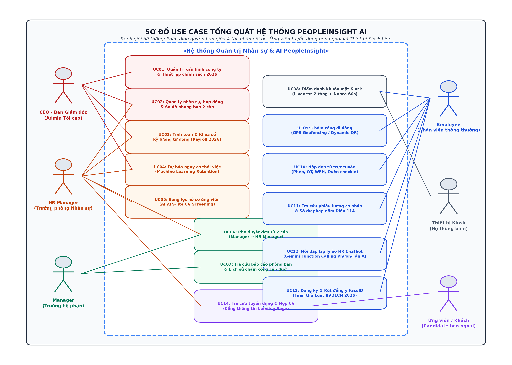

*Hình 2.1. Sơ đồ Use Case tổng quát hệ thống PeopleInsight AI*

*Mô tả biểu đồ Use Case tổng quát:*
Biểu đồ Use Case tổng quát thể hiện 14 chức năng chính của hệ thống trong ranh giới «Hệ thống Quản trị Nhân sự & AI PeopleInsight», kết nối chặt chẽ với 6 tác nhân:
- **Tác nhân Ban Giám đốc (CEO):** Quản trị cấu hình toàn công ty và thiết lập chính sách năm 2026, quản lý cơ cấu tổ chức và nhân sự cấp cao, xem và phê duyệt bảng lương toàn doanh nghiệp, cùng theo dõi dự báo nguy cơ thôi việc để định hướng chiến lược giữ chân nhân sự.
- **Tác nhân Trưởng phòng Nhân sự (HR_MANAGER):** Quản lý hồ sơ nhân viên và hợp đồng lao động, khởi chạy tính toán và thực hiện khóa sổ bảng lương, khai thác báo cáo dự báo nguy cơ thôi việc, quản lý tin tuyển dụng và sàng lọc hồ sơ ứng viên, cùng phê duyệt chung cuộc (Cấp 2) các loại đơn từ.
- **Tác nhân Trưởng bộ phận (MANAGER):** Phê duyệt sơ bộ (Cấp 1) đối với đơn xin nghỉ phép và đơn làm thêm giờ của nhân viên cấp dưới trực tiếp, tra cứu báo cáo tình hình chuyên cần và theo dõi kế hoạch làm việc của phòng ban.
- **Tác nhân Nhân viên (EMPLOYEE):** Điểm danh vào/ra ca làm việc bằng nhận diện khuôn mặt tại máy Kiosk hoặc qua ứng dụng di động (định vị GPS / quét mã QR), nộp đơn trực tuyến, tra cứu phiếu lương cá nhân và số ngày phép năm còn lại, trò chuyện với Trợ lý ảo HR AI, và đăng ký hoặc rút đồng ý dữ liệu khuôn mặt.
- **Tác nhân Thiết bị Kiosk (Kiosk Device):** Tự động phát hiện khuôn mặt, đưa ra chỉ dẫn cử động ngẫu nhiên để kiểm tra người thật và chuyển tiếp dữ liệu đặc trưng đã mã hóa về máy chủ để ghi nhận điểm danh.
- **Tác nhân Ứng viên / Khách vãng lai (CANDIDATE):** Truy cập cổng thông tin doanh nghiệp (Landing Page) để tìm hiểu môi trường làm việc, tra cứu danh sách việc làm đang mở tuyển dụng công khai và nộp hồ sơ CV ứng tuyển trực tuyến.

---

## 2.2 Biểu đồ use case phân rã chức năng

Để làm rõ phương thức vận hành thực tế của phần mềm, phần này tiến hành đặc tả chi tiết 6 ca sử dụng cốt lõi và quan trọng nhất của hệ thống PeopleInsight AI. Mỗi ca sử dụng được mô tả toàn diện theo chuẩn phân tích hướng đối tượng, bao gồm: mã và tên ca sử dụng, các tác nhân tham gia, tiền điều kiện kích hoạt, hậu điều kiện đạt được, cùng luồng sự kiện tương tác chính và các luồng xử lý tình huống phát sinh:

---

### 2.2.1 Đặc tả use case UC_01: Điểm danh khuôn mặt Kiosk FaceID

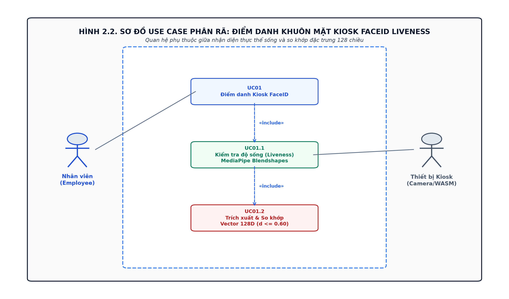

*Hình 2.2. Usecase Điểm danh khuôn mặt Kiosk FaceID Trực tiếp 1 Chạm*

### Bảng 2.4. Bảng đặc tả use case UC_01: Điểm danh khuôn mặt Kiosk FaceID

| Mã use case | **UC_01** |
| :--- | :--- |
| **Tên use case:** | **Điểm danh khuôn mặt Kiosk FaceID (Chế độ Trực tiếp 1 Chạm)** |
| **Mô tả sơ lược:** | Cho phép nhân viên thực hiện điểm danh vào ca làm việc hoặc tan ca tại thiết bị Kiosk văn phòng bằng công nghệ nhận diện khuôn mặt tự động 1 chạm thời gian thực, bám vết điểm mốc sinh học, tự động ghi nhận thời gian và hiển thị thông tin ca làm việc tức thì. |
| **Actor chính:** | Nhân viên (`EMPLOYEE`) |
| **Actor phụ:** | Thiết bị Kiosk (`Kiosk Device`), Máy chủ hệ thống |
| **Tiền điều kiện:** | Thiết bị Kiosk đang chạy ở chế độ điểm danh; camera hoạt động bình thường; nhân viên đã hoàn tất đăng ký dữ liệu khuôn mặt tại văn phòng. |
| **Hậu điều kiện:** | Bản ghi chấm công được lưu vào sổ chấm công `attendanceLogs`; Kiosk hiển thị thẻ thông báo nổi dưới chân màn hình (Toast Card) ghi rõ trạng thái Vào/Tan ca, họ tên, mã nhân viên, phòng ban, tình trạng ca (đúng giờ hoặc đi muộn kèm số phút); cập nhật danh sách các lượt chấm công gần nhất. |
| **Luồng sự kiện chính** | **Luồng sự kiện chính** |
| **Người dùng** | **Hệ thống** |
| 1. Nhân viên bước vào vùng quét trước camera Kiosk ở cự ly thích hợp (khoảng 0.5 – 1.2m). | 2. Kiosk tự động phát hiện khuôn mặt, hiển thị khung viền radar dẫn hướng, lưới điểm mốc sinh học thời gian thực và thanh tiến độ nhận diện. |
| 3. Nhân viên giữ vị trí khuôn mặt ổn định trước ống kính. | 4. Kiosk xác nhận có duy nhất 1 khuôn mặt trong khung hình; khi khuôn mặt ổn định trong khoảng 0.25 giây (6 khung hình liên tục), hệ thống tự động trích xuất vector đặc trưng sinh trắc học và gửi yêu cầu điểm danh lên máy chủ. |
| | 5. Máy chủ giải mã tập mẫu khuôn mặt nội bộ trong bộ nhớ RAM, thực hiện thuật toán so khớp 1:N với khoảng cách an toàn và xác định danh tính nhân viên. |
| | 6. Máy chủ xác định trạng thái ca làm việc (Vào ca hoặc Tan ca theo chế độ Tự động hoặc chế độ chọn thủ công), tính toán tình trạng đến đúng giờ hoặc số phút đi muộn, lưu trữ nhật ký chấm công vào hệ thống. |
| | 7. Kiosk hiển thị thẻ thông báo nổi (Toast Card) trang nhã phía dưới đáy màn hình hiển thị đầy đủ: Họ tên, Mã nhân viên, Phòng ban, Trạng thái Vào ca/Tan ca, Giờ phút chi tiết và Cảnh báo đi muộn (nếu có); đồng thời ghi nhận vào danh sách "Lượt chấm công vừa ghi nhận tại Kiosk" và tự động đóng thẻ sau 3.5 giây để tiếp nhận lượt điểm danh tiếp theo. |
| **Luồng thay thế** | **Luồng thay thế** |
| **Người dùng** | **Hệ thống** |
| 1.1 Có từ hai người trở lên cùng xuất hiện trong khung hình quét. | 2.1 Hệ thống phát hiện nhiều khuôn mặt trong khung hình, đổi khung viền radar sang màu đỏ cảnh báo, tạm dừng tiến trình quét và phát thông báo: *"Vui lòng chỉ từng người một bước vào điểm danh"* để tránh nhận diện nhầm. |
| 3.1 Người đứng trước camera chưa đăng ký mẫu khuôn mặt hoặc không khớp danh tính trong CSDL. | 4.1 Hệ thống hiển thị thông báo lỗi: *"Không tìm thấy khuôn mặt phù hợp trong hệ thống"*, tự động đóng thông báo sau 3 giây và hướng dẫn nhân viên điểm danh dự phòng bằng quét mã QR cá nhân trên ứng dụng di động. |
| 5.1 Nhân viên muốn chủ động chọn ca điểm danh theo ý muốn. | 6.1 Nhân viên bấm nút chuyển đổi chế độ trên thanh công cụ Kiosk (`🟢 Vào Ca` hoặc `🔵 Tan Ca`) thay vì để chế độ `⚡ Tự Động`. |
| 7.1 Cán bộ quản lý (CEO / HR Manager) cần cấu hình camera hoặc tắt ca trực. | 8.1 Bấm nút *"Chỉnh Sửa Cam"* để đổi thiết bị camera, chuyển đổi độ phân giải VGA/HD, lật gương hình ảnh hoặc bấm *"Tắt Cam"* khi kết thúc phiên làm việc. |

---

### 2.2.2 Đặc tả use case UC_02: Nộp và phê duyệt đơn nghỉ phép 2 cấp

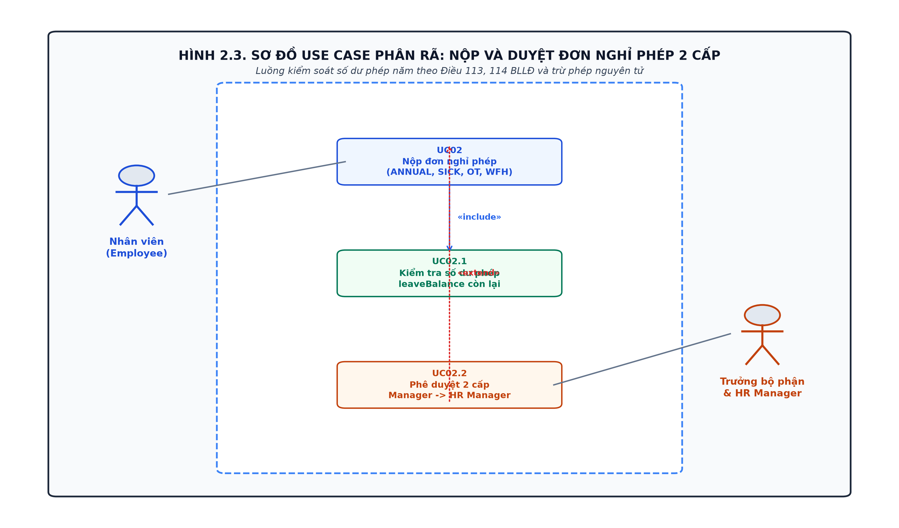

*Hình 2.3. Usecase Nộp và phê duyệt đơn nghỉ phép 2 cấp*

### Bảng 2.5. Bảng đặc tả use case UC_02: Nộp và phê duyệt đơn nghỉ phép 2 cấp

| Mã use case | **UC_02** |
| :--- | :--- |
| **Tên use case:** | **Nộp và phê duyệt đơn nghỉ phép 2 cấp** |
| **Mô tả sơ lược:** | Cho phép nhân viên tạo đơn xin nghỉ phép trực tuyến có kiểm tra số ngày phép năm còn lại theo luật định, sau đó chuyển qua quy trình phê duyệt 2 cấp độc lập: Trưởng bộ phận duyệt kế hoạch và Trưởng phòng Nhân sự duyệt chung cuộc, tự động trừ ngày phép vào quỹ phép cá nhân. |
| **Actor chính:** | Nhân viên (`EMPLOYEE`), Trưởng bộ phận (`MANAGER`), Trưởng phòng Nhân sự (`HR_MANAGER`) |
| **Actor phụ:** | Máy chủ thông báo tức thời |
| **Tiền điều kiện:** | Nhân viên và cấp quản lý đã đăng nhập tài khoản hợp lệ trên hệ thống cổng thông tin doanh nghiệp. |
| **Hậu điều kiện:** | Đơn nghỉ phép chuyển sang trạng thái "Đã phê duyệt", số ngày nghỉ được tự động trừ chính xác vào quỹ phép năm của nhân viên. |
| **Luồng sự kiện chính** | **Luồng sự kiện chính** |
| **Người dùng** | **Hệ thống** |
| 1. Nhân viên chọn mục *"Quản lý Đơn từ"*, bấm nút *"Tạo đơn mới"*. | 2. Hiển thị biểu mẫu nộp đơn kèm số ngày phép năm còn lại khả dụng. |
| 3. Nhân viên chọn loại đơn *"Nghỉ phép năm"*, chọn khoảng ngày xin nghỉ và nhập lý do. | 4. Kiểm tra tính hợp lệ: ngày kết thúc sau ngày bắt đầu, số ngày xin nghỉ không vượt quá số ngày phép còn lại. |
| | 5. Tạo đơn mới ở trạng thái *"Chờ Quản lý duyệt"* và tự động gửi thông báo trực tiếp đến Trưởng bộ phận phụ trách. |
| 6. Trưởng bộ phận vào danh sách đơn chờ duyệt, kiểm tra kế hoạch công việc và chọn *"Phê duyệt Cấp 1"*. | 7. Cập nhật trạng thái đơn sang *"Chờ Nhân sự duyệt"* và tự động chuyển tiếp thông báo đến Trưởng phòng Nhân sự. |
| 8. Trưởng phòng Nhân sự rà soát quỹ phép chung và chọn *"Phê duyệt Cấp 2 (Chung cuộc)"*. | 9. Cập nhật trạng thái đơn thành *"Đã phê duyệt"*, tự động trừ số ngày nghỉ vào quỹ phép của nhân viên và gửi thông báo hoàn tất cho nhân viên. |
| **Luồng thay thế** | **Luồng thay thế** |
| **Người dùng** | **Hệ thống** |
| 1.1 Số ngày xin nghỉ vượt quá số ngày phép năm còn lại. | 2.1 Hệ thống từ chối tạo đơn và thông báo rõ: *"Số dư ngày phép năm không đủ để thực hiện yêu cầu này"*. |
| 6.1 Trưởng bộ phận hoặc Trưởng phòng Nhân sự từ chối đơn. | 6.2 Yêu cầu người duyệt nhập lý do từ chối, chuyển trạng thái đơn thành *"Từ chối"* và gửi thông báo giải thích cho nhân viên. |
| 6.3 Quản lý cố tình tự phê duyệt đơn do chính mình tạo ra. | 6.4 Hệ thống ngăn chặn do vi phạm quy định kiểm soát phê duyệt độc lập (không được tự phê duyệt đơn của bản thân). |
| 8.1 Nhân viên xin hủy đơn đã được phê duyệt trước ngày nghỉ. | 8.2 Sau khi Trưởng phòng Nhân sự đồng ý hủy, hệ thống tự động hoàn lại đủ số ngày phép vào quỹ phép của nhân viên. |

---

### 2.2.3 Đặc tả use case UC_03: Tính toán và khóa sổ kỳ lương 2026

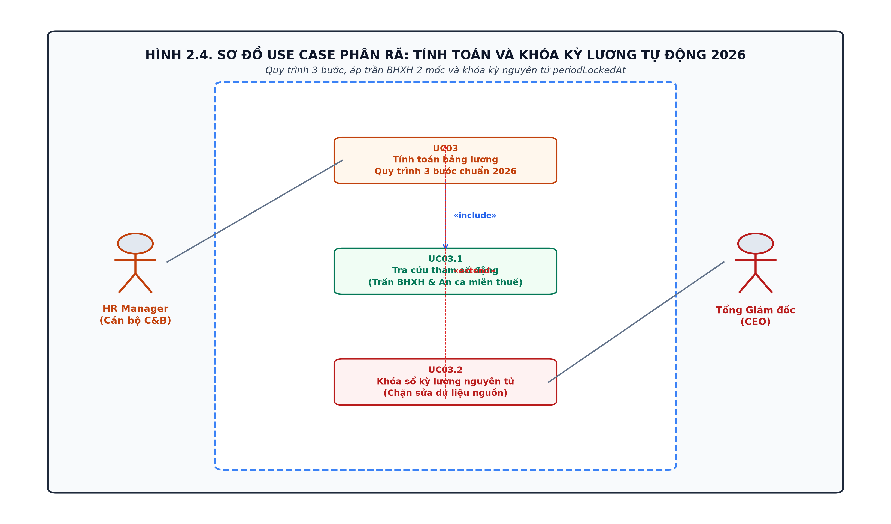

*Hình 2.4. Usecase Tính toán và khóa sổ kỳ lương 2026*

### Bảng 2.6. Bảng đặc tả use case UC_03: Tính toán và khóa sổ kỳ lương 2026

| Mã use case | **UC_03** |
| :--- | :--- |
| **Tên use case:** | **Tính toán và khóa sổ kỳ lương 2026** |
| **Mô tả sơ lược:** | Tự động tổng hợp dữ liệu chấm công, ngày phép, giờ làm thêm của toàn bộ nhân viên trong tháng, áp dụng quy trình tính lương 3 bước chuẩn năm 2026 (miễn thuế tiền làm thêm giờ theo luật, áp dụng Biểu thuế TNCN 5 bậc mới), xuất bảng lương cho Nhân sự kiểm tra và thực hiện khóa sổ kỳ lương để cố định số liệu tài chính lịch sử. |
| **Actor chính:** | Trưởng phòng Nhân sự (`HR_MANAGER`), Ban Giám đốc (`CEO`) |
| **Actor phụ:** | Động cơ tính lương tự động, Cơ sở dữ liệu hệ thống |
| **Tiền điều kiện:** | Kỳ công của tháng đã kết thúc; toàn bộ đơn từ và giải trình công đã được phê duyệt; cán bộ nhân sự có quyền quản trị tiền lương. |
| **Hậu điều kiện:** | Bảng lương toàn công ty được tạo lập hoàn chỉnh; trạng thái khóa sổ kỳ lương được xác lập, ngăn chặn mọi hành vi chỉnh sửa dữ liệu nguồn của kỳ công đó. |
| **Luồng sự kiện chính** | **Luồng sự kiện chính** |
| **Người dùng** | **Hệ thống** |
| 1. Trưởng phòng Nhân sự chọn kỳ lương cần tính (ví dụ: tháng 10/2026) và bấm nút *"Tính toán kỳ lương"*. | 2. Kiểm tra xác nhận kỳ lương chưa bị khóa sổ, tự động trích xuất bảng chấm công, giờ làm thêm, ngày nghỉ phép và mức lương hợp đồng của toàn bộ nhân viên. |
| | 3. Hệ thống áp dụng chính sách lương năm 2026: xác định mức trần đóng bảo hiểm, mức trần phụ cấp ăn ca và các khoản giảm trừ gia cảnh (bản thân 15.5 triệu đồng, người phụ thuộc 6.2 triệu đồng/người). |
| | 4. Động cơ tính lương thực hiện tuần tự 3 bước: Tính tổng thu nhập (Gross), miễn thuế thu nhập đối với tiền lương làm thêm giờ theo luật, trích các khoản bảo hiểm bắt buộc (10.5%) và tính thuế TNCN theo Biểu thuế lũy tiến 5 bậc mới. |
| | 5. Hiển thị bảng tổng hợp tiền lương chi tiết của toàn công ty trên giao diện để Nhân sự và Ban Giám đốc rà soát đối chiếu. |
| 6. Trưởng phòng Nhân sự sau khi kiểm tra số liệu bấm nút *"Khóa sổ kỳ lương"*. | 7. Hệ thống xác nhận khóa kỳ, lưu giữ nguyên vẹn toàn bộ số liệu và công thức đã áp dụng, ngăn chặn mọi hành vi chỉnh sửa dữ liệu công và lương của kỳ này trong tương lai. |
| | 8. Tự động gửi thông báo phát hành phiếu lương cá nhân chi tiết đến từng nhân viên. |
| **Luồng thay thế** | **Luồng thay thế** |
| **Người dùng** | **Hệ thống** |
| 1.1 Cán bộ nhân sự bấm tính lại kỳ lương đã bị khóa sổ từ trước. | 2.1 Hệ thống từ chối thao tác và thông báo: *"Kỳ lương này đã được khóa sổ chính thức, không thể thay đổi dữ liệu tài chính lịch sử"*. |
| 1.2 Phát hiện nhân viên chưa được thiết lập mức lương hoặc thiếu thông tin hợp đồng. | 2.2 Tạm dừng tính cho nhân sự đó và cảnh báo cụ thể trên màn hình để Nhân sự bổ sung thông tin trước khi tính toán. |

---

### 2.2.4 Đặc tả use case UC_04: Trợ lý ảo HR AI đa năng & An toàn thông tin

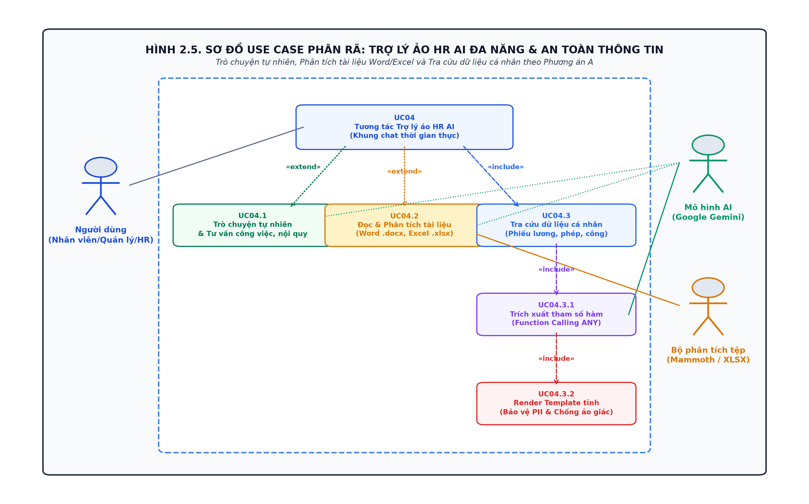

*Hình 2.5. Sơ đồ Use Case phân rã: Trợ lý ảo HR AI đa năng & An toàn thông tin*

### Bảng 2.7. Bảng đặc tả use case UC_04: Trợ lý ảo HR AI đa năng & An toàn thông tin

| Mã use case | **UC_04** |
| :--- | :--- |
| **Tên use case:** | **Tương tác & Tra cứu qua Trợ lý ảo HR AI đa năng** |
| **Mô tả sơ lược:** | Hỗ trợ người dùng giao tiếp bằng tiếng Việt tự nhiên để trò chuyện, hỏi thăm công việc, giải đáp thắc mắc nội quy lao động; hỗ trợ đính kèm và phân tích tài liệu văn phòng (Word `.docx`, Excel `.xlsx`) để thẩm định pháp lý và đối soát số liệu; đồng thời tra cứu tự phục vụ số dư ngày phép, phiếu lương, lịch sử chấm công với cơ chế bảo vệ dữ liệu PII khép kín (Phương án A: ngắt luồng LLM, truy vấn CSDL nội bộ và trình bày kết quả Markdown an toàn). |
| **Actor chính:** | Nhân viên (`EMPLOYEE`), Trưởng bộ phận (`MANAGER`), Trưởng phòng Nhân sự (`HR_MANAGER`), Ban Giám đốc (`CEO`) |
| **Actor phụ:** | Mô hình Trí tuệ nhân tạo (Google Gemini), Bộ phân tích tệp văn phòng (Mammoth, XLSX Parser), Cơ sở dữ liệu nội bộ MongoDB |
| **Tiền điều kiện:** | Người dùng đã đăng nhập hệ thống bằng tài khoản hợp lệ. |
| **Hậu điều kiện:** | Câu trả lời tự nhiên, báo cáo phân tích tài liệu hoặc bảng biểu tra cứu nhân sự được hiển thị trực tiếp trên khung chat; thông tin cá nhân và dữ liệu tiền lương nhạy cảm được bảo vệ an toàn tuyệt đối. |
| **Luồng sự kiện chính** | **Luồng sự kiện chính** |
| **Người dùng** | **Hệ thống** |
| 1. Người dùng bấm biểu tượng Trợ lý ảo trên màn hình để mở khung chat, xem danh sách câu hỏi gợi ý nhanh hoặc chuẩn bị tài liệu đính kèm. | 2. Hệ thống tiếp nhận, xác thực tài khoản và khởi tạo phiên trò chuyện bảo mật. |
| 3. Người dùng tương tác theo 1 trong 3 kịch bản: | |
| *Kịch bản 1: Trò chuyện tự nhiên & giải đáp thắc mắc:* - Người dùng nhập câu chào hỏi, hỏi thăm hoặc thắc mắc về nội quy, chế độ làm việc (ví dụ: *"Nội quy làm việc từ xa của công ty như thế nào?"*). | 4. Hệ thống phân tích ngữ nghĩa, tra cứu tài liệu nội quy công ty (`policyChunks`) và phản hồi tự nhiên, chuẩn xác, thân thiện như một đồng nghiệp thực thụ. |
| *Kịch bản 2: Đọc & phân tích tài liệu Word/Excel:* - Người dùng bấm biểu tượng kẹp ghim (📎), chọn tệp hợp đồng Word (`.docx`) hoặc bảng tính Excel (`.xlsx`) và đặt câu hỏi liên quan. | 5. Hệ thống trích xuất văn bản từ tệp đính kèm; mô hình AI Gemini phân tích nội dung, tóm tắt điều khoản cốt lõi, đối soát số liệu lương/công, thẩm định pháp lý theo BLLĐ 2019 và giải đáp cặn kẽ mọi câu hỏi về văn bản. |
| *Kịch bản 3: Tra cứu dữ liệu cá nhân nhạy cảm (Phương án A):* - Người dùng hỏi về phiếu lương, ngày phép, ngày công (ví dụ: *"Xem phiếu lương tháng này của tôi"*). | 6. Mô hình Gemini nhận diện ý định và trích xuất tham số hàm có cấu trúc (`Function Calling mode: ANY`). 7. Hệ thống ngắt luồng gọi ra ngoài, tự động truy vấn CSDL nội bộ MongoDB theo đúng mã nhân viên của người đang đăng nhập. 8. Điền số liệu vào Template Markdown tĩnh tách bạch 2 khối (Thực nhận Net và Tham chiếu Thuế TNCN). |
| 9. Người dùng theo dõi kết quả hiển thị trên màn hình chat. | 10. Ghi vết kiểm toán vào `auditLogs` và kết xuất Markdown an toàn qua `DOMPurify` lên giao diện. |
| **Luồng thay thế** | **Luồng thay thế** |
| **Người dùng** | **Hệ thống** |
| 1.1 Người dùng tải tệp không đúng định dạng (không phải .docx, .xlsx, .csv, .txt) hoặc dung lượng vượt quá giới hạn cho phép. | 2.1 Hệ thống từ chối tải tệp và thông báo hướng dẫn người dùng chọn định dạng hợp lệ. |
| 1.2 Người dùng cố tình hỏi số liệu lương của đồng nghiệp hoặc cấp trên (ví dụ: *"Xem lương của Giám đốc"*). | 2.2 Hệ thống nhận diện hành vi tra cứu sai thẩm quyền, từ chối cung cấp và chỉ trả về dữ liệu của chính người đang hỏi. |
| 1.3 Người dùng gửi câu hỏi độc hại, prompt injection hoặc cố tình yêu cầu thay đổi dữ liệu hệ thống. | 2.3 Hệ thống kích hoạt bộ lọc an toàn, từ chối thực thi và giữ nguyên chuẩn mực an ninh. |
| 1.4 Mạng gián đoạn hoặc dịch vụ Gemini phản hồi chậm / hết hạn mức API. | 2.4 Hệ thống tự động chuyển sang chế độ nhận diện từ khóa quy tắc nội bộ (Rule-based Fallback Engine) để phản hồi ngay lập tức cho người dùng. |

---

### 2.2.5 Đặc tả use case UC_05: Dự báo nguy cơ thôi việc Machine Learning

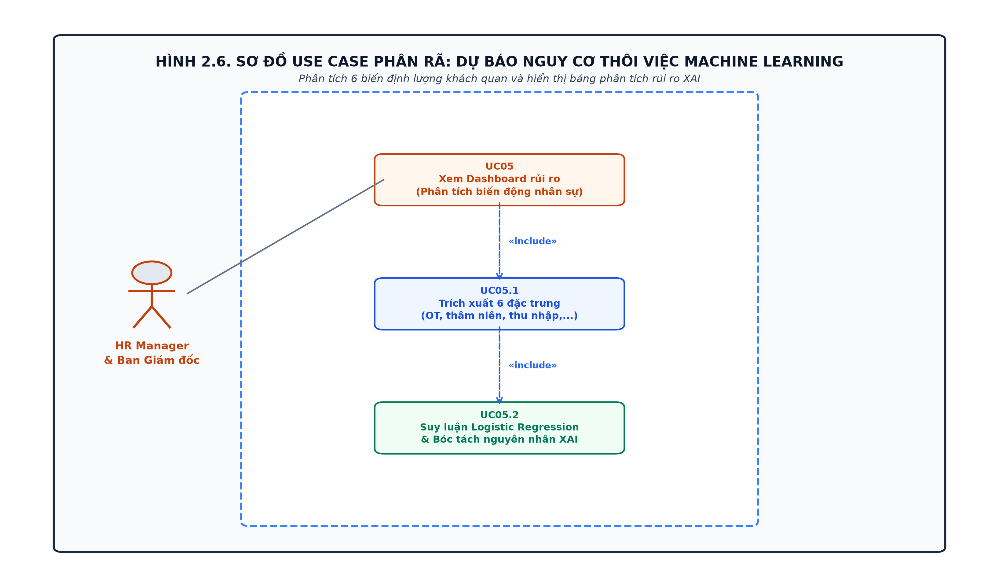

*Hình 2.6. Usecase Dự báo nguy cơ thôi việc Machine Learning*

### Bảng 2.8. Bảng đặc tả use case UC_05: Dự báo nguy cơ thôi việc Machine Learning

| Mã use case | **UC_05** |
| :--- | :--- |
| **Tên use case:** | **Dự báo nguy cơ thôi việc Machine Learning** |
| **Mô tả sơ lược:** | Phân tích tự động 6 chỉ số công việc khách quan của nhân sự toàn công ty, áp dụng mô hình học máy để dự báo xác suất nguy cơ thôi việc, chỉ ra các nguyên nhân chính và hiển thị trên Dashboard trực quan hỗ trợ bộ phận nhân sự chủ động có biện pháp giữ chân nhân tài. |
| **Actor chính:** | Trưởng phòng Nhân sự (`HR_MANAGER`), Ban Giám đốc (`CEO`) |
| **Actor phụ:** | Dịch vụ phân tích học máy, Cơ sở dữ liệu hệ thống |
| **Tiền điều kiện:** | Cán bộ quản lý có quyền hạn đăng nhập, hệ thống đã có dữ liệu chấm công và hợp đồng nhân sự. |
| **Hậu điều kiện:** | Báo cáo danh sách nhân sự kèm điểm rủi ro, phân loại 3 mức rủi ro (Thấp, Trung bình, Cao) và Top 3 nguyên nhân cốt lõi được kết xuất trên Dashboard. |
| **Luồng sự kiện chính** | **Luồng sự kiện chính** |
| **Người dùng** | **Hệ thống** |
| 1. Trưởng phòng Nhân sự truy cập trang *"Phân tích Nguy cơ Thôi việc"*. | 2. Kiểm tra quyền hạn (chỉ cho phép cấp Quản lý nhân sự và Ban Giám đốc truy cập), tự động tổng hợp dữ liệu làm việc của nhân sự toàn công ty. |
| | 3. Trích xuất 6 chỉ số làm việc khách quan: số giờ làm thêm trong tháng, số năm gắn bó với công ty, tổng số năm kinh nghiệm, mức thu nhập, số công ty từng làm việc và khoảng cách từ nhà đến nơi làm việc. |
| | 4. Đưa các chỉ số vào mô hình học máy đã được huấn luyện để tính toán xác suất nguy cơ thôi việc của từng nhân viên. |
| | 5. Phân loại nhân sự vào 3 nhóm nguy cơ rõ ràng: Nguy cơ thấp, Nguy cơ trung bình và Nguy cơ cao. |
| | 6. Hệ thống phân tích và chỉ ra Top 3 nguyên nhân chính tác động nhiều nhất đến nguy cơ của từng nhân viên (ví dụ: làm thêm giờ quá nhiều, khoảng cách đi lại xa). |
| | 7. Trình bày tổng quan trên Dashboard gồm: các biểu đồ thống kê trực quan, danh sách nhân viên cần quan tâm và gợi ý các hành động can thiệp (điều chỉnh ca kíp, cân đối khối lượng công việc, trao đổi chính sách đãi ngộ). |
| 8. Cán bộ nhân sự bấm xem chi tiết từng nhân viên để theo dõi giải trình. | 9. Hiển thị bảng giải trình chi tiết kèm khuyến nghị can thiệp cụ thể để bộ phận nhân sự chủ động đối thoại với nhân viên. |
| **Luồng thay thế** | **Luồng thay thế** |
| **Người dùng** | **Hệ thống** |
| 1.1 Nhân viên thường cố tình truy cập vào trang phân tích nguy cơ thôi việc. | 2.1 Hệ thống từ chối truy cập do không đủ thẩm quyền và ghi nhận cảnh báo an toàn thông tin. |
| 1.2 Nhân viên mới vào làm việc chưa có đủ dữ liệu lịch sử làm thêm giờ. | 2.2 Hệ thống tạm tính giờ làm thêm bằng 0 và dự báo sơ bộ dựa trên các thông tin kinh nghiệm, khoảng cách đi lại ban đầu. |

---

### 2.2.6 Đặc tả use case UC_06: Quản lý tuyển dụng, sàng lọc hồ sơ AI ATS và gửi thư mời phỏng vấn

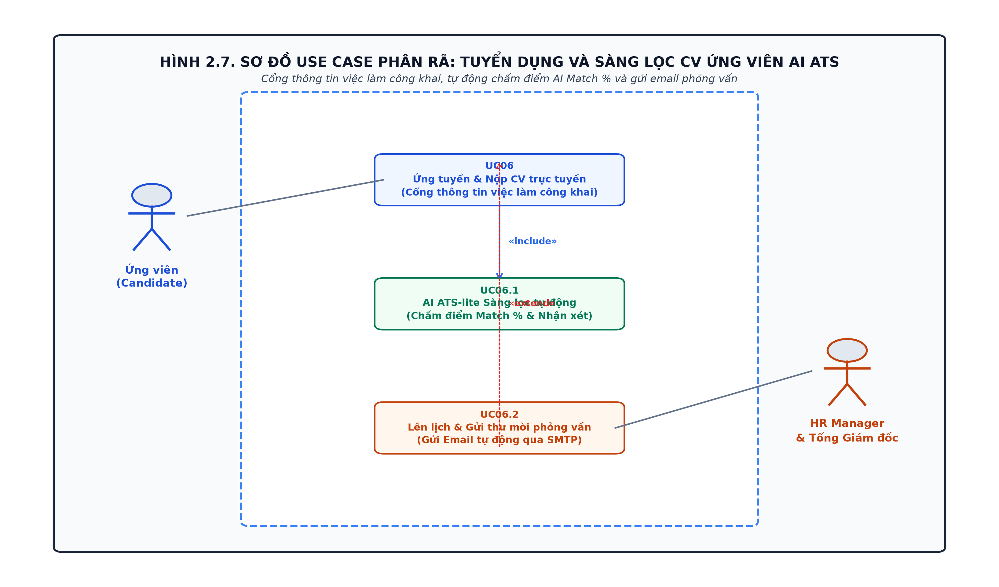

*Hình 2.7. Usecase Tuyển dụng, sàng lọc hồ sơ ứng viên AI ATS và gửi thư mời phỏng vấn*

### Bảng 2.9. Bảng đặc tả use case UC_06: Quản lý tuyển dụng và sàng lọc hồ sơ AI ATS

| Mã use case | **UC_06** |
| :--- | :--- |
| **Tên use case:** | **Quản lý tuyển dụng, sàng lọc hồ sơ AI ATS và gửi thư mời phỏng vấn** |
| **Mô tả sơ lược:** | Cho phép ứng viên nộp hồ sơ ứng tuyển trực tuyến qua Cổng thông tin việc làm công khai; hệ thống AI ATS tự động phân tích và chấm điểm độ phù hợp của CV; cán bộ nhân sự và ban giám đốc xem xét, duyệt ứng viên và gửi email thư mời phỏng vấn tự động. |
| **Actor chính:** | Ứng viên (`CANDIDATE`), Trưởng phòng Nhân sự (`HR_MANAGER`) |
| **Actor phụ:** | Ban Giám đốc (`CEO`), Động cơ AI ATS-lite, Dịch vụ Email SMTP |
| **Tiền điều kiện:** | Doanh nghiệp đã đăng tin tuyển dụng đang mở tiếp nhận hồ sơ; ứng viên có tệp hồ sơ cá nhân (CV) hợp lệ. |
| **Hậu điều kiện:** | Hồ sơ ứng viên được lưu vào cơ sở dữ liệu kèm điểm AI Match Score; trạng thái hồ sơ được cập nhật; thư mời phỏng vấn được gửi thành công đến email của ứng viên. |
| **Luồng sự kiện chính** | **Luồng sự kiện chính** |
| **Người dùng** | **Hệ thống** |
| 1. Ứng viên truy cập trang thông tin việc làm công khai của công ty (`/careers`). | 2. Hiển thị danh sách các vị trí đang tuyển dụng kèm bản mô tả công việc, yêu cầu kỹ năng và quyền lợi. |
| 3. Ứng viên chọn vị trí công việc phù hợp và bấm *"Ứng tuyển ngay"*. | 4. Hiển thị biểu mẫu nộp hồ sơ ứng tuyển trực tuyến. |
| 5. Ứng viên điền thông tin cá nhân (họ tên, email, số điện thoại, kinh nghiệm, liên kết portfolio) và tải lên tệp CV. | 6. Tiếp nhận hồ sơ, kiểm tra tính hợp lệ của tệp CV và lưu bản ghi ứng viên vào cơ sở dữ liệu tuyển dụng (`jobPostings.applicants[]`). |
| | 7. Động cơ AI ATS-lite tự động kích hoạt, phân tích nội dung CV, so khớp với yêu cầu tuyển dụng, tính toán điểm độ phù hợp AI Match Score (0 – 100%), trích xuất điểm mạnh, điểm yếu và đưa ra gợi ý phân loại sơ bộ (`ACCEPTED` hoặc `NEEDS_REVIEW`). |
| 8. Trưởng phòng Nhân sự (`HR_MANAGER`) hoặc Ban Giám đốc (`CEO`) đăng nhập hệ thống, truy cập trang Quản lý tuyển dụng (`/recruitment`). | 9. Hiển thị danh sách ứng viên đã nộp hồ sơ theo từng vị trí tuyển dụng kèm điểm số đánh giá của AI. |
| 10. Cán bộ nhân sự chọn xem chi tiết hồ sơ ứng viên, rà soát kết quả thẩm định kỹ năng của AI. | 11. Cán bộ nhân sự bấm *"Mời phỏng vấn"*, nhập thông tin lịch hẹn (ngày, giờ, hình thức phỏng vấn trực tiếp tại văn phòng hoặc trực tuyến qua Google Meet, người phỏng vấn và ghi chú chuẩn bị). |
| | 12. Hệ thống cập nhật trạng thái ứng viên thành `INTERVIEW_SCHEDULED`, lưu lịch hẹn vào cơ sở dữ liệu và tự động kích hoạt dịch vụ Email gửi thư mời phỏng vấn trang trọng đến email ứng viên qua giao thức SMTP SSL. |
| | 13. Hiển thị thông báo gửi thư mời phỏng vấn thành công trên giao diện quản trị. |
| **Luồng thay thế** | **Luồng thay thế** |
| **Người dùng** | **Hệ thống** |
| 1.1 Ứng viên điền thiếu thông tin bắt buộc hoặc tệp CV vượt quá dung lượng cho phép. | 2.1 Hệ thống hiển thị cảnh báo lỗi cụ thể và yêu cầu hoàn thiện đúng định dạng trước khi gửi. |
| 8.1 Nhân viên thường (`EMPLOYEE`) hoặc Quản lý cấp phòng (`MANAGER`) cố tình truy cập vào trang Quản lý tuyển dụng. | 9.1 Hệ thống kiểm tra quyền hạn theo ma trận RBAC, từ chối truy cập (403 Forbidden) và ghi nhận cảnh báo an ninh. |
| 10.1 Cán bộ nhân sự đánh giá hồ sơ chưa đạt yêu cầu của công ty. | 11.1 Cán bộ nhân sự bấm chuyển trạng thái thành *"Từ chối"* (`REJECTED`) và ghi chú lý do lưu vết nội bộ. |
| 12.1 Sự cố kết nối dịch vụ Email (mất kết nối mạng hoặc lỗi máy chủ SMTP). | 13.1 Hệ thống thông báo lỗi gửi thư, vẫn bảo lưu lịch phỏng vấn trong cơ sở dữ liệu và cung cấp nút bấm *"Gửi lại thư mời"* để thử lại. |

---

## 2.3 Biểu đồ tuần tự (Sequence Diagram)

Biểu đồ tuần tự (Sequence Diagram) mô hình hóa dòng thông điệp trao đổi giữa các đối tượng (Người dùng, Giao diện Client, Bộ điều khiển Controller, Dịch vụ Service và Cơ sở dữ liệu) theo trục thời gian cho 3 quy trình trọng yếu nhất của hệ thống:

### 2.3.1 Biểu đồ tuần tự: Điểm danh Kiosk FaceID trực tiếp 1 chạm

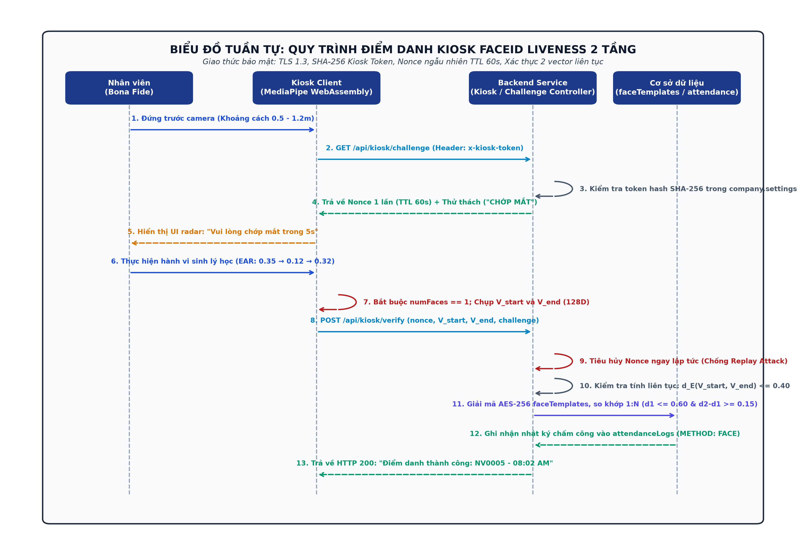

*Hình 2.7. Biểu đồ tuần tự: Quy trình điểm danh Kiosk FaceID trực tiếp 1 chạm*

*Mô tả biểu đồ tuần tự:*
1. Nhân viên bước vào vùng quét trước camera Kiosk (cự ly 0.5 – 1.2m).
2. Trình duyệt Kiosk kích hoạt luồng camera liên tục, bám vết khuôn mặt qua MediaPipe Face Landmarker, hiển thị khung radar và lưới điểm mốc thời gian thực.
3. Khi phát hiện duy nhất 1 khuôn mặt ổn định trong 6 khung hình liên tiếp (~0.25 giây), Kiosk trích xuất vector đặc trưng 128 chiều và gửi gói tin điểm danh kèm tiêu đề xác thực thiết bị (`x-kiosk-token`) và chế độ điểm danh (`mode: AUTO / CHECK_IN / CHECK_OUT`) lên máy chủ `POST /api/kiosk/check-in`.
4. Máy chủ xác thực thiết bị Kiosk, giải mã kho vector mẫu nội bộ trong bộ nhớ RAM và thực thi thuật toán so khớp 1:N với khoảng cách an toàn.
5. Máy chủ xác định danh tính nhân sự, tính toán thời gian vào ca/tan ca, so sánh với khung giờ quy định để tính số phút đi muộn (nếu có), và ghi bản ghi vào cơ sở dữ liệu `attendanceLogs`.
6. Máy chủ trả về dữ liệu kết quả chấm công gồm: Họ tên, Mã nhân viên, Phòng ban, Trạng thái (Vào ca/Tan ca), Giờ phút chi tiết và Tình trạng ca (Đi muộn X phút).
7. Giao diện Kiosk hiển thị thẻ thông báo nổi (Toast Card) phía dưới đáy màn hình, phát âm thanh xác nhận, ghi nhận vào băng chuyền "Lượt chấm công vừa ghi nhận tại Kiosk" và tự động ẩn sau 3.5 giây để sẵn sàng cho lượt tiếp theo.

---

### 2.3.2 Biểu đồ tuần tự: Tính lương và chốt sổ kỳ lương nguyên tử

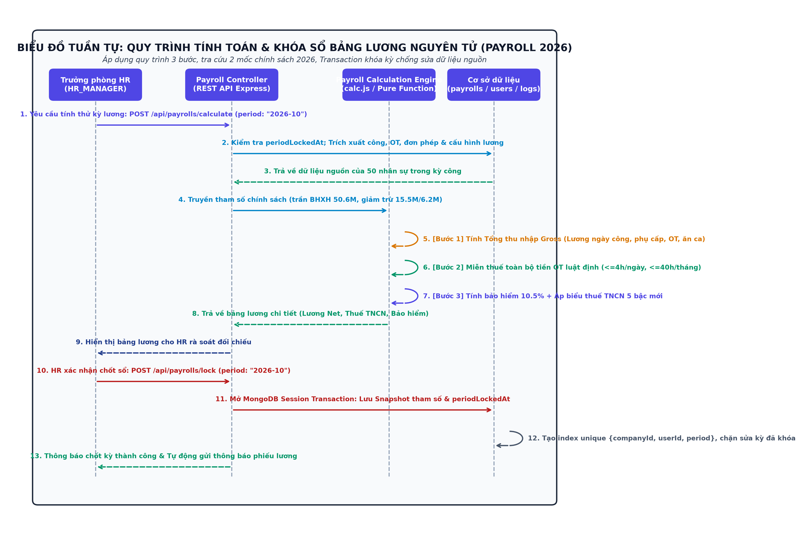

*Hình 2.8. Biểu đồ tuần tự: Quy trình tính toán & khóa sổ bảng lương nguyên tử (Payroll 2026)*

*Mô tả biểu đồ tuần tự:*
1. HR Manager gửi yêu cầu tính thử kỳ lương qua API `POST /api/payrolls/calculate` với kỳ `2026-10`.
2. Controller kiểm tra `periodLockedAt == null`, trích xuất dữ liệu ngày công, giờ OT, đơn phép từ `attendanceLogs`, `leaveRequests` và mức lương cơ bản từ `salaryConfig`.
3. Cơ sở dữ liệu trả về dữ liệu nguồn của toàn bộ 50 nhân sự trong kỳ công.
4. Controller truyền dữ liệu và tham số chính sách (trần BHXH 50.6M, trần ăn ca 1.2M, giảm trừ bản thân 15.5M/6.2M) sang động cơ tính lương `calc.js`.
5. Động cơ tính lương thực hiện 3 bước: Tính Gross, miễn thuế 100% tiền OT luật định, trích bảo hiểm 10.5% và tính thuế TNCN theo biểu 5 bậc mới.
6. Động cơ trả về bảng lương chi tiết để hiển thị cho HR rà soát đối chiếu.
7. HR Manager xác nhận chốt sổ kỳ lương qua `POST /api/payrolls/lock`.
8. Controller mở một MongoDB Session Transaction: lưu snapshot toàn bộ tham số vào `payrolls`, cập nhật dấu thời gian `periodLockedAt`, kích hoạt chỉ mục unique `{ companyId, userId, period }` chặn sửa kỳ đã khóa.
9. Thông báo chốt kỳ thành công và tự động phát hành thông báo phiếu lương cá nhân đến từng nhân viên.

---

### 2.3.3 Biểu đồ tuần tự: Xử lý hỏi đáp Trợ lý ảo HR AI Phương án A

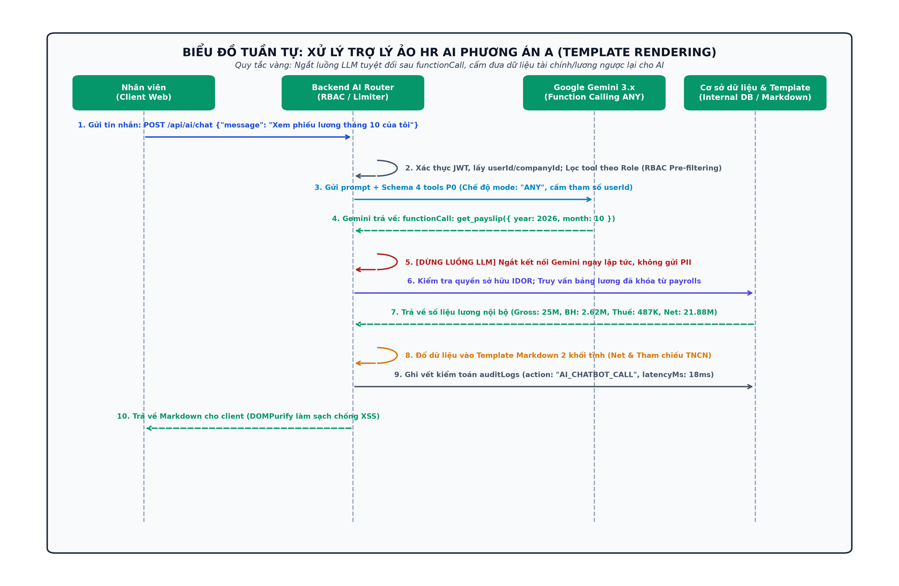

*Hình 2.9. Biểu đồ tuần tự: Xử lý Trợ lý ảo HR AI Phương án A (Template Rendering)*

*Mô tả biểu đồ tuần tự:*
1. Nhân viên gửi câu hỏi tiếng Việt tự nhiên qua khung chat: *"Xem phiếu lương tháng 10 của tôi"*.
2. Backend xác thực JWT, lấy `userId` và `companyId` thực tế, lọc danh sách công cụ theo vai trò (RBAC Pre-filtering).
3. Backend gửi prompt kèm schema 4 tools P0 đến Google Gemini ở chế độ ép gọi tool `mode: 'ANY'`. Schema công cụ tuyệt đối không có tham số `userId`.
4. Gemini phân tích ngôn ngữ tự nhiên và trả về chỉ thị gọi hàm có cấu trúc: `functionCall: get_payslip({ year: 2026, month: 10 })`.
5. **[DỪNG LUỒNG LLM]** Backend ngắt kết nối Gemini ngay lập tức, không gửi bất kỳ dữ liệu cá nhân hay số liệu tài chính nào ra ngoài.
6. Backend kiểm tra quyền sở hữu IDOR, tự truy vấn bảng lương đã khóa từ collection `payrolls` trong CSDL nội bộ.
7. CSDL trả về số liệu lương nội bộ chính xác.
8. Backend điền dữ liệu vào Template Markdown tĩnh 2 khối (Khối Thực nhận Net và Khối Tham chiếu Thuế TNCN).
9. Ghi vết nhật ký kiểm toán vào `auditLogs` và trả về chuỗi Markdown đã được làm sạch bằng `DOMPurify` cho client hiển thị.

---

## 2.4 Biểu đồ hoạt động (Activity Diagram)

Biểu đồ hoạt động (Activity Diagram) thể hiện dòng chảy công việc, các bước phối hợp song song trên các làn bơi (Swimlanes) và các điều kiện rẽ nhánh logic nghiệp vụ trong 2 quy trình xử lý đa cấp của hệ thống:

### 2.4.1 Biểu đồ hành động: Quy trình phê duyệt đơn từ 2 cấp & trừ phép nguyên tử

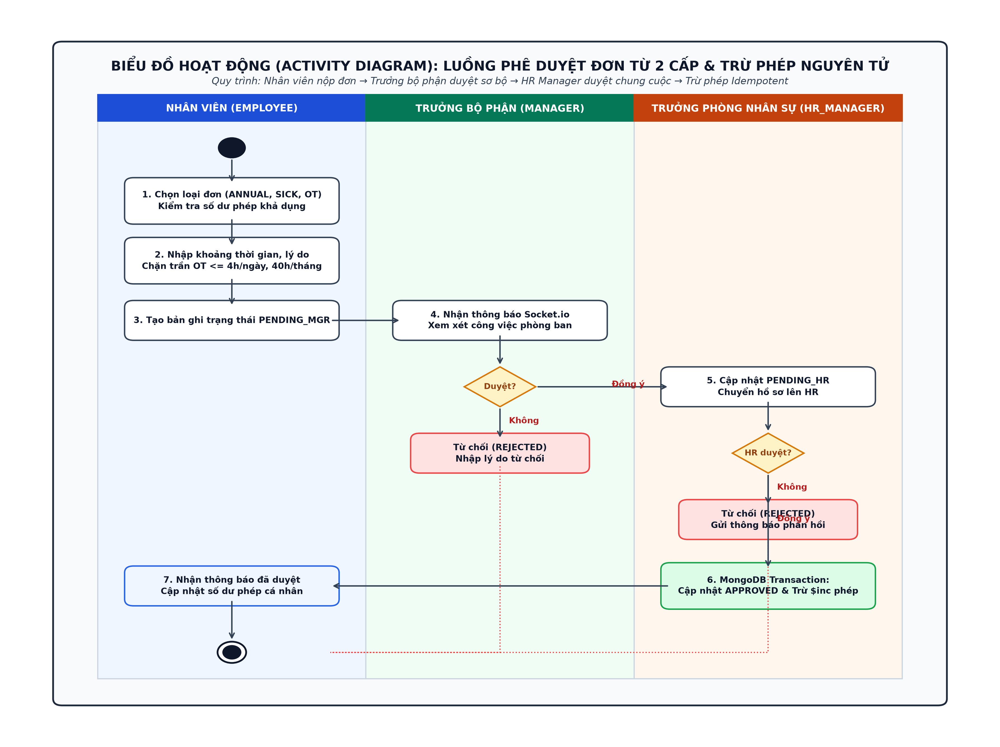

*Hình 2.10. Biểu đồ hành động: Quy trình phê duyệt đơn từ 2 cấp & trừ phép nguyên tử*

*Mô tả biểu đồ hoạt động:*
- Luồng hoạt động được phân tách rõ ràng trên 3 làn bơi (Swimlanes):
  - *Làn Nhân viên (Employee):* Chọn loại đơn (`ANNUAL`, `SICK`, `OT`), hệ thống kiểm tra số dư phép khả dụng và giới hạn trần OT (≤ 4h/ngày, ≤ 40h/tháng). Tạo bản ghi trạng thái ban đầu `PENDING_MGR`.
  - *Làn Trưởng bộ phận (Manager):* Nhận thông báo Socket.io thời gian thực. Trưởng bộ phận xem xét kế hoạch công việc phòng ban. Nếu từ chối, nhập lý do và kết thúc luồng với trạng thái `REJECTED`. Nếu đồng ý, cập nhật trạng thái `PENDING_HR` và chuyển tiếp hồ sơ lên phòng Nhân sự.
  - *Làn Trưởng phòng Nhân sự (HR Manager):* Rà soát điều kiện pháp lý và quỹ phép chung. Nếu từ chối, cập nhật `REJECTED`. Nếu đồng ý, hệ thống mở một MongoDB Transaction thực hiện đồng thời: chuyển trạng thái sang `APPROVED` và thực thi toán tử trừ phép nguyên tử `$inc: { annualRemaining: -days, annualUsed: +days }`.
  - Hệ thống phát sự kiện Socket.io hoàn tất quy trình và cập nhật số dư phép khả dụng về tài khoản nhân viên.

---

### 2.4.2 Biểu đồ hành động: Quy trình suy luận và cảnh báo nguy cơ thôi việc ML

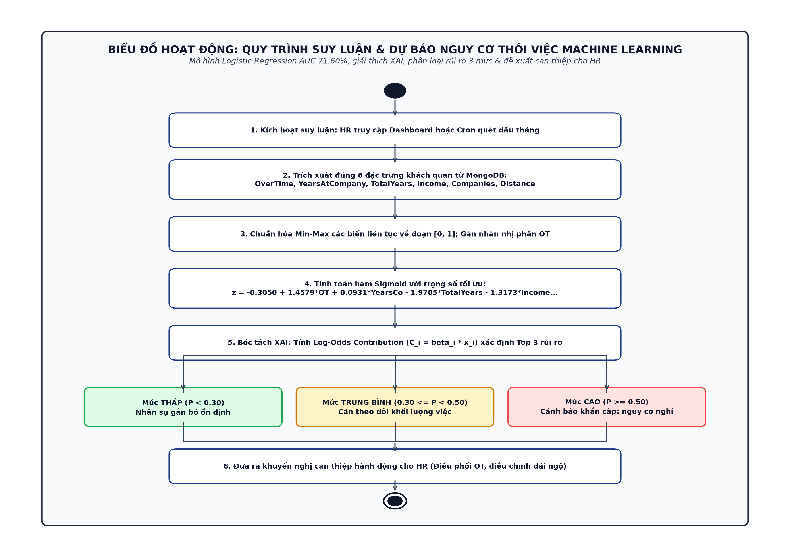

*Hình 2.11. Biểu đồ hành động: Quy trình suy luận & dự báo nguy cơ thôi việc Machine Learning*

*Mô tả biểu đồ hoạt động:*
1. Kích hoạt quy trình khi HR truy cập Dashboard phân tích (`/retention`) hoặc thông qua tiến trình Cron Job chạy ngầm định kỳ đầu tháng.
2. Trích xuất đúng 6 đặc trưng định lượng đo lường công việc khách quan từ CSDL MongoDB (`OverTime`, `YearsAtCompany`, `TotalWorkingYears`, `MonthlyIncome`, `NumCompaniesWorked`, `DistanceFromHome`), loại bỏ hoàn toàn các biến nhạy cảm về nhân khẩu học để tuân thủ Điều 8 BLLĐ 2019.
3. Chuẩn hóa Min-Max các biến liên tục về đoạn [0, 1] và gán nhãn nhị phân cho biến làm thêm giờ (`OverTime` ≥ 4h/tháng → 1).
4. Đưa vector đặc trưng vào hàm Sigmoid với phương trình trọng số đã huấn luyện tối ưu để tính xác suất nguy cơ thôi việc P.
5. Bóc tách nguyên nhân thông qua mức đóng góp log-odds (C_i = β_i · x̂_i) để xác định Top 3 yếu tố rủi ro hàng đầu.
6. Phân loại nhân sự vào 3 phân khúc: Nguy cơ Thấp (P < 0.30), Trung bình (0.30 ≤ P < 0.50), Cao (P ≥ 0.50).
7. Kết xuất dữ liệu trực quan lên Dashboard Recharts kèm các giải pháp can thiệp hành động định hướng (điều phối giảm giờ OT, điều chỉnh thu nhập, lộ trình thăng tiến) giúp doanh nghiệp chủ động duy trì nguồn nhân lực ổn định.

---

### 2.4.3 Biểu đồ hành động: Quy trình tuyển dụng, sàng lọc hồ sơ AI ATS và gửi thư mời phỏng vấn

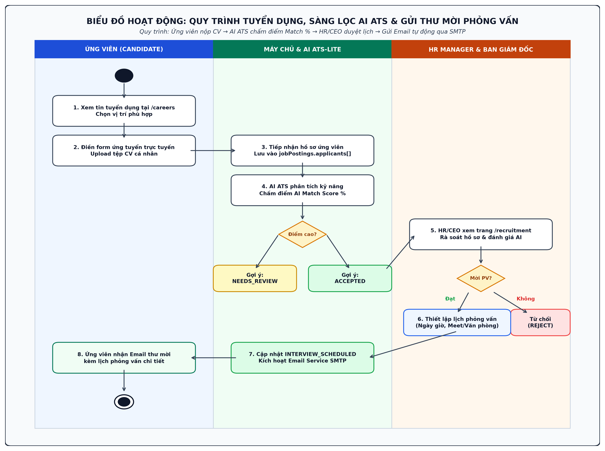

*Hình 2.13. Biểu đồ hành động: Quy trình ứng tuyển, sàng lọc hồ sơ AI ATS và gửi thư mời phỏng vấn*

*Mô tả biểu đồ hoạt động:*
1. Ứng viên truy cập Cổng thông tin việc làm công khai của doanh nghiệp (`/careers`), xem danh sách các vị trí đang tuyển dụng và lựa chọn công việc phù hợp với năng lực.
2. Ứng viên điền thông tin vào biểu mẫu ứng tuyển trực tuyến và tải lên tệp hồ sơ cá nhân (CV định dạng PDF/Word).
3. Máy chủ tiếp nhận hồ sơ, kiểm tra tính toàn vẹn và lưu bản ghi ứng viên vào cơ sở dữ liệu `jobPostings.applicants[]`.
4. Động cơ trí tuệ nhân tạo AI ATS-lite tự động kích hoạt, phân tích văn bản hồ sơ, so khớp các từ khóa kỹ năng với yêu cầu vị trí tuyển dụng, tính toán điểm độ phù hợp AI Match Score (0–100%) và đưa ra gợi ý phân loại sơ bộ (`ACCEPTED` hoặc `NEEDS_REVIEW`).
5. Cán bộ nhân sự (`HR_MANAGER`) hoặc Ban Giám đốc (`CEO`) đăng nhập hệ thống, truy cập trang Quản lý tuyển dụng (`/recruitment`) để rà soát danh sách ứng viên kèm nhận xét và điểm số đánh giá của AI.
6. Cán bộ nhân sự xem xét mức độ phù hợp: nếu hồ sơ không đạt thì bấm chuyển trạng thái thành *"Từ chối"* (`REJECTED`) kèm lý do; nếu hồ sơ đạt yêu cầu thì bấm *"Mời phỏng vấn"* và thiết lập thông tin lịch hẹn (ngày, giờ, hình thức phỏng vấn trực tiếp tại văn phòng hoặc trực tuyến qua Google Meet, người phụ trách, ghi chú dặn dò).
7. Hệ thống cập nhật trạng thái ứng viên thành `INTERVIEW_SCHEDULED`, lưu lịch hẹn vào cơ sở dữ liệu và kích hoạt dịch vụ Email gửi thư mời phỏng vấn tự động đến email ứng viên qua giao thức SMTP.
8. Ứng viên nhận được email thư mời phỏng vấn trang trọng kèm đầy đủ thông tin thời gian, địa điểm để tham gia phiên phỏng vấn.

---

## TỔNG KẾT CHƯƠNG 2

Chương 2 đã hoàn thành toàn diện công tác khảo sát hiện trạng nghiệp vụ, phân tích chi tiết các yêu cầu chức năng và phi chức năng của hệ thống PeopleInsight AI theo đúng phương pháp luận Phân tích & Thiết kế Hướng đối tượng (OOAD) và quy chuẩn Báo cáo Đồ án tốt nghiệp của Khoa Công nghệ Thông tin & Chuyển đổi số — Trường Đại học Nguyễn Trãi.

Các kết quả then chốt đạt được trong chương bao gồm:
1. **Xác định hệ thống yêu cầu rõ ràng:** Phân tích 11 chức năng mức cao và các tiêu chí phi chức năng nghiêm ngặt về hiệu năng (đáp ứng dưới 380ms), bảo mật phiên làm việc và an toàn dữ liệu sinh trắc học theo Luật Bảo vệ Dữ liệu Cá nhân số 91/2025/QH15.
2. **Mô hình hóa tác nhân và quy trình nghiệp vụ:** Xác định 6 tác nhân tham gia và chuẩn hóa 6 quy trình nghiệp vụ cốt lõi (điểm danh khuôn mặt 1 chạm, duyệt đơn từ 2 cấp, tính lương chuẩn pháp lý 2026, trợ lý ảo an toàn thông tin, dự báo thôi việc khách quan và tuyển dụng sàng lọc hồ sơ AI ATS).
3. **Mô hình hóa Use Case toàn diện:** Xây dựng Biểu đồ Use Case tổng quát với 14 chức năng chính và đặc tả chi tiết 6 Use Case trọng tâm với luồng sự kiện chính và luồng thay thế mạch lạc, dễ hiểu.
4. **Mô hình hóa động học hệ thống:** Thiết lập 3 Biểu đồ tuần tự (Sequence Diagram) làm rõ cơ chế tương tác đa tầng và 3 Biểu đồ hoạt động (Activity Diagram) phân định rõ làn bơi trách nhiệm giữa ứng viên, các phòng ban và động cơ trí tuệ nhân tạo.

Toàn bộ các phân tích và mô hình trong Chương 2 là căn cứ kỹ thuật trực tiếp để nhóm nghiên cứu tiến hành thiết kế kiến trúc phần mềm, sơ đồ lớp chi tiết và cấu trúc cơ sở dữ liệu 11 collections trong Chương 3 tiếp theo.