# CHƯƠNG 2. KHẢO SÁT VÀ PHÂN TÍCH HỆ THỐNG

Chương 2 tập trung khảo sát hiện trạng nghiệp vụ, phân tích chi tiết các yêu cầu chức năng và phi chức năng của hệ thống Quản trị nguồn nhân lực tích hợp trí tuệ nhân tạo PeopleInsight AI theo chuẩn phương pháp luận Phân tích & Thiết kế Hướng đối tượng (OOAD) và chuẩn quy định Đồ án tốt nghiệp của Khoa Công nghệ Thông tin & Chuyển đổi số Trường Đại học Nguyễn Trãi. Nội dung chương bao gồm: xác định các yêu cầu chức năng mức cao, các yêu cầu phi chức năng nghiêm ngặt về hiệu năng, an toàn dữ liệu và tính sẵn sàng; xác định các tác nhân (Actors) tham gia vào hệ thống; phân tích chi tiết 5 quy trình nghiệp vụ cốt lõi; xây dựng biểu đồ Use Case tổng quát và đặc tả chi tiết 5 Use Case trọng tâm; mô hình hóa động học các luồng tương tác thông qua hệ thống Biểu đồ tuần tự (Sequence Diagram) và Biểu đồ hoạt động (Activity Diagram). Toàn bộ quá trình phân tích đều gắn liền với các ràng buộc pháp lý mới của năm 2026 (Luật Thuế Thu nhập cá nhân số 109/2025/QH15, Luật Bảo vệ Dữ liệu Cá nhân số 91/2025/QH15 và Bộ luật Lao động 2019), tạo cơ sở vững chắc cho giai đoạn thiết kế kiến trúc và xây dựng ứng dụng trong các chương tiếp theo.

---

## 2.1 Chức năng của hệ thống

Phần này có nhiệm vụ tóm tắt các chức năng của phần mềm. Trong phần này, sinh viên lưu ý chỉ mô tả chức năng mức cao (tổng quan) mà không đặc tả chi tiết cho từng chức năng. Đặc tả chi tiết được trình bày trong phần 2.2.

### 2.1.1 Một số chức năng chính

Hệ thống PeopleInsight AI được xây dựng nhằm giải quyết triệt để các bất cập trong quản lý nhân sự truyền thống, tự động hóa các luồng công việc thủ công và tích hợp trí tuệ nhân tạo có kiểm soát để bảo vệ dữ liệu nhạy cảm.

### Bảng 2.1. Một số chức năng chính của hệ thống PeopleInsight AI

| Yêu cầu chức năng | Mô tả |
| :--- | :--- |
| **Đăng ký và xác thực tài khoản** | Nhân viên và quản trị viên đăng nhập hệ thống bằng email và mật khẩu; máy chủ cấp phát JWT Access Token (thời hạn 15 phút) và Refresh Token lưu trong HttpOnly Cookie (thời hạn 7 ngày); hỗ trợ cơ chế Refresh Token Rotation với Grace Window 20s chống đăng xuất oan do đa tab; phát hiện dùng lại token và thu hồi toàn bộ phiên hoạt động. |
| **Quản trị phân quyền RBAC 4 cấp** | Thiết lập ma trận phân quyền dựa trên vai trò (Role-Based Access Control) gồm 4 cấp: Tổng Giám đốc (`CEO`), Trưởng phòng Nhân sự (`HR_MANAGER`), Trưởng bộ phận (`MANAGER`) và Nhân viên (`EMPLOYEE`); kiểm soát quyền truy cập tập trung qua hàm `canAccess()`; bảo vệ IDOR tuyệt đối chặn Trưởng bộ phận xem cấu hình lương của nhân viên cấp dưới. |
| **Quản lý sơ đồ phòng ban 2 cấp** | Thiết lập và quản lý cây sơ đồ tổ chức doanh nghiệp tối đa 2 cấp (Khối chức năng cấp 1 → Phòng ban tác nghiệp cấp 2); gán trưởng bộ phận quản lý (`managerId`); theo dõi số lượng nhân sự trực thuộc; chặn xóa an toàn khi phòng ban vẫn còn phòng con hoặc nhân viên. |
| **Quản lý hồ sơ nhân sự và hợp đồng** | Quản lý thông tin lý lịch nhân sự, tự động sinh mã định danh tăng dần `NVxxxx`; quản lý mảng hợp đồng lao động (`contracts[]`: thử việc, xác định thời hạn và không xác định thời hạn) theo Điều 20 Bộ luật Lao động 2019; tiến trình Cron Job chạy ngầm hàng ngày tự động quét và gửi cảnh báo hạn hợp đồng trước 30 ngày và 60 ngày. |
| **Điểm danh khuôn mặt Kiosk FaceID** | Nhận diện khuôn mặt sinh trắc học tại thiết bị Kiosk văn phòng: Tầng 1 kiểm tra độ sống (Liveness Detection) theo chuỗi thời gian chuyển đổi trạng thái sinh lý học (chớp mắt qua EAR, há miệng qua MAR, quay đầu qua ma trận Yaw) đáp ứng mã Nonce thử thách ngẫu nhiên từ server (TTL 60s); Tầng 2 trích xuất vector 128 chiều so khớp với cơ sở dữ liệu `faceTemplates`. |
| **Chấm công di động GPS & QR động** | Chấm công qua ứng dụng di động trong bán kính địa lý cho phép (GPS Geofencing bán kính ≤ 100m) tính theo công thức Haversine; điểm danh bằng mã QR động chu kỳ 30 giây ký chữ ký số HMAC-SHA256 kết hợp mã Nonce ngẫu nhiên dùng một lần trên RAM, triệt tiêu 100% rủi ro chụp màn hình gửi cho đồng nghiệp điểm danh hộ. |
| **Quản lý và phê duyệt đơn từ 2 cấp** | Tiếp nhận 5 loại đơn trực tuyến (`ANNUAL`, `SICK`, `OT`, `WFH`, `FORGOT_CHECKIN`); áp dụng luồng phê duyệt 2 cấp tuần tự cố định (Trưởng bộ phận duyệt sơ bộ → Trưởng phòng Nhân sự duyệt chung cuộc); bọc thao tác duyệt và khấu trừ số dư phép năm `leaveBalance` trong MongoDB Transaction nguyên tử theo Điều 113, 114 BLLĐ. |
| **Động cơ tính lương tự động 2026** | Tự động hóa quy trình tính lương 3 bước: Tổng thu nhập (Gross) → Thu nhập chịu thuế → Thu nhập tính thuế & Lương thực nhận (Net); cập nhật Biểu thuế TNCN lũy tiến 5 bậc mới theo Luật Thuế TNCN số 109/2025/QH15; xử lý chính xác 2 mốc trần BHXH (46.8M / 50.6M) và trần ăn ca (730k / 1.2M) năm 2026; miễn thuế 100% tiền lương OT luật định; khóa sổ kỳ lương nguyên tử (`periodLockedAt`). |
| **Trợ lý ảo HR AI Phương án A** | Tiếp nhận câu hỏi tiếng Việt tự nhiên từ nhân viên qua Google Gemini SDK với chế độ ép gọi hàm (`mode: 'ANY'`); dừng luồng LLM ngay sau `functionCall`, máy chủ backend tự truy vấn CSDL nội bộ và kết xuất Markdown template tĩnh 2 khối (Lương Net và Tham chiếu giảm trừ gia cảnh), bảo vệ 100% dữ liệu lương và thông tin cá nhân. |
| **Dự báo nguy cơ thôi việc Machine Learning** | Phân tích tự động đúng 6 đặc trưng định lượng đo lường công việc khách quan từ tập dữ liệu chuẩn IBM HR Attrition bằng mô hình Hồi quy Logistic; phân loại 3 phân khúc rủi ro (`LOW`, `MEDIUM`, `HIGH`); bóc tách mức đóng góp biên log-odds (XAI) hiển thị Dashboard trực quan kèm khuyến nghị can thiệp hành động giúp HR chủ động giữ chân nhân tài. |
| **Cổng thông tin tuyển dụng & Nộp CV (AI ATS)** | Cung cấp cổng thông tin doanh nghiệp (Landing Page) cho phép ứng viên bên ngoài tra cứu danh sách việc làm (`Job Postings`), nộp hồ sơ xin việc trực tuyến và tải tệp CV; động cơ AI ATS tự động trích xuất thông tin, so khớp kỹ năng và chấm điểm ứng viên hỗ trợ HR sàng lọc hồ sơ nhanh chóng. |

---

### 2.1.2 Yêu cầu phi chức năng

Hệ thống cần đảm bảo tính ổn định, bảo mật và thân thiện với người dùng.

### Bảng 2.2. Yêu cầu phi chức năng của hệ thống PeopleInsight AI

| Yêu cầu chức năng | Mô tả |
| :--- | :--- |
| **Hiệu suất** | - Tốc độ nhận diện khuôn mặt và kiểm tra độ sống tại thiết bị Kiosk đạt ≥ 45 FPS, độ trễ xử lý ≤ 50 ms/khung hình. - Thời gian phản hồi của các API nghiệp vụ cốt lõi đạt phân vị P95 ≤ 380 ms dưới tải 100 người dùng ảo đồng thời (k6 stress test). - Động cơ tính lương tự động xử lý toàn bộ 50 nhân sự trong thời gian dưới 100 ms, thông lượng tính toán thuần toán đạt trên 500.000 lượt tính/giây. |
| **Bảo mật** | - Mật khẩu người dùng được băm một chiều bằng thuật toán `bcrypt` an toàn. - Bảo vệ phiên làm việc qua cơ chế Refresh Token Rotation với Grace Window 20s chống xung đột đa tab, dọn token hết hạn bằng `Ppull`. - Cách ly dữ liệu đa công ty (Multi-tenant Fail-Closed) tại tầng Mongoose ODM, chống triệt để tấn công IDOR. - Vector sinh trắc học 128 chiều được mã hóa đối xứng AES-256-GCM tại tầng ứng dụng, tuyệt đối không lưu trữ ảnh khuôn mặt thô của nhân viên theo Luật BVDLCN số 91/2025/QH15. |
| **Tương thích** | - Giao diện hoạt động trơn tru trên các trình duyệt web hiện đại (Google Chrome, Microsoft Edge, Safari, Mozilla Firefox). - Hỗ trợ cài đặt và sử dụng dưới dạng ứng dụng web tiến bộ (Progressive Web App - PWA) trên điện thoại thông minh chạy hệ điều hành Android và iOS. - Tương thích chuẩn WebRTC, WebAssembly (WASM) và WebGL 2.0 phục vụ xử lý luồng video webcam thời gian thực. |
| **Dễ sử dụng** | - Giao diện người dùng đồng bộ theo hệ thống Design Tokens, bố cục khoa học, màu sắc chuẩn SaaS doanh nghiệp. - Đạt điểm số Thang đo Khả dụng Hệ thống **SUS = 82.50 / 100** (Hạng A — Xuất sắc) trong khảo sát người dùng thực tế theo chuẩn ISO 9241-11. - Khung chat Trợ lý ảo tích hợp các thẻ câu hỏi nhanh (Quick Prompt Chips) 1-click tiện lợi theo vai trò. |
| **Khả năng mở rộng** | - Kiến trúc máy chủ REST API phi trạng thái (Stateless), dễ dàng mở rộng quy mô theo chiều ngang (Horizontal Scaling). - Cơ sở dữ liệu chuẩn hóa đúng 11 collections có cấu trúc rõ ràng, chỉ mục tối ưu, hạn chế chi phí truy vấn phân mảnh N+1. - Đóng gói hoàn chỉnh hỗ trợ triển khai bằng một lệnh qua Docker Compose. |

---

### 2.1.3 Các tác nhân tham gia hệ thống

Hệ thống PeopleInsight AI xác định 6 tác nhân chính tham gia tương tác với ứng dụng bao gồm: 4 tác nhân người dùng nội bộ (`CEO`, `HR_MANAGER`, `MANAGER`, `EMPLOYEE`), 1 tác nhân người dùng bên ngoài (`CANDIDATE` - Ứng viên tuyển dụng / Khách vãng lai truy cập cổng thông tin doanh nghiệp) và 1 tác nhân hệ thống biên (`Kiosk Device`).

---

### 2.1.4 Quy trình nghiệp vụ trong hệ thống

Phần này giới thiệu hoạt động nghiệp vụ của hệ thống, các đối tượng tham gia và mục đích thực hiện cho 5 quy trình cốt lõi:

1. **Quy trình điểm danh nhận diện khuôn mặt Kiosk FaceID 2 tầng:**
   - *Đối tượng tham gia:* Nhân viên (`EMPLOYEE`), Thiết bị Kiosk (`Kiosk Device`), Máy chủ Backend.
   - *Mục đích thực hiện:* Ghi nhận ngày công chính xác, ngăn chặn triệt để hành vi chấm công hộ và các hình thức tấn công giả mạo 2D bằng ảnh in hoặc video quay sẵn theo tiêu chuẩn ISO/IEC 30107-3.
   - *Hoạt động nghiệp vụ:* Nhân viên đứng trước camera Kiosk → Kiosk gửi yêu cầu lấy Nonce thử thách ngẫu nhiên từ server (TTL 60s) → Nhân viên thực hiện cử chỉ sinh lý học theo thử thách (chớp mắt, há miệng hoặc quay đầu) → Tầng 1 MediaPipe kiểm tra EAR/MAR/Yaw đạt chuẩn → Tầng 2 trích xuất vector đặc trưng 128D → Server so khớp với `faceTemplates` theo khoảng cách Euclid ≤ 0.60 → Ghi nhận bản ghi chấm công hợp lệ vào `attendanceLogs`.

2. **Quy trình nộp và phê duyệt đơn từ 2 cấp cố định:**
   - *Đối tượng tham gia:* Nhân viên (`EMPLOYEE`), Trưởng bộ phận (`MANAGER`), Trưởng phòng Nhân sự (`HR_MANAGER`).
   - *Mục đích thực hiện:* Số hóa quy trình xin nghỉ phép, làm thêm giờ (OT), làm việc tại nhà (WFH) và giải trình quên chấm công; bảo đảm sự sâu sát của cấp quản lý trực tiếp và tính tuân thủ quỹ phép của phòng nhân sự.
   - *Hoạt động nghiệp vụ:* Nhân viên tạo đơn trực tuyến → Hệ thống kiểm tra số dư phép khả dụng và trần giờ làm thêm → Đơn chuyển sang trạng thái `PENDING_MGR` → Trưởng bộ phận duyệt sơ bộ → Đơn chuyển sang `PENDING_HR` → Trưởng phòng Nhân sự duyệt chung cuộc → Hệ thống kích hoạt MongoDB Transaction trừ số dư phép `leaveBalance` nguyên tử và gửi thông báo Socket.io tức thời.

3. **Quy trình tính toán và khóa sổ bảng lương tự động năm 2026:**
   - *Đối tượng tham gia:* Trưởng phòng Nhân sự (`HR_MANAGER`), Tổng Giám đốc (`CEO`), Động cơ tính lương `calc.js`.
   - *Mục đích thực hiện:* Tự động hóa tính toán lương Net chính xác tuyệt đối, tuân thủ các quy định mới của Luật Thuế TNCN số 109/2025/QH15 và Luật Bảo hiểm xã hội 2024, bảo vệ dữ liệu tài chính lịch sử không bị thay đổi.
   - *Hoạt động nghiệp vụ:* Hàng tháng, HR khởi chạy chức năng tính lương → Hệ thống tổng hợp ngày công thực tế, giờ OT và đơn nghỉ phép từ `attendanceLogs` và `leaveRequests` → Động cơ tính lương tra cứu tham số chính sách theo ngày hiệu lực (trần BHXH 46.8M/50.6M, trần ăn ca 730k/1.2M) → Áp dụng quy trình 3 bước tính Tổng thu nhập, miễn thuế 100% tiền OT luật định, trích bảo hiểm 10.5% và tính thuế TNCN theo biểu 5 bậc mới → HR rà soát bảng lương và thực hiện khóa sổ nguyên tử (`periodLockedAt`) → Hệ thống lưu snapshot tham số và phát hành phiếu lương cá nhân.

4. **Quy trình tra cứu thông tin nhân sự qua Trợ lý ảo HR AI Phương án A:**
   - *Đối tượng tham gia:* Nhân viên (`EMPLOYEE`), Mô hình Google Gemini 3.x, Cơ sở dữ liệu nội bộ.
   - *Mục đích thực hiện:* Hỗ trợ nhân viên tra cứu nhanh chóng số dư phép năm, phiếu lương, lịch sử chấm công bằng ngôn ngữ tự nhiên 24/7 mà không làm lộ lọt dữ liệu tài chính ra bên ngoài.
   - *Hoạt động nghiệp vụ:* Nhân viên gửi câu hỏi tiếng Việt tự nhiên qua khung chat → Backend kiểm tra tính hợp lệ và lọc danh sách tools theo quyền hạn (RBAC Pre-filtering) → Gửi prompt tới Google Gemini ở chế độ ép gọi hàm (`mode: 'ANY'`) → Gemini trích xuất ý định và tham số hàm → Backend lập tức ngắt luồng LLM, tự truy vấn CSDL nội bộ để lấy số liệu thực tế → Điền số liệu vào mẫu biểu Markdown tĩnh 2 khối (Lương Net và Thông tin giảm trừ gia cảnh) → Trả kết quả sạch về giao diện chat cho nhân viên.

5. **Quy trình dự báo biến động nhân sự và cảnh báo nguy cơ thôi việc:**
   - *Đối tượng tham gia:* Trưởng phòng Nhân sự (`HR_MANAGER`), Ban Giám đốc (`CEO`), Dịch vụ suy luận ML.
   - *Mục đích thực hiện:* Nhận diện sớm các nhân sự có nguy cơ thôi việc cao để bộ phận HR chủ động có biện pháp đối thoại và điều chỉnh đãi ngộ kịp thời, giảm thiểu chi phí tuyển dụng thay thế.
   - *Hoạt động nghiệp vụ:* Hệ thống tự động trích xuất dữ liệu của nhân sự toàn công ty → Lọc đúng 6 biến định lượng (`OverTime`, `YearsAtCompany`, `TotalWorkingYears`, `MonthlyIncome`, `NumCompaniesWorked`, `DistanceFromHome`) → Chuẩn hóa dữ liệu và đưa vào mô hình Hồi quy Logistic → Tính toán xác suất nguy cơ thôi việc P, phân loại 3 mức rủi ro (`LOW`, `MEDIUM`, `HIGH`) → Bóc tách nguyên nhân đóng góp biên (XAI) và hiển thị trực quan trên Dashboard kèm các giải pháp can thiệp kịp thời cho HR.

---

### 2.1.5 Các tác nhân tham gia hệ thống

Liệt kê các tác nhân (Actors): Xác định tất cả cá nhân, nhóm người dùng hoặc hệ thống bên ngoài có tương tác với hệ thống đang xây dựng.

Mô tả từng tác nhân: Nêu vai trò, mục đích sử dụng và trách nhiệm của mỗi tác nhân trong hệ thống.

### Bảng 2.3. Một số chức năng chính theo tác nhân

| STT | Tên tác nhân | Chức năng |
| :---: | :--- | :--- |
| **1** | **Admin (Tổng Giám đốc - `CEO`)** | - Quản trị cấu hình toàn công ty: thiết lập tọa độ GPS, bán kính geofence, chính sách bảo hiểm, ngày nghỉ lễ. - Tra cứu hồ sơ nhân sự, bảng lương và báo cáo chi phí quỹ lương toàn doanh nghiệp. - Xem Dashboard phân tích biến động nhân sự và dự báo nguy cơ thôi việc toàn công ty. - Phê duyệt các ngoại lệ về cơ cấu phòng ban và bảng lương chốt kỳ. |
| **2** | **Trưởng phòng Nhân sự (`HR_MANAGER`)** | - Quản lý danh sách nhân viên, cấp phát mã `NVxxxx`, thiết lập hợp đồng lao động `contracts[]`. - Giám sát trực tiếp quy trình đăng ký mẫu khuôn mặt (FaceID Enrollment) tại văn phòng. - Phê duyệt Cấp 2 (chung cuộc) đối với tất cả các loại đơn từ (nghỉ phép, OT, WFH, quên check-in). - Khởi chạy động cơ tính lương, rà soát bảng lương và thực hiện khóa sổ kỳ lương nguyên tử. - Khai thác Dashboard dự báo nguy cơ thôi việc ML và quản lý tuyển dụng AI ATS. |
| **3** | **Trưởng bộ phận (`MANAGER`)** | - Theo dõi bảng chấm công ngày, lịch sử đi muộn, về sớm của nhân viên trong phòng ban. - Phê duyệt Cấp 1 (sơ bộ) đối với đơn xin nghỉ phép và đơn làm thêm giờ của nhân sự trực thuộc. - Tra cứu báo cáo thống kê chuyên cần và tình hình nghỉ phép của phòng ban. - *Bị chặn quyền:* Tuyệt đối không được xem cấu hình lương và phiếu lương của nhân viên cấp dưới. |
| **4** | **Nhân viên (`EMPLOYEE`)** | - Điểm danh vào/ra ca làm việc qua Kiosk FaceID hoặc thiết bị di động (GPS Geofencing / QR động). - Quản lý hồ sơ cá nhân, xem lịch sử hợp đồng và số dư phép năm theo Điều 114 BLLĐ. - Nộp đơn trực tuyến: xin nghỉ phép năm, nghỉ ốm, làm thêm giờ, WFH, giải trình quên chấm công. - Tra cứu phiếu lương chi tiết từng kỳ đã khóa sổ (đầy đủ các khoản thu nhập, khấu trừ và thuế). - Tương tác với Trợ lý ảo HR AI để tra cứu chế độ chính sách và ngày công cá nhân. |
| **5** | **Thiết bị Kiosk (`Kiosk Device`)** | - Xác thực an toàn với máy chủ qua tiêu đề bí mật `x-kiosk-token` (băm SHA-256). - Yêu cầu cấp mã Nonce thử thách ngẫu nhiên 1 lần (TTL 60 giây). - Bám vết 468 điểm mốc khuôn mặt và kiểm tra độ sống sinh lý học (EAR, MAR, Yaw) tại biên. - Gửi cặp vector nhúng V_start, V_end về máy chủ để so khớp định danh 1:N. |
| **6** | **Ứng viên / Khách vãng lai (`CANDIDATE`)** | - Truy cập cổng thông tin doanh nghiệp (Landing Page) để xem giới thiệu công ty, môi trường làm việc và chế độ đãi ngộ. - Tra cứu các vị trí việc làm đang mở tuyển dụng công khai (`Job Postings`). - Nộp hồ sơ xin việc trực tuyến, tải lên tệp CV (định dạng PDF/DOCX) để ứng tuyển vào vị trí phù hợp. - Nhận kết quả sàng lọc sơ bộ tự động từ AI ATS và nhận email thông báo lịch phỏng vấn tuyển dụng. |

---

### 2.1.6 Biểu đồ use case tổng quát

Sinh viên vẽ biểu đồ use case tổng quan và giải thích các tác nhân tham gia là gì, nêu vai trò của từng tác nhân, và mô tả ngắn gọn các use case chính.

Lưu ý: Sinh viên phải sử dụng một trong các phần mềm sau để vẽ UML: Visual Paradigm phiên bản Education, ArgoUML, Microsoft Visio, Rational Rose. Không được phép sử dụng AI tạo sơ đồ.

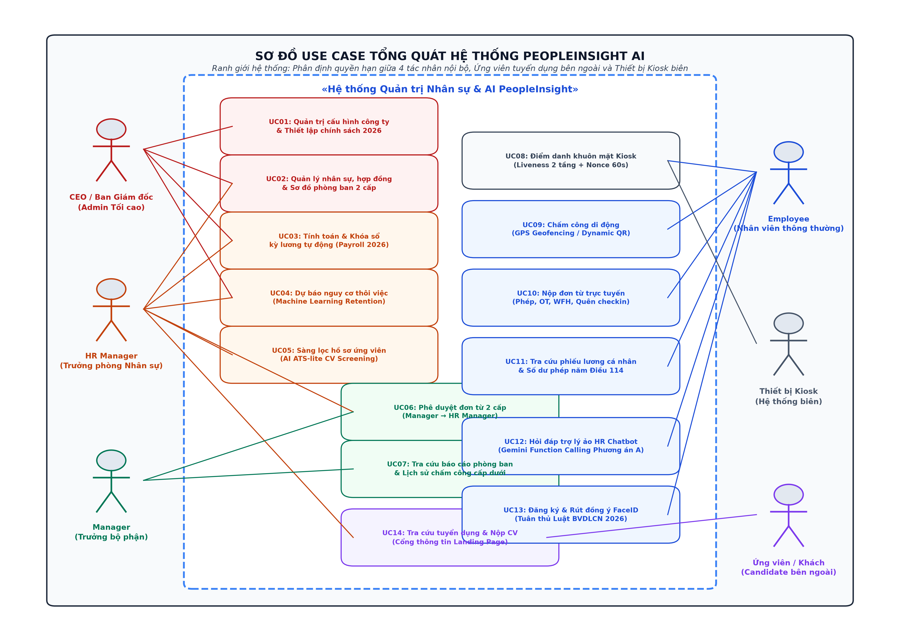

*Hình 2.1. Sơ đồ Use Case tổng quát hệ thống PeopleInsight AI*

*Mô tả biểu đồ Use Case tổng quát:*
- Biểu đồ Use Case tổng quát thể hiện 14 Use Case chức năng chính của hệ thống trong ranh giới `«Hệ thống Quản trị Nhân sự & AI PeopleInsight»`, kết nối chặt chẽ với 6 tác nhân:
  - *Tác nhân CEO:* Có quyền truy cập các Use Case cấp cao UC01 (Quản trị cấu hình công ty & Thiết lập chính sách 2026), UC02 (Quản lý nhân sự & Cơ cấu tổ chức), UC03 (Xem và duyệt kỳ lương) và UC04 (Xem dự báo nguy cơ thôi việc).
  - *Tác nhân HR Manager:* Tương tác trực tiếp với UC02 (Quản lý nhân viên & hợp đồng), UC03 (Tính toán & Khóa sổ bảng lương), UC04 (Dự báo thôi việc ML), UC05 (Sàng lọc hồ sơ ứng viên AI ATS), UC06 (Phê duyệt đơn từ Cấp 2) và quản lý tin tuyển dụng tại UC14.
  - *Tác nhân Manager:* Tương tác với UC06 (Phê duyệt đơn từ Cấp 1) và UC07 (Tra cứu báo cáo phòng ban & chuyên cần).
  - *Tác nhân Employee:* Tương tác với UC08 (Điểm danh Kiosk FaceID), UC09 (Chấm công di động GPS/QR), UC10 (Nộp đơn trực tuyến), UC11 (Tra cứu phiếu lương cá nhân & số dư phép), UC12 (Hỏi đáp Trợ lý ảo HR Chatbot) và UC13 (Đăng ký & Rút đồng ý FaceID).
  - *Tác nhân Thiết bị Kiosk:* Tương tác với UC08 (Điểm danh khuôn mặt Kiosk Liveness 2 tầng).
  - *Tác nhân Ứng viên / Khách vãng lai (`CANDIDATE`):* Tương tác với UC14 (Tra cứu thông tin tuyển dụng & Nộp hồ sơ CV ứng tuyển trực tuyến qua Cổng thông tin Landing Page).

---

## 2.2 Biểu đồ use case phân rã chức năng

Sinh viên lựa chọn từ 5 đến 10 use case quan trọng nhất của đồ án để đặc tả chi tiết. Mỗi đặc tả bao gồm ít nhất các thông tin sau: (i) Tên use case, (ii) Luồng sự kiện (chính và phát sinh), (iii) Tiền điều kiện, và (iv) Hậu điều kiện.

Dưới đây là 5 use case cốt lõi và quan trọng nhất của hệ thống PeopleInsight AI được đặc tả chi tiết:

---

### 2.2.1 Đặc tả use case UC_01: Điểm danh khuôn mặt Kiosk FaceID

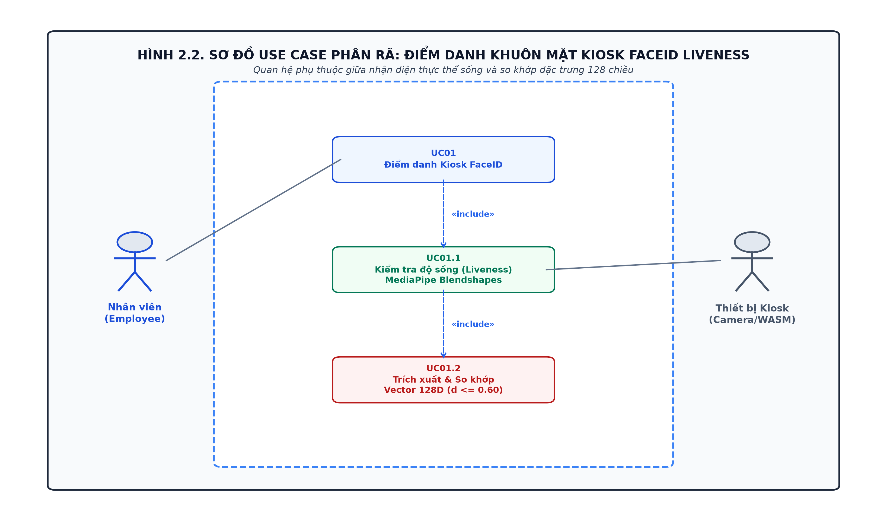

*Hình 2.2. Usecase Điểm danh khuôn mặt Kiosk FaceID Liveness 2 tầng*

### Bảng 2.4. Bảng đặc tả use case UC_01: Điểm danh khuôn mặt Kiosk FaceID

| Mục thông tin | Nội dung chi tiết |
| :--- | :--- |
| **Mã use case** | **UC_01** |
| **Tên use case:** | **Điểm danh khuôn mặt Kiosk FaceID** |
| **Mô tả sơ lược:** | Cho phép nhân viên điểm danh ngày công tại thiết bị Kiosk văn phòng thông qua nhận diện khuôn mặt sinh trắc học có kiểm tra độ sống theo thời gian và so khớp vector 128 chiều, ngăn chặn gian lận 2D. |
| **Actor chính:** | Nhân viên (`EMPLOYEE`) |
| **Actor phụ:** | Thiết bị Kiosk (`Kiosk Device`), Máy chủ Backend |
| **Tiền điều kiện:** | Thiết bị Kiosk đã kích hoạt với token hợp lệ; nhân viên đã hoàn tất lấy mẫu khuôn mặt tại văn phòng; camera hoạt động bình thường (độ rọi ≥ 100 lux). |
| **Hậu điều kiện:** | Nhật ký chấm công được ghi nhận trong CSDL `attendanceLogs` với phương thức `FACE`. |

**Luồng sự kiện chính**

| Người dùng | Hệ thống |
| :--- | :--- |
| 1. Đứng trước camera Kiosk trong khoảng cách 0.5 – 1.2m. | 2. Gửi yêu cầu `GET /api/kiosk/challenge` lấy mã Nonce ngẫu nhiên (TTL 60s). |
| | 3. Hiển thị giao diện radar và chỉ thị thử thách ngẫu nhiên (ví dụ: *"Vui lòng chớp mắt"*). |
| 4. Thực hiện cử chỉ sinh lý học chớp mắt tự nhiên theo yêu cầu. | 5. MediaPipe bám vết 468 điểm mốc, xác nhận `numFaces === 1`, đo tỷ lệ EAR mở → nhắm → mở trong 100–800ms. |
| | 6. Trích xuất cặp vector nhúng V_start và V_end, gửi gói tin lên API `POST /api/kiosk/verify`. |
| | 7. Tiêu hủy Nonce 1 lần, đối chiếu tính liên tục dE(V_start, V_end) ≤ 0.40. |
| | 8. Giải mã `faceTemplates` bằng AES-256 trong RAM, so khớp 1:N (d1 ≤ 0.60 và d2 - d1 ≥ 0.15). |
| | 9. Ghi nhận chấm công vào `attendanceLogs` và phát âm thanh thông báo điểm danh thành công. |

**Luồng thay thế**

| Người dùng | Hệ thống |
| :--- | :--- |
| 1.1 Cố tình giơ ảnh in màu khổ A4 hoặc video quay sẵn trên điện thoại trước camera. | 2.1 Không có sự biến thiên sinh lý của EAR/MAR/Yaw trong khung giờ thử thách hoặc dE(V_start, V_end) > 0.40. |
| | 2.2 Hệ thống từ chối điểm danh, phát âm thanh cảnh báo và ghi log nghi vấn gian lận. |
| 3.1 Có từ 2 người trở lên cùng xuất hiện trong khung hình camera. | 3.2 Phát hiện `numFaces > 1`, lập tức dừng phiên quét và yêu cầu chỉ một người đứng trước camera. |
| 4.1 Người lạ chưa đăng ký hoặc khuôn mặt không khớp (d1 > 0.60). | 4.2 Báo lỗi không nhận diện và gợi ý điểm danh bằng mã QR. Tạm khóa sau 5 lần thất bại liên tiếp. |

---

### 2.2.2 Đặc tả use case UC_02: Nộp và phê duyệt đơn nghỉ phép 2 cấp

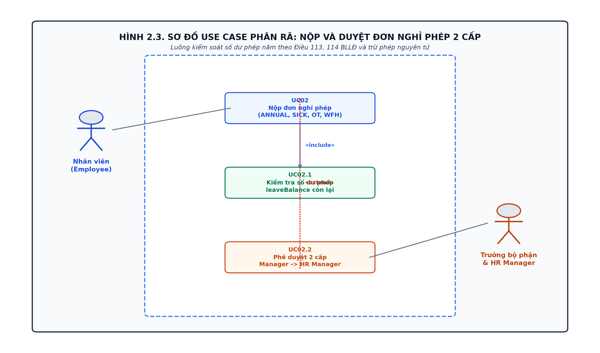

*Hình 2.3. Usecase Nộp và phê duyệt đơn nghỉ phép 2 cấp*

### Bảng 2.5. Bảng đặc tả use case UC_02: Nộp và phê duyệt đơn nghỉ phép 2 cấp

| Mục thông tin | Nội dung chi tiết |
| :--- | :--- |
| **Mã use case** | **UC_02** |
| **Tên use case:** | **Nộp và phê duyệt đơn nghỉ phép 2 cấp** |
| **Mô tả sơ lược:** | Cho phép nhân viên tạo đơn xin nghỉ phép trực tuyến có kiểm tra số dư phép năm theo Bộ luật Lao động, sau đó chuyển qua luồng phê duyệt 2 cấp độc lập: Trưởng bộ phận duyệt Cấp 1 và Trưởng phòng Nhân sự duyệt Cấp 2, tự động trừ phép nguyên tử. |
| **Actor chính:** | Nhân viên (`EMPLOYEE`), Trưởng bộ phận (`MANAGER`), Trưởng phòng Nhân sự (`HR_MANAGER`) |
| **Actor phụ:** | Máy chủ Socket.io |
| **Tiền điều kiện:** | Nhân viên và cấp quản lý đã đăng nhập tài khoản hợp lệ trên cổng thông tin doanh nghiệp. |
| **Hậu điều kiện:** | Trạng thái đơn được chuyển sang `APPROVED`, số dư ngày phép `leaveBalance.annualRemaining` của nhân viên bị khấu trừ tương ứng bằng giao dịch nguyên tử. |

**Luồng sự kiện chính**

| Người dùng | Hệ thống |
| :--- | :--- |
| 1. Chọn mục *"Quản lý Đơn từ"*, bấm nút *"Tạo đơn mới"*. | 2. Hiển thị form nộp đơn kèm số dư phép năm khả dụng hiện tại. |
| 3. Chọn loại đơn `ANNUAL`, chọn khoảng ngày xin nghỉ và nhập lý do. | 4. Kiểm tra tính hợp lệ: ngày bắt đầu P\leP ngày kết thúc, số ngày xin nghỉ P\leP số ngày phép còn lại. |
| | 5. Tạo bản ghi đơn trong `leaveRequests` với trạng thái `PENDING_MGR`, bắn sự kiện Socket.io đến Trưởng bộ phận. |
| 6. Trưởng bộ phận truy cập *"Đơn chờ duyệt"*, chọn *"Phê duyệt Cấp 1"*. | 7. Cập nhật trạng thái `PENDING_HR`, bắn sự kiện Socket.io chuyển tiếp hồ sơ lên Trưởng phòng Nhân sự. |
| 8. Trưởng phòng Nhân sự rà soát hồ sơ, chọn *"Phê duyệt Cấp 2 (Chung cuộc)"*. | 9. Mở MongoDB Transaction: chuyển trạng thái `APPROVED` và thực thi toán tử `Pinc` trừ ngày phép nguyên tử. Gửi thông báo hoàn tất cho nhân viên. |

**Luồng thay thế**

| Người dùng | Hệ thống |
| :--- | :--- |
| 1.1 Số ngày xin nghỉ vượt quá số dư phép năm còn lại. | 2.1 Từ chối tạo đơn với mã lỗi 422 Unprocessable Entity kèm thông báo: *"Số dư phép năm không đủ"*. |
| 6.1 Trưởng bộ phận hoặc Trưởng phòng Nhân sự từ chối đơn. | 6.2 Yêu cầu nhập lý do từ chối, cập nhật trạng thái đơn thành `REJECTED` và gửi thông báo phản hồi cho nhân viên. |
| 6.3 Quản lý cố tình duyệt đơn do chính mình tạo ra. | 6.4 Chặn đứng với mã lỗi 403 Forbidden do vi phạm nguyên tắc kiểm soát xung đột lợi ích (Anti-Self-Approval). |
| 8.1 Nhân viên xin hủy đơn sau khi đã được phê duyệt `APPROVED`. | 8.2 Được HR chấp thuận, hệ thống thực hiện hoàn phép tự động qua toán tử `Pinc` cộng lại số dư phép năm nguyên tử. |

---

### 2.2.3 Đặc tả use case UC_03: Tính toán và khóa sổ kỳ lương 2026

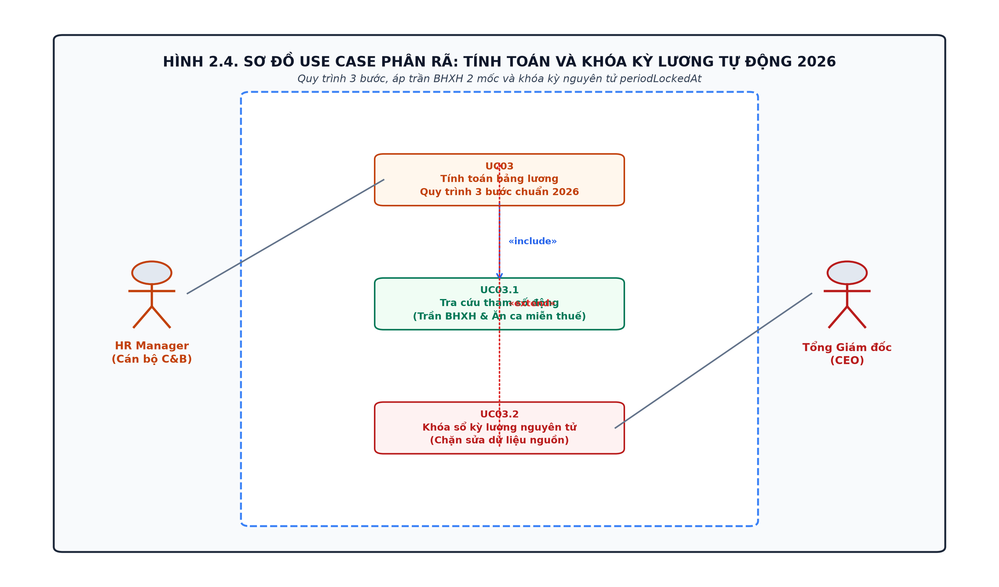

*Hình 2.4. Usecase Tính toán và khóa sổ kỳ lương 2026*

### Bảng 2.6. Bảng đặc tả use case UC_03: Tính toán và khóa sổ kỳ lương 2026

| Mục thông tin | Nội dung chi tiết |
| :--- | :--- |
| **Mã use case** | **UC_03** |
| **Tên use case:** | **Tính toán và khóa sổ kỳ lương 2026** |
| **Mô tả sơ lược:** | Tự động tổng hợp dữ liệu chấm công, ngày phép, giờ làm thêm của toàn bộ nhân viên trong tháng, áp dụng quy trình tính lương 3 bước chuẩn năm 2026 (miễn thuế 100% tiền OT hợp lệ, áp biểu thuế TNCN 5 bậc mới, trần BHXH theo kỳ), xuất bảng lương cho HR rà soát và thực hiện khóa sổ nguyên tử bất biến. |
| **Actor chính:** | Trưởng phòng Nhân sự (`HR_MANAGER`), Tổng Giám đốc (`CEO`) |
| **Actor phụ:** | Động cơ tính lương `calc.js`, Cơ sở dữ liệu MongoDB |
| **Tiền điều kiện:** | Kỳ công của tháng đã kết thúc; toàn bộ đơn từ và giải trình công đã được phê duyệt; HR có quyền quản trị tiền lương. |
| **Hậu điều kiện:** | Bảng lương toàn công ty được tạo lập trong `payrolls`, trạng thái khóa sổ `periodLockedAt` được xác lập, chặn mọi hành vi chỉnh sửa dữ liệu nguồn của kỳ công đó. |

**Luồng sự kiện chính**

| Người dùng | Hệ thống |
| :--- | :--- |
| 1. HR Manager chọn kỳ lương cần tính (ví dụ: `2026-10`) và bấm nút *"Tính toán kỳ lương"*. | 2. Kiểm tra kỳ lương chưa bị khóa (`periodLockedAt == null`), trích xuất công, giờ OT, đơn phép và cấu hình lương. |
| | 3. Tra cứu tham số chính sách: xác định kỳ thuộc Giai đoạn 2 (trần BHXH 50.6M, trần ăn ca 1.2M, giảm trừ bản thân 15.5M/6.2M). |
| | 4. Động cơ `calc.js` tính 3 bước: Tổng thu nhập Gross, miễn thuế toàn bộ tiền OT luật định, trích bảo hiểm 10.5%, tính thuế TNCN biểu 5 bậc mới. |
| | 5. Hiển thị bảng tổng hợp lương toàn doanh nghiệp trên giao diện để HR và CEO rà soát. |
| 6. HR Manager kiểm tra xong, bấm nút *"Khóa sổ kỳ lương (Lock Payroll)"*. | 7. Mở MongoDB Transaction: lưu snapshot tham số vào `payrolls`, cập nhật `periodLockedAt`, kích hoạt chỉ mục unique `{ companyId, userId, period }`. |
| | 8. Tự động gửi thông báo đến từng nhân viên kèm phiếu lương cá nhân chi tiết. |

**Luồng thay thế**

| Người dùng | Hệ thống |
| :--- | :--- |
| 1.1 HR cố tình tính lại kỳ lương đã khóa sổ trước đó. | 2.1 Từ chối thao tác với mã lỗi 409 Conflict: *"Kỳ lương đã được khóa sổ, không được phép sửa đổi dữ liệu tài chính lịch sử"*. |
| 1.2 Phát hiện nhân viên chưa được cấu hình hợp đồng hoặc thiếu mức lương cơ bản. | 2.2 Tạm dừng tính cho nhân sự đó và cảnh báo cụ thể trên giao diện để HR cập nhật bổ sung. |

---

### 2.2.4 Đặc tả use case UC_04: Tra cứu thông tin qua Trợ lý ảo HR AI Phương án A

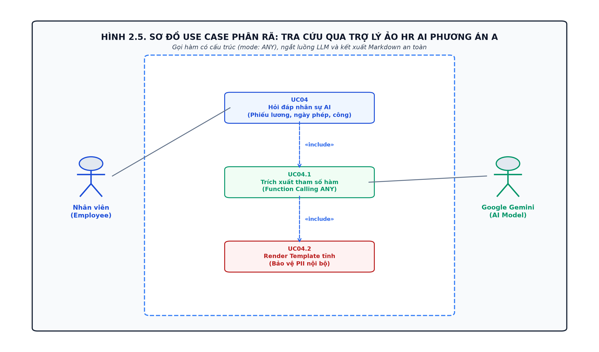

*Hình 2.5. Usecase Tra cứu thông tin qua Trợ lý ảo HR AI Phương án A*

### Bảng 2.7. Bảng đặc tả use case UC_04: Tra cứu thông tin qua Trợ lý ảo HR AI

| Mục thông tin | Nội dung chi tiết |
| :--- | :--- |
| **Mã use case** | **UC_04** |
| **Tên use case:** | **Tra cứu thông tin qua Trợ lý ảo HR AI** |
| **Mô tả sơ lược:** | Hỗ trợ nhân viên tra cứu nhanh số dư ngày phép, phiếu lương chi tiết, lịch sử chấm công bằng ngôn ngữ tự nhiên thông qua Google Gemini. Hệ thống áp dụng triệt để Phương án A: dừng luồng LLM sau khi gọi hàm, tự truy vấn CSDL và kết xuất Markdown tĩnh, bảo vệ tuyệt đối dữ liệu nội bộ. |
| **Actor chính:** | Nhân viên (`EMPLOYEE`), Trưởng bộ phận (`MANAGER`), HR Manager |
| **Actor phụ:** | Mô hình ngôn ngữ lớn Google Gemini 3.x, Cơ sở dữ liệu nội bộ MongoDB |
| **Tiền điều kiện:** | Người dùng đã đăng nhập hệ thống, phiên làm việc có gắn Token JWT hợp lệ. |
| **Hậu điều kiện:** | Câu trả lời dưới dạng bảng biểu Markdown định dạng chuẩn được hiển thị trên khung chat mà không rò rỉ bất kỳ thông tin nhạy cảm nào ra dịch vụ đám mây bên ngoài. |

**Luồng sự kiện chính**

| Người dùng | Hệ thống |
| :--- | :--- |
| 1. Bấm biểu tượng chat nổi, nhập câu hỏi (ví dụ: *"Xem phiếu lương tháng này của tôi"*) hoặc bấm Quick Chip *"💰 Phiếu lương"*. | 2. Nhận request `POST /api/ai/chat`, kiểm tra rate limit (10 req/phút), xác thực JWT lấy `userId` và `companyId`. |
| | 3. Lọc danh sách tools theo vai trò (RBAC Pre-filtering), gửi prompt kèm schema tools đến Gemini với `mode: 'ANY'`. |
| | 4. Gemini phân tích ngữ nghĩa, trả về lệnh gọi hàm có cấu trúc `functionCall: get_payslip({ year: 2026, month: 10 })`. |
| | 5. **[DỪNG LUỒNG LLM]** Ngắt kết nối Gemini ngay lập tức, tự truy vấn CSDL nội bộ với `userId` lấy từ JWT. |
| | 6. Điền số liệu thực tế vào template Markdown tĩnh 2 khối (Khối Thực nhận Net và Khối Tham chiếu giảm trừ gia cảnh). |
| | 7. Ghi nhật ký vào `auditLogs`, làm sạch bằng `DOMPurify` và hiển thị câu trả lời trực quan trên khung chat. |

**Luồng thay thế**

| Người dùng | Hệ thống |
| :--- | :--- |
| 1.1 Người dùng hỏi các câu hỏi không liên quan đến nhân sự (thời tiết, thơ ca). | 2.1 Gemini kích hoạt tool `unsupported_request`. Backend trả về câu từ chối lịch sự và hướng dẫn quay lại nghiệp vụ HR. |
| 1.2 Kẻ xấu cố tình hỏi lương người khác: *"Xem lương của Tổng Giám đốc"*. | 2.2 Do schema tool cấm tham số `userId`, Gemini chỉ gọi hàm chung, backend luôn lấy lương của chính kẻ đó từ JWT, loại bỏ 100% IDOR. |
| 1.3 Kẻ xấu nhập prompt phá vỡ quy tắc (Jailbreak, DAN Mode). | 2.3 System Instruction đóng băng từ chối thực thi và kích hoạt cơ chế phòng vệ an toàn. |
| 1.4 Mất kết nối API Google hoặc tài khoản hết hạn ngạch (HTTP 429). | 2.4 Circuit Breaker tự động chuyển hướng sang bộ nhận diện từ khóa cục bộ, phản hồi template tĩnh trong vòng 3ms. |

---

### 2.2.5 Đặc tả use case UC_05: Dự báo nguy cơ thôi việc Machine Learning

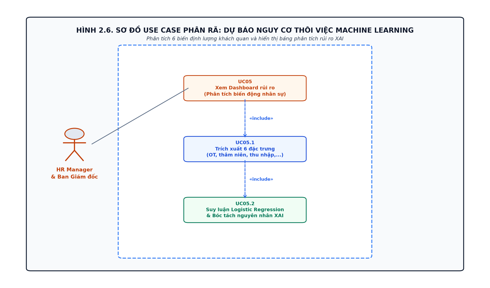

*Hình 2.6. Usecase Dự báo nguy cơ thôi việc Machine Learning*

### Bảng 2.8. Bảng đặc tả use case UC_05: Dự báo nguy cơ thôi việc Machine Learning

| Mục thông tin | Nội dung chi tiết |
| :--- | :--- |
| **Mã use case** | **UC_05** |
| **Tên use case:** | **Dự báo nguy cơ thôi việc Machine Learning** |
| **Mô tả sơ lược:** | Phân tích tự động 6 đặc trưng công việc khách quan của nhân sự toàn công ty, áp dụng mô hình Hồi quy Logistic để dự báo xác suất nguy cơ thôi việc, bóc tách nguyên nhân giải thích XAI và hiển thị Dashboard trực quan hỗ trợ HR chủ động giữ chân nhân tài. |
| **Actor chính:** | Trưởng phòng Nhân sự (`HR_MANAGER`), Tổng Giám đốc (`CEO`) |
| **Actor phụ:** | Dịch vụ suy luận ML Node.js `attritionPredictorService.js` |
| **Tiền điều kiện:** | Cán bộ quản lý có quyền hạn đăng nhập, CSDL đã có dữ liệu chấm công và hợp đồng nhân sự. |
| **Hậu điều kiện:** | Báo cáo danh sách nhân sự kèm điểm rủi ro, phân loại 3 phân khúc rủi ro (`LOW`, `MEDIUM`, `HIGH`) và Top 3 nguyên nhân cốt lõi được kết xuất trên Dashboard. |

**Luồng sự kiện chính**

| Người dùng | Hệ thống |
| :--- | :--- |
| 1. HR Manager truy cập màn hình *"Phân tích Nguy cơ Thôi việc"* (`/retention`). | 2. Kiểm tra quyền hạn (chặn 403 đối với nhân viên thường và Manager), trích xuất dữ liệu nhân sự toàn công ty. |
| | 3. Trích xuất đúng 6 đặc trưng định lượng: giờ OT 30 ngày, số năm tại công ty, tổng năm kinh nghiệm, thu nhập, số công ty cũ, khoảng cách. |
| | 4. Chuẩn hóa Min-Max và áp dụng phương trình Hồi quy Logistic: z = -0.3050 + 1.4579 · OT + 0.0931 · YearsAtCompany - 1.9705 · TotalWorkingYears... |
| | 5. Tính xác suất P = σ(z), phân loại 3 mức rủi ro: Thấp (P < 0.30), Trung bình (0.30 ≤ P < 0.50), Cao (P ≥ 0.50). |
| | 6. Bóc tách mức đóng góp biên C_i = β_i · x̂_i xác định Top 3 nguyên nhân hàng đầu tác động đến rủi ro của từng cá nhân. |
| | 7. Hiển thị Dashboard gồm: 4 thẻ KPI tổng quan, biểu đồ Feature Importance, biểu đồ phân bổ rủi ro và bảng dữ liệu nhân sự tương tác. |
| 8. HR bấm nút *"Chi tiết XAI"* của nhân sự nguy cơ cao để xem giải trình. | 9. Hiển thị modal giải trình chi tiết kèm khuyến nghị can thiệp (điều phối giờ OT, thỏa thuận điều chỉnh đãi ngộ). |

**Luồng thay thế**

| Người dùng | Hệ thống |
| :--- | :--- |
| 1.1 Nhân viên thường hoặc Manager phòng ban cố tình truy cập. | 2.1 Hệ thống chặn đứng với mã lỗi 403 Forbidden và ghi log cảnh báo an ninh vào `auditLogs`. |
| 1.2 Nhân sự mới tiếp nhận chưa có dữ liệu chấm công lịch sử. | 2.2 Tự động gán giá trị an toàn cho biến OT (P= 0P) và tính toán dựa trên các biến số hồ sơ ban đầu. |

---

## 2.3 Sequence diagram

Phần này mô hình hóa dòng thông điệp trao đổi giữa các đối tượng theo trục thời gian cho các quy trình nghiệp vụ trọng yếu của hệ thống.

### 2.3.1 Biểu đồ tuần tự: Điểm danh Kiosk FaceID Liveness 2 tầng

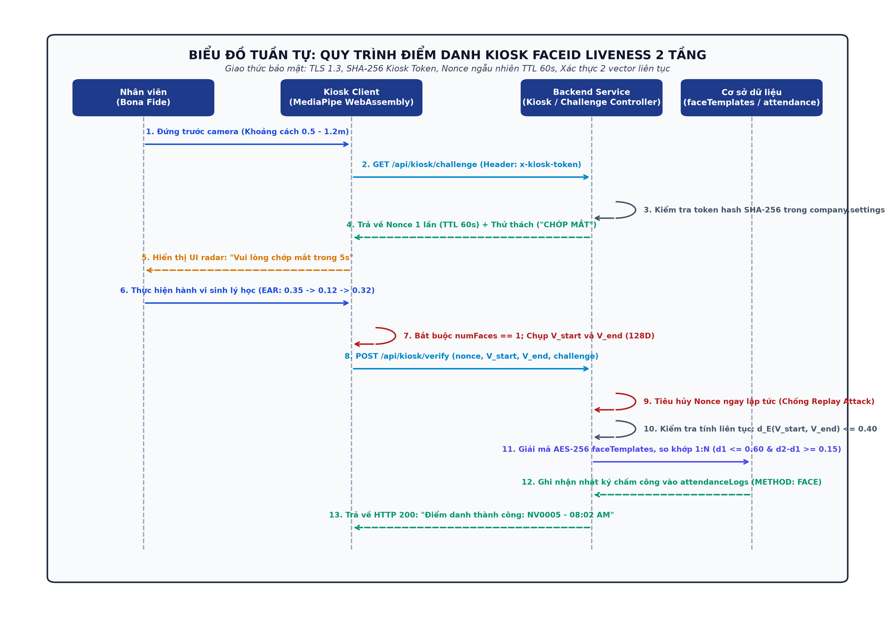

*Hình 2.7. Biểu đồ tuần tự: Quy trình điểm danh Kiosk FaceID Liveness 2 tầng*

*Mô tả biểu đồ tuần tự:*
1. Nhân viên đứng trước camera Kiosk (khoảng cách 0.5 – 1.2m).
2. Kiosk gửi yêu cầu `GET /api/kiosk/challenge` kèm tiêu đề xác thực thiết bị `x-kiosk-token`.
3. Máy chủ kiểm tra hash SHA-256 token trong cấu hình `company.settings`, sinh Nonce ngẫu nhiên dùng 1 lần (TTL 60s) và trả về thử thách ngẫu nhiên (`BLINK`).
4. Kiosk hiển thị hướng dẫn người dùng chớp mắt trong 5 giây.
5. Nhân viên thực hiện chớp mắt tự nhiên. MediaPipe bám vết 468 điểm mốc, xác nhận `numFaces === 1`, đo chuỗi tỷ lệ EAR mở → nhắm → mở.
6. Kiosk chụp 2 vector đặc trưng V_start và V_end, gửi lên `POST /api/kiosk/verify`.
7. Máy chủ tiêu hủy Nonce ngay lập tức chống tấn công phát lại, kiểm tra tính liên tục dE(V_start, V_end) ≤ 0.40.
8. Máy chủ giải mã `faceTemplates` bằng AES-256-GCM trong RAM, so khớp 1:N (d1 ≤ 0.60 và d2 - d1 ≥ 0.15).
9. Ghi nhận nhật ký chấm công vào `attendanceLogs` và trả về thông báo điểm danh thành công trên màn hình Kiosk.

---

### 2.3.2 Biểu đồ tuần tự: Tính lương và chốt sổ kỳ lương nguyên tử

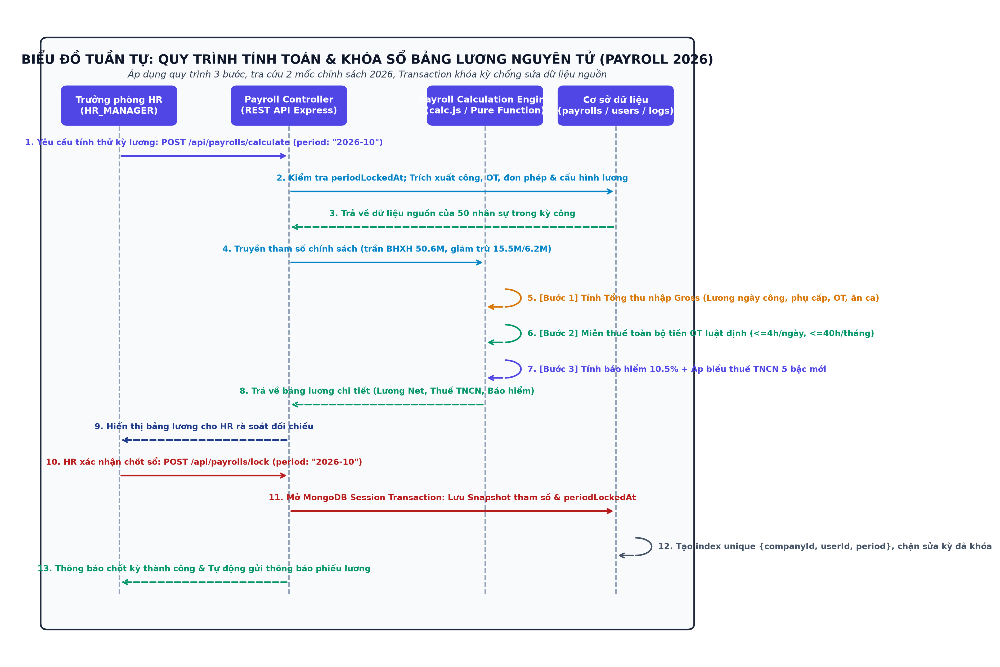

*Hình 2.8. Biểu đồ tuần tự: Quy trình tính toán & khóa sổ bảng lương nguyên tử (Payroll 2026)*

*Mô tả biểu đồ tuần tự:*
1. HR Manager gửi yêu cầu tính thử kỳ lương qua API `POST /api/payrolls/calculate` với kỳ `2026-10`.
2. Controller kiểm tra `periodLockedAt == null`, trích xuất dữ liệu ngày công, giờ OT, đơn phép từ `attendanceLogs`, `leaveRequests` và mức lương cơ bản từ `salaryConfig`.
3. Cơ sở dữ liệu trả về dữ liệu nguồn của toàn bộ 50 nhân sự trong kỳ công.
4. Controller truyền dữ liệu và tham số chính sách (trần BHXH 50.6M, trần ăn ca 1.2M, giảm trừ bản thân 15.5M/6.2M) sang động cơ tính lương `calc.js`.
5. Động cơ tính lương thực hiện 3 bước: Tính Gross, miễn thuế 100% tiền OT luật định, trích bảo hiểm 10.5% và tính thuế TNCN theo biểu 5 bậc mới.
6. Động cơ trả về bảng lương chi tiết để hiển thị cho HR rà soát đối chiếu.
7. HR Manager xác nhận chốt sổ kỳ lương qua `POST /api/payrolls/lock`.
8. Controller mở một MongoDB Session Transaction: lưu snapshot toàn bộ tham số vào `payrolls`, cập nhật dấu thời gian `periodLockedAt`, kích hoạt chỉ mục unique `{ companyId, userId, period }` chặn sửa kỳ đã khóa.
9. Thông báo chốt kỳ thành công và tự động phát hành thông báo phiếu lương cá nhân đến từng nhân viên.

---

### 2.3.3 Biểu đồ tuần tự: Xử lý hỏi đáp Trợ lý ảo HR AI Phương án A

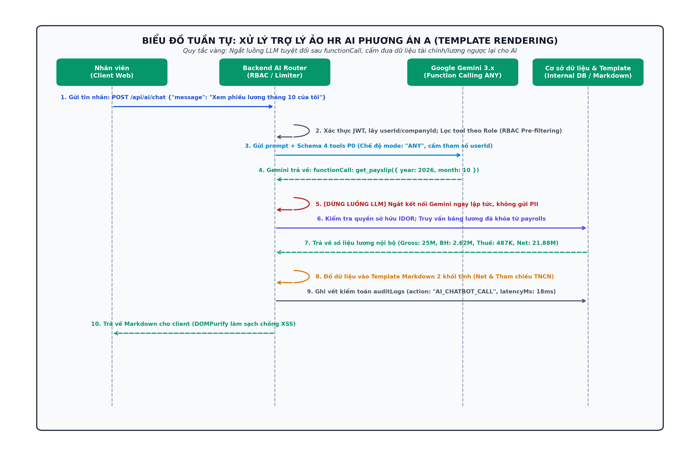

*Hình 2.9. Biểu đồ tuần tự: Xử lý Trợ lý ảo HR AI Phương án A (Template Rendering)*

*Mô tả biểu đồ tuần tự:*
1. Nhân viên gửi câu hỏi tiếng Việt tự nhiên qua khung chat: *"Xem phiếu lương tháng 10 của tôi"*.
2. Backend xác thực JWT, lấy `userId` và `companyId` thực tế, lọc danh sách công cụ theo vai trò (RBAC Pre-filtering).
3. Backend gửi prompt kèm schema 4 tools P0 đến Google Gemini ở chế độ ép gọi tool `mode: 'ANY'`. Schema công cụ tuyệt đối không có tham số `userId`.
4. Gemini phân tích ngôn ngữ tự nhiên và trả về chỉ thị gọi hàm có cấu trúc: `functionCall: get_payslip({ year: 2026, month: 10 })`.
5. **[DỪNG LUỒNG LLM]** Backend ngắt kết nối Gemini ngay lập tức, không gửi bất kỳ dữ liệu cá nhân hay số liệu tài chính nào ra ngoài.
6. Backend kiểm tra quyền sở hữu IDOR, tự truy vấn bảng lương đã khóa từ collection `payrolls` trong CSDL nội bộ.
7. CSDL trả về số liệu lương nội bộ chính xác.
8. Backend điền dữ liệu vào Template Markdown tĩnh 2 khối (Khối Thực nhận Net và Khối Tham chiếu Thuế TNCN).
9. Ghi vết nhật ký kiểm toán vào `auditLogs` và trả về chuỗi Markdown đã được làm sạch bằng `DOMPurify` cho client hiển thị.

---

## 2.4 Activy diagram

Phần này mô tả biểu đồ hành động (Activity Diagram) thể hiện dòng chảy công việc và các điều kiện rẽ nhánh logic nghiệp vụ trong hệ thống.

### 2.4.1 Biểu đồ hành động: Quy trình phê duyệt đơn từ 2 cấp & trừ phép nguyên tử

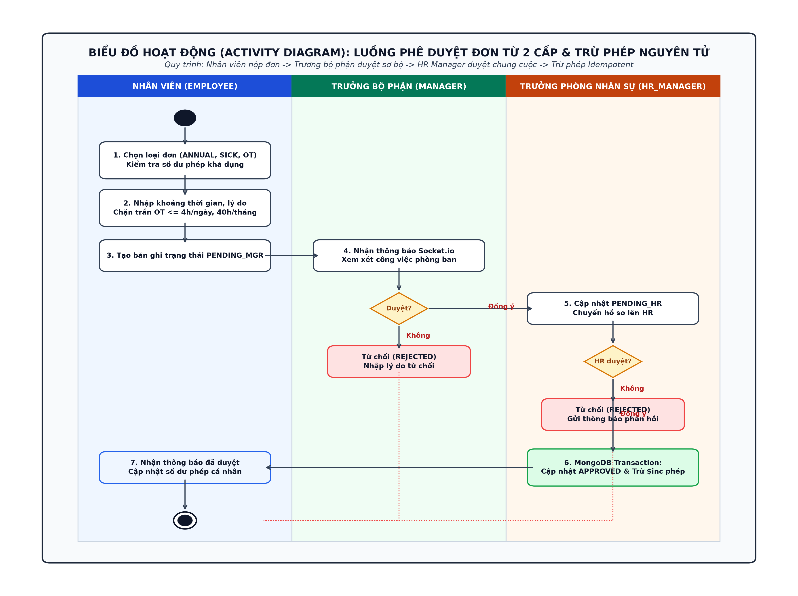

*Hình 2.10. Biểu đồ hành động: Quy trình phê duyệt đơn từ 2 cấp & trừ phép nguyên tử*

*Mô tả biểu đồ hoạt động:*
- Luồng hoạt động được phân tách rõ ràng trên 3 làn bơi (Swimlanes):
  - *Làn Nhân viên (Employee):* Chọn loại đơn (`ANNUAL`, `SICK`, `OT`), hệ thống kiểm tra số dư phép khả dụng và giới hạn trần OT (≤ 4h/ngày, ≤ 40h/tháng). Tạo bản ghi trạng thái ban đầu `PENDING_MGR`.
  - *Làn Trưởng bộ phận (Manager):* Nhận thông báo Socket.io thời gian thực. Trưởng bộ phận xem xét kế hoạch công việc phòng ban. Nếu từ chối, nhập lý do và kết thúc luồng với trạng thái `REJECTED`. Nếu đồng ý, cập nhật trạng thái `PENDING_HR` và chuyển tiếp hồ sơ lên phòng Nhân sự.
  - *Làn Trưởng phòng Nhân sự (HR Manager):* Rà soát điều kiện pháp lý và quỹ phép chung. Nếu từ chối, cập nhật `REJECTED`. Nếu đồng ý, hệ thống mở một MongoDB Transaction thực hiện đồng thời: chuyển trạng thái sang `APPROVED` và thực thi toán tử trừ phép nguyên tử `Pinc: { annualRemaining: -days, annualUsed: +days }`.
  - Hệ thống phát sự kiện Socket.io hoàn tất quy trình và cập nhật số dư phép khả dụng về tài khoản nhân viên.

---

### 2.4.2 Biểu đồ hành động: Quy trình suy luận và cảnh báo nguy cơ thôi việc ML

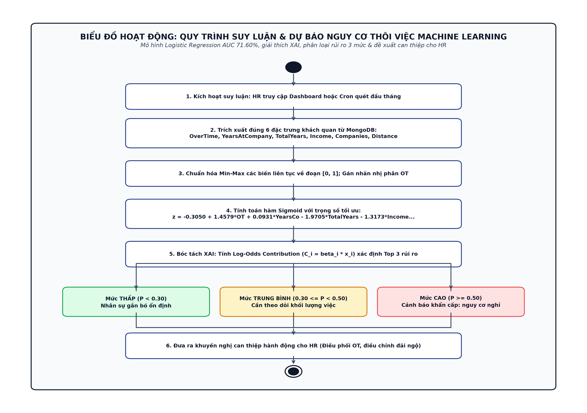

*Hình 2.11. Biểu đồ hành động: Quy trình suy luận & dự báo nguy cơ thôi việc Machine Learning*

*Mô tả biểu đồ hoạt động:*
1. Kích hoạt quy trình khi HR truy cập Dashboard phân tích (`/retention`) hoặc thông qua tiến trình Cron Job chạy ngầm định kỳ đầu tháng.
2. Trích xuất đúng 6 đặc trưng định lượng đo lường công việc khách quan từ CSDL MongoDB (`OverTime`, `YearsAtCompany`, `TotalWorkingYears`, `MonthlyIncome`, `NumCompaniesWorked`, `DistanceFromHome`), loại bỏ hoàn toàn các biến nhạy cảm về nhân khẩu học để tuân thủ Điều 8 BLLĐ 2019.
3. Chuẩn hóa Min-Max các biến liên tục về đoạn [0, 1] và gán nhãn nhị phân cho biến làm thêm giờ (`OverTime` ≥ 4h/tháng → 1).
4. Đưa vector đặc trưng vào hàm Sigmoid với phương trình trọng số đã huấn luyện tối ưu để tính xác suất nguy cơ thôi việc P.
5. Bóc tách nguyên nhân thông qua mức đóng góp log-odds (C_i = β_i · x̂_i) để xác định Top 3 yếu tố rủi ro hàng đầu.
6. Phân loại nhân sự vào 3 phân khúc: Nguy cơ Thấp (P < 0.30), Trung bình (0.30 ≤ P < 0.50), Cao (P ≥ 0.50).
7. Kết xuất dữ liệu trực quan lên Dashboard Recharts kèm các giải pháp can thiệp hành động định hướng (điều phối giảm giờ OT, điều chỉnh thu nhập, lộ trình thăng tiến) giúp doanh nghiệp chủ động duy trì nguồn nhân lực ổn định.

---

## TỔNG KẾT CHƯƠNG 2

Chương 2 đã hoàn thành toàn diện công tác khảo sát hiện trạng, phân tích chi tiết các yêu cầu chức năng và phi chức năng của hệ thống PeopleInsight AI theo đúng mẫu quy chuẩn của Khoa Công nghệ Thông tin & Chuyển đổi số — Trường Đại học Nguyễn Trãi. Các mô hình Use Case tổng quát, đặc tả 5 Use Case cốt lõi, biểu đồ tuần tự và biểu đồ hoạt động đã phản ánh chính xác các cơ chế kỹ thuật then chốt: nhận diện khuôn mặt chống giả mạo 2 tầng, phê duyệt đơn từ 2 cấp có kiểm soát nguyên tử, tính toán và khóa sổ kỳ lương theo luật mới 2026, trợ lý ảo an toàn dữ liệu Phương án A và mô hình học máy dự báo thôi việc khách quan. Đây là tiền đề vững chắc để triển khai chi tiết kiến trúc phần mềm và cơ sở dữ liệu trong Chương 3.
