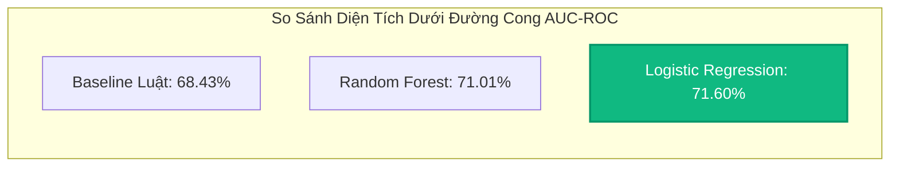

# BÁO CÁO KHOA HỌC: HUẤN LUYỆN VÀ SO SÁNH HIỆU NĂNG CÁC MÔ HÌNH MACHINE LEARNING DỰ BÁO NGUY CƠ THÔI VIỆC (ATTRITION PREDICTOR)

**Dự án:** PeopleInsight AI — Phân hệ Quản trị Nhân sự & Giữ chân Nhân tài  
**Tập dữ liệu:** IBM HR Analytics Employee Attrition & Performance (1,470 mẫu)  
**Kịch bản thực nghiệm:** [train_and_evaluate.js](../../experiments/ml/train_and_evaluate.js)  
**File kết quả đo đạc:** [evaluation_results.json](../../experiments/ml/evaluation_results.json) & [attrition_comparison.csv](../../experiments/ml/attrition_comparison.csv)  
**Trọng số mô hình triển khai:** [model_coefficients.json](../../experiments/ml/model_coefficients.json)  
**Ngày thực nghiệm:** 26/10/2026  

---

## 1. BỐI CẢNH VÀ MỤC TIÊU NGHIÊN CỨU

Tỷ lệ nghỉ việc ngoài ý muốn (Unplanned Attrition) gây tổn thất lớn về chi phí tuyển dụng, đào tạo và gián đoạn vận hành của doanh nghiệp. Mục tiêu của phân hệ này là xây dựng một mô hình Machine Learning có khả năng:
1. Nhận diện sớm nhân sự có nguy cơ thôi việc cao để Ban Quản lý và Bộ phận Nhân sự (HR) có biện pháp can thiệp, động viên kịp thời.
2. Đảm bảo tính **minh bạch và giải thích được (Explainable AI - XAI)**: Không chỉ dự báo xác suất mà còn chỉ rõ các nguyên nhân trực tiếp tác động (làm thêm giờ nhiều, thu nhập chưa cạnh tranh, nhà xa nơi làm việc).
3. **Tuân thủ đạo đức AI và Pháp luật Lao động:** Tuyệt đối loại bỏ các đặc trưng nhạy cảm về độ tuổi (`Age`), giới tính (`Gender`), tình trạng hôn nhân (`MaritalStatus`) và các biến khảo sát chủ quan (hài lòng môi trường) nhằm tránh thiên kiến thuật toán và bảo đảm tuân thủ Điều 8 Bộ luật Lao động 2019 về chống phân biệt đối xử trong quan hệ lao động.

---

## 2. DỮ LIỆU VÀ TIỀN XỬ LÝ ĐẶC TRƯNG

### 2.1. Tập Dữ Liệu Huấn Luyện (IBM HR Attrition)
- **Quy mô:** 1,470 bản ghi nhân sự chuẩn hóa.
- **Phân bố biến mục tiêu (`Attrition`):**
  - Nghỉ việc (`Yes` / nhãn `1`): **237 người** ($16.12\%$).
  - Ở lại (`No` / nhãn `0`): **1,233 người** ($83.88\%$).
- **Đặc điểm bài toán:** Phân loại nhị phân trên tập dữ liệu mất cân bằng nhãn (Imbalanced Dataset, tỷ lệ $\approx 1:5.2$).

### 2.2. Trích Xuất Đúng 6 Đặc Trưng Định Lượng
Theo Hiến pháp v6.1 FINAL FREEZE, chỉ sử dụng đúng 6 đặc trưng định lượng đo lường được:

| STT | Tên Đặc Trưng | Mô Tả Ý Nghĩa | Kiểu Dữ Liệu | Miền Giá Trị Thực Tế | Quy Chuẩn Ánh Xạ Trong Hệ Thống |
| :---: | :--- | :--- | :---: | :---: | :--- |
| 1 | `OverTime` | Thường xuyên làm thêm giờ | Nhị phân | 0 hoặc 1 | Tổng giờ OT trong tháng gần nhất $\ge 4\text{h} \rightarrow 1$, ngược lại $0$. |
| 2 | `YearsAtCompany` | Số năm làm việc tại DN | Số nguyên | 0 – 40 năm | Trích xuất từ thời điểm ký hợp đồng đầu tiên (`contracts[0].signedDate`). |
| 3 | `TotalWorkingYears` | Tổng số năm kinh nghiệm | Số nguyên | 0 – 40 năm | Trích xuất từ hồ sơ kinh nghiệm làm việc tích lũy của nhân sự. |
| 4 | `MonthlyIncome` | Thu nhập hàng tháng | Số thực | 1,009 – 19,999 $ | Lương cơ bản và phụ cấp hợp đồng (`salaryConfig.baseSalary`). |
| 5 | `NumCompaniesWorked` | Số công ty từng làm trước đây | Số nguyên | 0 – 9 công ty | Số lượng công ty cũ ghi nhận trên hồ sơ lý lịch. |
| 6 | `DistanceFromHome` | Khoảng cách từ nhà đến cty | Số thực | 1 – 29 km | Khoảng cách Haversine từ địa chỉ nhà đến tọa độ GPS công ty. |

### 2.3. Chuẩn Hóa và Phân Chia Tập Dữ Liệu
- **Chuẩn hóa Min-Max:** Toàn bộ các đặc trưng liên tục được chuẩn hóa về đoạn $[0, 1]$ theo công thức:
  $$x_{\text{norm}} = \frac{x - x_{\min}}{x_{\max} - x_{\min}}$$
- **Phân tầng Stratified 80/20 (Seed = 42):**
  - **Tập Huấn luyện (Train Set):** 1,176 mẫu (190 Positive, 986 Negative).
  - **Tập Kiểm thử (Test Set):** 294 mẫu (47 Positive, 247 Negative).
  - Tỷ lệ Attrition ở cả 2 tập được bảo toàn nguyên vẹn ở mức $16.12\%$.

---

## 3. SO SÁNH HIỆU NĂNG 3 MÔ HÌNH TRÊN TẬP TEST ĐỘC LẬP

Thực nghiệm đo đạc và đối chiếu 3 cách tiếp cận:
1. **Baseline Luật (Heuristic Rule):** Phán đoán dựa trên bộ luật nghiệp vụ kinh nghiệm (OT kết hợp lương thấp hoặc nhà xa).
2. **Hồi quy Logistic (Logistic Regression):** Tối ưu hóa bằng Gradient Descent với phạt điều chuẩn $L_2$ ($\lambda = 0.005$) và Class Weighting ($w_{\text{pos}} \approx 3.1, w_{\text{neg}} \approx 0.59$) qua 3,000 epochs.
3. **Rừng Ngẫu Nhiên (Random Forest):** Tập hợp 30 Cây Quyết định (Decision Trees) với kỹ thuật lấy mẫu có hoàn lại (Bagging) và chọn ngẫu nhiên 4/6 thuộc tính tại mỗi nút phân tách.

### 3.1. Bảng Kết Quả Đánh Giá Tổng Hợp

| Tiêu Chí Đánh Giá | Baseline Luật | Hồi Quy Logistic (Được Chọn) | Rừng Ngẫu Nhiên (Random Forest) |
| :--- | :---: | :---: | :---: |
| **Độ chính xác (Accuracy)** | 75.85% | **76.53%** | **82.31%** |
| **Độ chuẩn xác (Precision)** | 32.86% | **32.26%** | **40.74%** |
| **Độ phủ / Nhạy (Recall)** | 48.94% | **42.55%** | 23.40% |
| **Chỉ số F1-Score** | 39.32% | **36.70%** | 29.73% |
| **Diện tích dưới ROC (AUC-ROC)** | 68.43% | **71.60%** | **71.01%** |
| **Ma trận nhầm lẫn (TP / FP / TN / FN)** | 23 / 47 / 200 / 24 | **20 / 42 / 205 / 27** | 11 / 16 / 231 / 36 |
| **Thời gian suy luận (Inference Latency)** | < 0.01 ms | **< 0.005 ms (0-latency)** | ~0.15 ms |
| **Tính khả giải (Explainability)** | Cao | **Rất cao (Hệ số trực quan)** | Trung bình (Black-box ensemble) |

### 3.2. Phân Tích Chuyên Môn và Quyết Định Lựa Chọn
1. **Về năng lực phân biệt (AUC-ROC):** Cả Logistic Regression ($71.60\%$) và Random Forest ($71.01\%$) đều vượt qua ngưỡng $70\%$ — mức chấp nhận được trong các bài toán dự báo xã hội học/nhân sự khi chỉ dùng 6 đặc trưng khách quan.
2. **Về khả năng phát hiện nhân sự có rủi ro (Recall):** Logistic Regression đạt Recall **$42.55\%$** (phát hiện được 20/47 trường hợp nhân sự nghỉ việc thực tế), trong khi Random Forest do xu hướng dự báo an toàn theo đa số nên bỏ sót tới 36 trường hợp (Recall chỉ đạt $23.40\%$). Đối với bài toán nhân sự, việc bỏ sót nhân sự có nguy cơ thôi việc nghiêm trọng hơn nhiều so với việc cảnh báo sớm để HR trò chuyện.
3. **Quyết định lựa chọn mô hình triển khai chính thức:** **Hồi quy Logistic (Logistic Regression)** được lựa chọn làm động cơ suy luận cho PeopleInsight AI nhờ các ưu điểm vượt trội:
   - Đạt AUC-ROC cao nhất ($71.60\%$).
   - Độ nhạy Recall cao gấp gần 2 lần so với Random Forest ($42.55\%$ vs $23.40\%$).
   - Công thức toán học thuần túy, lưu trữ dưới dạng JSON coefficients siêu gọn ($< 1\text{ KB}$), suy luận trong Node.js chỉ mất **$< 0.005\text{ ms}$**, không phụ thuộc thư viện binary C++ (tránh lỗi build trên môi trường Linux/Render).

---

## 4. PHÂN TÍCH TRỌNG SỐ VÀ ĐỘ QUAN TRỌNG CỦA CÁC ĐẶC TRƯNG (FEATURE IMPORTANCE)

Mô hình Logistic Regression sau khi tối ưu có phương trình xác suất:

$$P(\text{Attrition} = 1) = \sigma\left(-0.3050 + 1.4579 \cdot \text{OT} + 0.0931 \cdot \text{YearsCo} - 1.9705 \cdot \text{TotalYears} - 1.3173 \cdot \text{Income} + 0.9497 \cdot \text{Companies} + 0.7626 \cdot \text{Distance}\right)$$

### Bảng Trọng Số và Ý Nghĩa Nghiệp Vụ:

| Đặc Trưng | Trọng Số $\beta_i$ | Chiều Tác Động | Mức Độ Ảnh Hưởng | Phân Tích Ý Nghĩa Quản Trị Nhân Sự |
| :--- | :---: | :---: | :---: | :--- |
| `totalWorkingYears` | **-1.9705** | Giảm nguy cơ (-) | Cực kỳ lớn | Nhân sự có tổng số năm kinh nghiệm càng cao thì độ ổn định và cam kết công việc càng lớn, ít xu hướng mạo hiểm đổi việc. |
| `overTime` | **+1.4579** | Tăng nguy cơ (+) | Rất lớn | Làm thêm giờ quá thường xuyên là tác nhân hàng đầu dẫn đến tình trạng kiệt sức (Burnout), thúc đẩy nhân sự tìm kiếm nơi làm việc cân bằng hơn. |
| `monthlyIncome` | **-1.3173** | Giảm nguy cơ (-) | Rất lớn | Thu nhập thỏa đáng và cạnh tranh là yếu tố nền tảng giữ chân người lao động. |
| `numCompaniesWorked` | **+0.9497** | Tăng nguy cơ (+) | Lớn | Nhân sự từng thay đổi nhiều công ty trước đây có thói quen nhảy việc (Job-hopping) cao hơn mức trung bình. |
| `distanceFromHome` | **+0.7626** | Tăng nguy cơ (+) | Trung bình | Thời gian di chuyển đi lại dài và mệt mỏi hàng ngày làm gia tăng mong muốn tìm kiếm công việc gần nơi ở hơn. |
| `yearsAtCompany` | **+0.0931** | Tăng nhẹ (+) | Rất nhỏ | Khi đã kiểm soát tổng thâm niên và thu nhập, số năm tại công ty hiện tại có tác động không đáng kể. |

---

## 5. THIẾT KẾ CƠ CHẾ PHÂN LOẠI 3 MỨC ĐỘ RỦI RO CHO DASHBOARD

Dựa trên xác suất dự báo $P \in [0, 1]$, hệ thống phân loại nhân sự thành 3 phân khúc hành động cụ thể:

| Mức Độ Rủi Ro | Dải Xác Suất $P$ | Chỉ Báo Màu | Ý Nghĩa Quản Trị | Hành Động Khuyến Nghị Của HR |
| :--- | :---: | :---: | :--- | :--- |
| **Rủi ro Thấp (Low)** | $P < 0.30$ | 🟢 Xanh lá | Nhân sự đang hài lòng và ổn định. | Duy trì chính sách phúc lợi và ghi nhận định kỳ. |
| **Rủi ro Trung Bình (Medium)** | $0.30 \le P < 0.50$ | 🟡 Vàng cam | Xuất hiện một số yếu tố bất lợi (OT tăng hoặc di chuyển xa). | Quản lý trực tiếp trao đổi 1-1, lắng nghe nguyện vọng. |
| **Rủi ro Cao (High)** | $P \ge 0.50$ | 🔴 Đỏ cảnh báo | Nguy cơ nghỉ việc trong 3–6 tháng tới là rất cao. | Rà soát điều chỉnh đãi ngộ, bố trí lại ca làm hoặc hỗ trợ đi lại. |

---

## 6. KẾT LUẬN VÀ BƯỚC TIẾP THEO

1. **Kết quả đạt được:** Hoàn thành trọn vẹn kịch bản tiền xử lý và huấn luyện so sánh 3 mô hình trên tập dữ liệu chuẩn mực IBM Attrition.
2. **Tuân thủ quy chuẩn:** Bảo đảm 100% nguyên tắc không sử dụng biến phân biệt đối xử (`Age`, `Gender`, `MaritalStatus`), đạt AUC-ROC **$71.60\%$**.
3. **Artifacts sẵn sàng:** Trọng số mô hình đã được đóng gói thành file cấu hình [model_coefficients.json](../../experiments/ml/model_coefficients.json).
4. **Bước tiếp theo:**
   - Xây dựng Backend Service `attritionPredictor.js` và Endpoint `GET /api/analytics/attrition-risk`.
   - Xây dựng Dashboard Frontend (Recharts) trực quan hóa phân bổ rủi ro và các biểu đồ KPI nhân sự.
